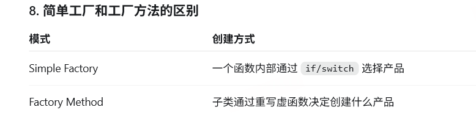

# 设计模式

## 单例模式

##### 目的：一个类在程序中只有一个实例，程序可以通过统一入口访问它。

#### 常用情况：
日志系统 Logger  配置管理器 ConfigManager  全局资源管理器

#### 代码：
```
class single
{
    single()=default;
    ~single()=default;
public:
    single(single&other)=delete;
    single& operator=(single&other)=delete;
    single(single&&other)=delete;
    single& operator=(single&&other)=delete;
    static single& get()
    {
        static single a;
        return a;
    }
    
}
```
#####  C++11 的 Meyers Singleton 是否线程安全？
局部静态对象的初始化是线程安全的，但对象初始化完成后的成员函数是否线程安全，仍取决于类自身的实现。

##### 为什么删除移动：
移动的目的往往是交接指针的权限，节约地址分配开销，而单例对象代表的是一种唯一身份，而不是可以复制或转移的普通值。并且，移动不会删除源对象，使用相当于同时有两个对象。

##### 使用static：
使用 static，是为了让唯一对象只初始化一次，并能被所有调用共享，不需要对象指针

##### 问题：
耦合化严重，不能保证线程安全，
本质上是全局状态，任何代码都可能读取或修改它。
依赖关系被隐藏，函数签名看不出它依赖了哪些全局服务。
单元测试困难，不容易替换为 Mock，也容易造成测试之间相互污染。
##### 优点：
可以保证某项服务只有一个实例或统一身份。
使用方便，可以从任意位置访问。
可以延迟到第一次使用时初始化。
适合进程级唯一且生命周期接近整个程序的基础设施。

## 工厂模式：
##### 目的：调用者需要某种对象，但不希望依赖具体对象的创建过程。


##### 优点：
降低调用方与具体类型的耦合。
注册式工厂可以新增类型而少改调用代码。
可以统一对象的创建、错误处理和所有权策略
##### 缺点：
简单工厂里的巨大 switch 只是把分支从调用方搬到了工厂，新增类型仍要修改工厂。
工厂方法和抽象工厂可能产生大量接口和工厂类，结构变复杂。
创建过程被间接化，定位“对象到底在哪里创建”会更困难。
工厂本身不自动解决对象生命周期问题，仍要设计智能指针、对象池或其他所有权机制

## 策略模式：

##### 目的： 把不同算法封装成独立对象，让它们可以相互替换。
```
例如购物系统有多种折扣算法：
普通用户不打折
VIP 用户打八折
促销活动减 30 元
```
常用的实现就是根据类型码来进行识别，读入。

##### 思想：在结账类内设置一个Context Strategy ，在结账时，set类，从而自动调用对应的结账函数

## 观察者模式

##### 当一个对象状态发生变化时，自动通知所有依赖它的对象。

```
class WeatherStation {
public:
    void subscribe(Observer& observer)
    {
        observers_.push_back(&observer);
    }
    void unsubscribe(Observer& observer)
    {
        observers_.erase(
            std::remove(
                observers_.begin(),
                observers_.end(),
                &observer),
            observers_.end());
    }

    void setTemperature(double temperature)
    {
        temperature_ = temperature;
        notify();
    }
private:
    void notify()
    {
        for (Observer* observer : observers_) {
            observer->onTemperatureChanged(temperature_);
        }
    }

    double temperature_ = 0.0;

    // WeatherStation 不拥有这些对象
    std::vector<Observer*> observers_;
};
```
### 问题：
保存裸指针，延长生命周期，可以通过weakptr来解决
### 优点：
被观察者不依赖具体观察者
可以动态添加和删除观察者
一个事件可以通知多个对象
添加新观察者时不需要修改被观察者
### 缺点
观察者生命周期管理比较麻烦
通知顺序可能不明确
某个观察者处理时间太长，会阻塞其他观察者
观察者之间可能形成复杂的更新链
通知期间增删观察者时，需要特别处理容器失效问题

### s18事件系统
Publisher → Event Bus → Subscribers


