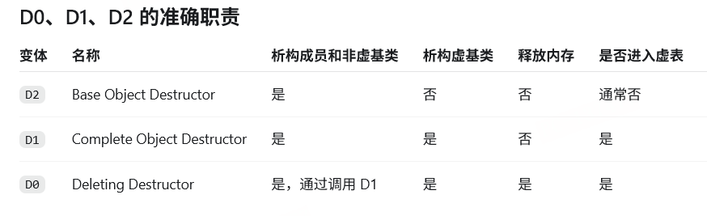

# 1.5 类、继承与多态

<!-- course-navigation:start -->
[上一节：1.4 指针与引用](pointers-and-references.md) · [本章目录](README.md) · [下一节：1.6 C++ 关键字与可调用对象](cpp-keywords-and-callables.md) · [手册首页](../README.md)
<!-- course-navigation:end -->

理解类的行为时，先分清三件事：对象里存了什么、构造和析构按什么顺序执行、一次函数调用由什么决定。语言规则决定程序是否正确；`vptr`、虚表、偏移量和析构函数的多个入口，是编译器落实这些规则的常见方式，具体布局由 ABI 决定。

本篇接着[指针与引用](pointers-and-references.md)学习：先能区分对象与别名，再观察成员和继承行为。第一次阅读先完成类、生命周期和虚函数的实验；虚表与 ABI 部分属于进阶解释，不是写出第一个类的前提。[C++17 语言实验](../examples/course/cpp-language-labs.cpp)的 `class_labs` 对应下面的推演。

## 1.5.1 对象、成员与内存布局

### 1.5.1.1 `class` 和 `struct`

两者都能有构造函数、成员函数、继承和虚函数。区别在于默认权限：`class` 的成员和继承默认是 `private`，`struct` 默认是 `public`。把 `struct` 用于简单数据、把 `class` 用于封装对象，是编码习惯，不是语言限制。

### 1.5.1.2 对齐与 `sizeof`

成员地址需要满足它的**对齐要求**，不能直接把要求等同于成员大小。例如，`alignof(T)` 才是类型 `T` 的对齐值，`alignas` 可以提出更强的对齐要求。编译器可能在成员之间和对象尾部插入填充，使数组中的每个对象也能正确对齐。

通常可按“放成员 → 补齐下一个成员的对齐 → 最后补齐整个类的对齐”分析简单结构体。整个对象的对齐至少要满足其成员需要，但不能一概写成“最大基本类型成员的大小”。继承、虚函数、位域和编译选项都会影响实际布局。

独立完整对象的大小不能为 0，因此空类常见 `sizeof` 是 1；`alignas` 等可能使它更大。空基类优化以及 C++20 的 `[[no_unique_address]]` 允许某些子对象不额外占空间，不能据此认为所有空类子对象都占一个字节。

### 1.5.1.3 不同成员分别放在哪里

| 成员 | 是否属于每个对象 | 初始化与访问要点 |
| --- | --- | --- |
| 普通非静态数据成员 | 是 | 按声明顺序初始化；布局还需考虑填充 |
| 非静态 `const` 成员 | 是 | 在初始化阶段确定值，不能在构造函数体内补做赋值 |
| `mutable` 成员 | 是 | 即使对象通过 `const` 访问，也可修改该成员，常用于缓存或计数 |
| `static` 数据成员 | 否 | 类的各对象共享，不计入单个对象的 `sizeof` |

`const` 描述可修改性，不描述存储区域。一个对象里的 `const` 成员会随对象一起存储，对象可以具有自动存储期，也可以动态分配，不能统一归到“常量区”。

普通非静态成员的声明顺序是分析布局的重要线索，但不应把对象看成无填充的成员拼接。C++23 对不同访问权限成员的声明顺序布局作了进一步统一；旧版本分析时还需考虑相应的布局规则。

传统静态数据成员一般在类内声明、类外定义；C++17 起可用 `inline static` 在类内定义。整型 `const static`、`constexpr static` 等还有各自的规则，见[关键字与可调用对象](cpp-keywords-and-callables.md)。

### 1.5.1.4 成员函数与 `this`

普通非静态成员函数通过隐式对象参数访问当前对象。`static` 成员函数没有隐式 `this`，不能直接使用非静态成员；若显式传入一个对象或指针，仍可通过它访问对象成员。

`void f() const` 限制通过当前对象修改非静态成员，`mutable` 成员除外。它不限制修改 `static` 成员，也不意味着指针成员所指向的外部对象自动变成只读。`const` 对象只能调用适用的 `const` 非静态成员函数；非 `const` 对象两类函数都能调用，有成对重载时通常选择非 `const` 版本。

用“查询角色血量，并记录查询次数”区分这些成员：

```cpp
class Health {
    int value_ = 100;                    // 每个角色各有一份
    mutable int reads_ = 0;              // 允许只读查询维护统计
public:
    inline static int created = 0;      // C++17：所有对象共享
    Health() { ++created; }
    int value() const { ++reads_; return value_; }
    int reads() const { return reads_; }
};

const Health first;
Health second;
int hp = first.value();                  // 100
first.value();
// first.reads() == 2，second.reads() == 0，Health::created == 2
```

假设这是本次程序中首次创建 `Health`。两次调用都通过 `first` 的隐式对象参数访问它自己的 `reads_`；没有修改 `value_`。`created` 在此例的默认构造路径中递增，没有在拷贝等其他构造路径维护统计，也没有在析构时递减，因此不能把它解释成完整的对象构造或当前存活数量统计。这里用 `mutable` 记录内部统计，并不建议把所有想改的成员都标成 `mutable` 绕过接口约束。运行 [member_kinds()](../examples/course/cpp-language-labs.cpp) 可检查对象间是否意外共享了计数。

## 1.5.2 构造、初始化与析构

### 1.5.2.1 初始化列表不是“构造后再赋值”

对象的基类和成员先完成初始化，再进入构造函数体。初始化列表直接给子对象指定初始化方式；构造函数体里的 `member = value` 已经是赋值。

```cpp
#include <string>
#include <utility>

class Player {
    const int id_;
    std::string name_;
public:
    Player(int id, std::string name)
        : id_(id), name_(std::move(name)) {}
};
```

如果不写成员初始化器，有类内默认成员初始化器就使用它，否则按相应规则默认初始化。类类型成员可能先调用默认构造函数，再在函数体赋值；未显式初始化的普通标量成员则不会自动全部变成 0。

初始化列表的价值有两类：减少“先默认构造、再赋值”的额外工作；完成不能延后的初始化，例如引用绑定、`const` 成员初始化、没有默认构造函数的类成员初始化。`const` 和引用成员也可以用合适的类内默认成员初始化器，所以不能说它们“只能在列表里写”。

### 1.5.2.2 固定的初始化顺序

对于非委托构造函数，顺序是：

1. 最派生类负责初始化虚基类。
2. 按继承声明从左到右初始化直接非虚基类。
3. 按成员在类内的声明顺序初始化非静态数据成员。
4. 执行构造函数体。

初始化列表书写顺序改变不了这些规则，最好和声明顺序保持一致，避免某个成员使用了尚未初始化的另一个成员。[标准草案：基类与成员初始化](https://eel.is/c++draft/class.base.init)

析构时先执行当前类析构函数体，再逆序销毁成员、逆序销毁直接非虚基类；完整对象最后销毁虚基类。这与成功构造的子对象顺序对应。

可以让每个子对象把事件写进同一张记录表。下面使用 `vector<string>` 仅用于保存顺序，容器细节留到 [STL](stl-and-algorithms.md)：

```cpp
struct Trace {
    std::string name;
    std::vector<std::string>& events;
    Trace(std::string n, std::vector<std::string>& e)
        : name(std::move(n)), events(e) { events.push_back(name + "+"); }
    ~Trace() { events.push_back(name + "-"); }
};
struct Character : Trace {
    Trace weapon;
    Trace armor;
    explicit Character(std::vector<std::string>& e)
        : Trace("base", e), weapon("weapon", e), armor("armor", e) {
        events.push_back("body+");
    }
    ~Character() { events.push_back("body-"); }
};

std::vector<std::string> events;
{ Character character(events); }
// events: base+ weapon+ armor+ body+ body- armor- weapon- base-
```

构造先完成基类，再按声明顺序完成 `weapon`、`armor`，最后执行函数体；退出内层作用域时顺序反过来。外层 `events` 活得更久，所以析构记录仍有有效目标。把初始化列表中的 `armor(...)` 写到 `weapon(...)` 前面也不会改变真实顺序；应保持书写顺序一致，避免误导读者。实验 [lifetime_order()](../examples/course/cpp-language-labs.cpp) 会比较整个事件序列。这里为教学记录而在析构中追加字符串，可能分配内存；实际资源类的析构应避免让异常逃出，不能把这段日志代码直接当作可靠的生产清理器。

### 1.5.2.3 `delete` 的语义与实现细节

普通 `delete p` 负责销毁对象并调用匹配的释放函数。通常可以理解为“析构 + `operator delete`”，但不能断言所有实现都读取对象头部的 `header`，也不能把 `operator delete` 与 `free` 直接画等号。分配器元数据、数组 cookie、sized delete、C++20 destroying delete 都有各自规则。

通过基类指针删除派生对象时，常规做法是让基类拥有虚析构函数。若基类析构非虚，在通常的删除规则下属于未定义行为；即使派生类没有额外分配资源，也不能认为“实际上没事”。它可能漏掉派生部分的析构，也可能把错误的地址传给释放函数。[标准草案：delete 表达式](https://eel.is/c++draft/expr.delete)

## 1.5.3 继承：访问权限、名字查找与对象转换

### 1.5.3.1 三种继承方式

| 继承方式 | 基类 `public` 成员在派生类中 | 基类 `protected` 成员在派生类中 | 外部能否直接把派生指针转为基类指针 |
| --- | --- | --- | --- |
| `public` | `public` | `protected` | 可以，前提是基类无歧义 |
| `protected` | `protected` | `protected` | 通常不可以 |
| `private` | `private` | `private` | 通常不可以 |

基类的 `private` 成员仍存在于基类子对象里，但派生类不能直接访问。`protected`、`private` 继承的转换可在拥有相应访问权限的成员或友元上下文中使用。

`public` 继承通常表达“派生类是一种基类”（is-a）。`private` 继承更接近“借助基类实现”，`protected` 继承则保留给派生层次使用的接口。是否使用继承，还应看对象是否真的需要可替代关系。

### 1.5.3.2 重载、隐藏、覆盖要分开记

**重载**发生在参与同一次重载决议的函数之间：同名、参数列表不同。仅返回类型不同不能区分重载，例如单独写 `GetValue();` 就无法据返回值决定调用谁。

```cpp
int GetValue();
// double GetValue();           // 错误：仅返回类型不同

void Func(int);
void Func(const int);           // 同一个函数的再次声明

void f(int*);
void f(const int*);             // 不同重载：指向对象的 const 不同
```

按值参数的顶层 `const` 不区分函数类型；它只限制函数内部那份参数副本能否修改。引用和指向对象的 `const` 会影响匹配，详见[模板中的重载与推导](templates.md)。

**隐藏**是名字查找规则：派生类声明同名成员后，基类中该名字的其他成员可能不再被非限定查找找到，参数是否相同并不是条件。被隐藏的基类数据成员仍存在，没有从内存里消失。

```cpp
struct Base {
    void func(int) {}
    int value = 1;
};
struct Derived : Base {
    using Base::func;           // 把基类重载集带入当前作用域
    void func() {}
    int value = 2;
};
// d.func(1) 可调用基类版本；d.Base::value 可访问被隐藏的成员。
```

**覆盖（override）**针对基类虚函数，需要匹配名称、参数、`const` / 引用限定等规则，返回类型需相同或满足协变条件。仅仅同名不等于覆盖。写 `override` 可以让编译器检查本意，写错签名就报错。

### 1.5.3.3 多继承中的静态类型与指针调整

多继承对象包含多个基类子对象和自己的成员。常见 ABI 把它们安排在对象内的不同位置，但“把基类从左到右按 `sizeof` 直接拼起来”不是通用布局公式。

```cpp
struct Base1 { int a = 0; void op1() {} };
struct Base2 { int b = 0; void op2() {} };
struct Derived : Base1, Base2 { int d = 0; };

Derived object;
Base1* p1 = &object;
Base2* p2 = &object;
Derived* pd = &object;
// p1->op2();                  // 错误：Base1 的接口里没有 op2
p2->op2();
pd->op2();
```

`Base1*` 的静态类型决定能查找哪些成员，即使它指向更大的 `Derived` 对象，也不会自动获得 `Base2` 的接口。把 `Derived*` 转成 `Base2*`，或通过派生对象调用 `Base2::op2`，编译器会按布局调整对应的对象地址，使函数收到指向 `Base2` 子对象的 `this`。

基类构造函数也接收指向其子对象的地址。常见实现会由派生类构造代码完成地址调整，但偏移量不一定就是前一个基类的 `sizeof`，更不能认定第一个声明的基类一定是 ABI 里的“主基类”。

### 1.5.3.4 向下转换和侧向转换

`static_cast<Derived*>(base)` 不做运行时类型检查。它要求语言允许这次基类到派生类转换，并且非空指针确实指向相应派生对象的基类子对象；类型不符是未定义行为。从虚基类指针直接静态向下转换还受到禁止规则限制。[标准草案：static_cast](https://eel.is/c++draft/expr.static.cast)

**兄弟基类之间不能直接 `static_cast`。** 如果已知真实对象就是 `Derived`，必须显式经过它：

```cpp
Base2* p2 = &object;
Base1* p1 = static_cast<Base1*>(static_cast<Derived*>(p2));
// static_cast<Base1*>(p2);    // 错误：两种基类之间没有这种直接转换
```

这里需要看到完整的 `Derived` 定义，也需要由程序员保证真实类型。编译器不会自行搜索某个共同派生类来“跨过去”。

需要运行时检查时使用 `dynamic_cast`。对于通常的向下、侧向转换，源类型必须是多态类型，并需启用编译器相应的 RTTI 支持；目标类需要完整定义。目标基类不一定自己声明虚函数，关键是源对象和公开、无歧义的继承关系满足转换规则。

```cpp
struct Left { virtual ~Left() = default; };
struct Right { void work() {} };
struct Both : Left, Right {};

Both both;
Left* left = &both;
Right* right = dynamic_cast<Right*>(left); // 侧向转换，成功
```

指针形式失败返回 `nullptr`；引用形式失败抛 `std::bad_cast`。向下和侧向转换都不会自动隐式发生。RTTI 还包括 `typeid`：对多态表达式可识别动态类型，对非多态类型则不需要通过虚表查询。[标准草案：dynamic_cast](https://eel.is/c++draft/expr.dynamic.cast)

## 1.5.4 虚函数：调用同一个接口，选择不同实现

重载、模板等静态多态在编译期确定具体调用。虚函数提供动态多态：通过基类接口调用时，依据对象的动态类型选择最终覆盖者。

```cpp
struct Actor {
    virtual ~Actor() = default;
    virtual int damage() const { return 1; }
};
struct Ninja : Actor {
    int damage() const override { return 10; }
};

Ninja ninja;
Actor& actor = ninja;
// actor.damage() == 10
```

虚函数可以有基类实现，派生类可选择覆盖或继承它。非成员函数、静态成员函数、构造函数不能声明为虚函数；**`inline` 函数可以是虚函数**。函数是否内联展开和是否具有虚函数语义是两回事。[标准草案：虚函数](https://eel.is/c++draft/class.virtual)

### 1.5.4.1 纯虚函数与抽象类

`virtual void draw() = 0;` 声明纯虚函数。如果类中仍有最终覆盖者为纯虚函数的接口，该类就是抽象类，不能创建完整对象，但可以作为派生对象的基类子对象，也可以声明它的指针或引用。

纯虚函数可在类外提供函数体，派生类可用 `Base::draw()` 显式调用。提供函数体不会取消纯虚性质，派生类若想成为具体类仍需满足覆盖要求。

纯虚析构函数常用于“这个类只能作为基类”的设计，而且**必须有定义**，因为派生对象析构仍会执行它。

```cpp
struct Interface {
    virtual ~Interface() = 0;
    virtual void draw() = 0;
};
inline Interface::~Interface() = default;
inline void Interface::draw() { /* 可共享的基础行为 */ }
```

抽象类在常见实现里也会有虚表；纯虚槽位可能指向 `__cxa_pure_virtual`、MSVC 的 `_purecall` 等处理函数。不能解释成“子类必须复制父类那张表，因此父类必须有表”，因为标准没有规定这种生成过程。在构造或析构中对正在处理的对象虚调用纯虚函数属于未定义行为，不能依赖特定终止方式。[标准草案：抽象类](https://eel.is/c++draft/class.abstract)

### 1.5.4.2 构造、析构期间的虚调用

基类构造时，派生部分还没构造完成；基类析构时，派生部分已经结束。因此在当前类的构造/析构阶段调用虚函数，选择的是当前阶段对应的最终覆盖者，不会调用尚未构造或已经析构的更派生部分。

常见实现通过分阶段设置 `vptr` 来落实这一规则，编译器也可能直接生成已知目标的调用。不要把“先设置哪个 vptr、再初始化哪个字段”的具体机器码顺序当成跨编译器保证。

### 1.5.4.3 限定调用、对象切片与 `final`

`actor.Actor::damage()` 显式指定基类实现，抑制虚派发。按值复制/传递派生对象到基类类型则产生对象切片：新对象只有基类部分，之后虚调用对应基类对象，不会保留派生对象的行为。

```cpp
Actor sliced = ninja;
// sliced.damage() == 1
```

现在把三个看似相近的调用放在一起，先预测再运行 [dispatch_and_slice()](../examples/course/cpp-language-labs.cpp)：

```cpp
int through_reference(const Actor& object) { return object.damage(); }
int through_value(Actor object) { return object.damage(); }

Ninja fighter;
int a = through_reference(fighter); // 10：引用仍指向原来的 Ninja
int b = through_value(fighter);     // 1：形参是新构造的 Actor 对象
int c = fighter.Actor::damage();    // 1：显式选择基类实现
// fighter.damage() 仍然是 10，按值传递没有把原对象“削掉”。
```

第一步先看函数参数是否创建了新对象，再看调用是否显式限定基类，最后才判断虚派发的目标。这样比记“点号/箭头对应哪一种绑定”更可靠。多态接口常用指针或引用接收对象；如果按值保存进 `vector<Actor>`，同样会切片。

不能简单记成“用点号调用就不动态绑定”：`Actor& ref = ninja; ref.damage();` 仍是虚调用。对编译器已知具体类型的对象，调用结果可能在编译期确定，属于优化可见性的问题。

`final` 修饰类表示禁止继承；修饰虚函数表示禁止进一步覆盖。它能帮助编译器证明目标唯一，从而去虚化，但不保证每个调用点都会优化，也不改变语言层面的虚函数语义。

## 1.5.5 虚继承：共享同一个虚基类子对象

```cpp
struct A { int value = 0; };
struct B : virtual A {};
struct C : virtual A {};
struct D : B, C {};
```

非虚菱形继承会让 `D` 含两份 `A`，经不同路径访问会歧义。这里两条路径都虚继承 `A`，`D` 中共享一份 `A` 子对象；`B` 单独构造时也包含自己的那一份 `A`。虚继承解决共享基类问题，并不自动消除所有同名成员或多覆盖者歧义。

共享的是哪一个对象，可以用语言允许的转换直接验证，不必猜内存偏移：

```cpp
D diamond;
A* via_b = static_cast<B*>(&diamond);
A* via_c = static_cast<C*>(&diamond);
via_b->value = 7;
// via_b == via_c 为 true；via_c->value == 7。
```

两次转换分别走 `D → B → A` 和 `D → C → A`，最终到达同一份虚基类。实验 [shared_virtual_base()](../examples/course/cpp-language-labs.cpp) 检查这两个结论；它没有假设基类位于第几个字节，也没有使用不合法的兄弟类直接静态转换。

从 `B*` 找到 `A` 时，偏移量可能因完整对象是 `B` 还是 `D` 而变化。实现通常通过表项记录偏移：MSVC 常见 `vbptr/vbtable`，Itanium ABI 可以把虚基类偏移放在虚表中。因此原先的 `BCDA`、`BA` 可作某种实现的示意，不能当成固定内存排列，也不能断言一定额外增加几个指针。

构造 `D` 时，最派生类 `D` 负责先构造共享 `A`，随后构造 `B`、`C`，再初始化自身成员、执行函数体。此时 `B`、`C` 构造函数中对虚基类的初始化器不再负责构造 `A`。销毁时共享 `A` 最后只销毁一次。

代价可能是额外的布局元数据、偏移读取和更复杂的构造逻辑。类布局改变也可能破坏二进制兼容，依赖它的模块通常需要重新编译；具体内存和速度成本应在目标编译器下测量。

一种工程约束是只继承一个带数据的实体基类，其他基类只提供接口，以减少共享数据基类的复杂性，但它不是现代 C++ 的强制规则。游戏中还可用组合或 ECS 按“拥有哪些组件”组织能力。

若不使用语言虚函数，也可以手动保存函数表和对象指针实现动态分派；[CRTP](templates.md#188-crtp奇异递归模板)则在编译期把派生类型传入基类模板，提供静态多态，不具备同一种异构基类指针接口。

## 1.5.6 从虚表理解一次动态调用

这一节需要先掌握前面的虚调用结果，并了解编译、链接和函数地址；初读可以暂时跳过这些实现细节，先完成章末练习。下面只描述常见实现模型：

```text
对象或某个基类子对象
  └─ vptr → 虚表的地址点
               ├─ 虚函数入口 / 调整 this 的 thunk
               └─ ABI 规定位置的类型、偏移等元数据
```

不同类的虚表不同；一个完整 `Base` 对象和 `Derived` 中的 `Base` 子对象，其 `vptr` 可能指向不同表，因为后者需要派发到派生实现。多继承对象还可能有多个虚表指针。

假设 `B* p` 指向某种派生对象，`p->func()` 的示意过程是：

```text
读取 p 所指子对象中的 vptr
按编译期确定的槽位偏移取得入口
必要时调整 this，调用最终实现
```

```asm
; 仅是某种布局下的伪汇编，16 不是通用槽位偏移
mov rax, [p]
mov rax, [rax]
call [rax + 16]
```

运行时通常不按函数名搜索，而是按固定槽位间接访问。单次槽位查找是常数次访问；实际代价还包括间接分支预测、缓存和内联机会。槽位布局受 ABI、继承、析构入口等影响，不能简化成“声明的第几个函数就是第几个数组元素”。

虚表一般置于只读或重定位后只读的静态数据中，`vptr` 位于对象存储中。常见平台槽位保存函数地址或 thunk 地址；也有不同函数指针表示，不能固定认为每项都是一个普通虚拟地址。

编译期确定表结构并生成符号/重定位信息，链接期解析引用，加载动态模块时可能继续重定位以适应 ASLR 等机制。DLL 中的虚函数仍遵守目标平台的导入和重定位规则；不能一概说操作系统会“伪造一张新虚表”或所有平台都必须使用 `.lib`。

RTTI 元数据的位置也由 ABI 决定。Itanium ABI 中虚表地址点前有类型信息指针等条目；MSVC 的布局不同。`type_info` 和继承描述用于运行时类型判断，但并非所有 RTTI 都必须经由对象虚表。

### 1.5.6.1 Itanium ABI 的三个析构入口

这一组名字是 ABI 细节，不是 C++ 语法，也不能原样套到 MSVC：

| 入口 | 含义 |
| --- | --- |
| D2：base object destructor | 析构函数体、成员和非虚直接基类，不处理完整对象的虚基类 |
| D1：complete object destructor | 完成 D2 对应工作，并析构该完整对象的虚基类 |
| D0：deleting destructor | 完成 D1 对应工作，再调用适当的释放函数 |



虚析构表项通常包含完整对象析构与 deleting destructor 两个入口；次级表可能通过 thunk 调整 `this`。D2 通常作为内部直接调用入口。编译器可以合并等效实现，不必真的逐层调用独立函数。

对于 `B`、`C` 虚继承 `A`，`D` 继承 `B, C` 的例子，逻辑关系可写为：

```text
D 的完整析构
├─ D 析构函数体
├─ D 的成员（逆序）
├─ C 的基类子对象析构（不重复析构 A）
├─ B 的基类子对象析构（不重复析构 A）
└─ 共享的虚基类 A（最后一次）
之后由 deleting destructor 完成内存释放（若此次是 delete）。
```

这里把 D1、D2 分开，是因为“作为完整对象销毁”和“作为另一个对象的基类销毁”对虚基类的责任不同。[Itanium C++ ABI：布局、虚表与析构入口](https://itanium-cxx-abi.github.io/cxx-abi/abi.html)

读完后试着改动实验并说明原因：

- 把 `Health::reads_` 的 `mutable` 去掉，为什么 `value() const` 无法再执行 `++reads_`？因为它试图通过只读对象路径修改普通非静态成员。
- 把 `through_value` 改成接收 `const Actor&`，结果为什么从 1 变成 10？因为不再构造切片后的基类副本。
- 把菱形继承两条路径上的 `virtual` 都去掉，会有几份 `A`？两份；经各自路径取得的 `A*` 指向不同子对象，直接访问 `diamond.value` 也出现歧义。
