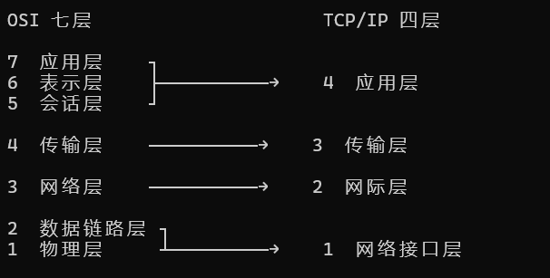
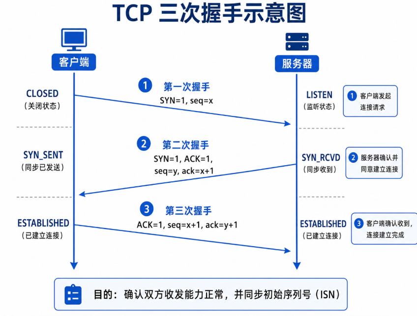
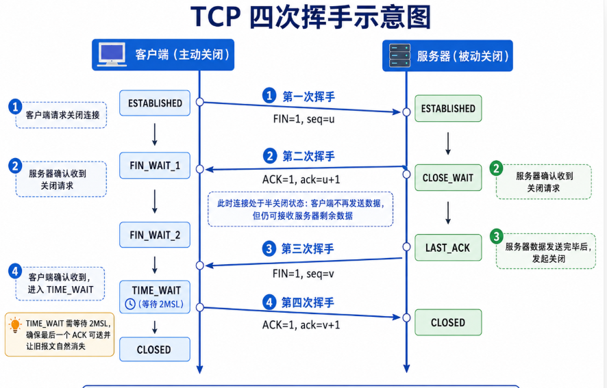
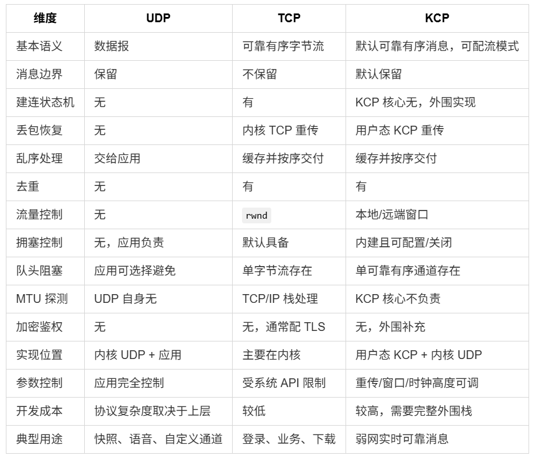

# 1.11 计算机网络：从消息发送到游戏协议选择

<!-- course-navigation:start -->
[上一节：1.10 进程、线程与同步](processes-threads-and-synchronization.md) · [本章目录](README.md) · [下一节：1.12 设计模式](design-patterns.md) · [手册首页](../README.md)
<!-- course-navigation:end -->

这篇笔记沿着一条消息的发送过程理解网络：先区分每一层负责什么，再看 TCP、UDP 和 KCP 如何交付数据，最后落到游戏消息与 RPC 的选择。

读到这里，应已能使用 `vector`、函数和整数类型，并知道进程地址空间相互隔离。先带着三个问题学习：一次 `send` 是否等于一条接收消息，旧位置能否覆盖新位置，可靠到达是否等于业务只执行一次？本节用[可运行的网络数据实验](../examples/course/network-labs.cpp)验证这三个区别；它模拟接收字节与业务状态，不会实际创建 Socket。

## 1.11.1 一条聊天消息怎样到达对方

假设客户端 A 要给 B 发一句“你好”，客户端通常只连接聊天服务器，服务器维护当前在线用户与连接的对应关系。A 提交“接收者 B + 消息内容”，服务器找到 B 的连接并转发。A 不需要直接知道 B 的 IP。

发送前，客户端通过 DNS 解析域名，或者通过启动配置、服务发现/服务器下发的信息获得服务端地址。业务还需要确定消息格式、编码和登录身份，例如：

```text
会话标识：Session123
消息类型：文字
接收者：B
内容：你好
```

服务器根据会话标识或令牌关联登录状态；这属于应用的会话管理。它与底层 TCP 连接相关，但不是同一概念：一次断线重连后，应用会话也可能继续存在。

随后，应用数据向下封装；接收端向上解封装。分层的目的，是让业务代码不必同时处理消息格式、可靠交付、路由和电信号。**OSI 七层是理解职责的参考模型，实际互联网协议通常按 TCP/IP 架构实现，并非每条消息都经过七个独立模块。**

### 1.11.1.1 OSI 与 TCP/IP 的职责对应

| OSI 层 | 要解决的问题 | 典型内容 | TCP/IP 中的位置 |
| --- | --- | --- | --- |
| 7 应用层 | 应用按什么规则交流 | HTTP/HTTPS、DNS、FTP、SMTP、IMAP/POP3、SSH | 应用层 |
| 6 表示层 | 数据如何表示和还原 | 编码、序列化、压缩、加密；如 UTF-8、JSON、JPEG | 通常由应用层协议或库承担 |
| 5 会话层 | 一场交流如何建立、维持、恢复 | 会话状态、认证上下文、恢复机制 | 通常由应用层承担 |
| 4 传输层 | 数据交给哪一个通信端点，如何交付 | TCP、UDP，端口与端到端传输 | 传输层 |
| 3 网络层 | 目标在哪里、下一跳怎么走 | IPv4、IPv6、ICMP，路由器 | 网际层 |
| 2 数据链路层 | 当前链路上如何传一帧 | Ethernet、Wi-Fi、MAC、交换机 | 链路层 |
| 1 物理层 | 如何把比特送入介质 | 电信号、光信号、无线信号，网线/光纤 | 链路层的底层能力 |

JSON、JPEG 是格式，UTF-8 是编码，不宜都叫作“表示层协议”；TLS 在实际协议栈中也不能机械地塞进唯一一层。ARP 用于 IPv4 地址到链路地址的解析，处在 IP 与链路衔接处。RPC 是远程调用机制，也不等于 OSI 会话层的一种固定协议。



### 1.11.1.2 IP 找主机，端口区分通信端点

同一台服务器可能运行多个服务，所以只有 IP 还不够；不同服务器也可以同时监听 8000，所以只有端口同样不够。`IP + 端口` 构成常见的 Socket 地址，TCP 连接进一步用两端地址组成的四元组区分：

```text
客户端：192.168.1.5:52000
服务端：203.0.113.10:8000

四元组 = 源 IP、源端口、目的 IP、目的端口
```

TCP 首部里放端口，不放 IP 地址；协议栈根据连接保存的目标地址，让 IP 层添加 IP 首部。路由器通常只负责转发 IP 包，不替通信双方管理 TCP 的确认和重传。

如果目标就在本机，数据可以走本机回环路径，不必真的从网卡发出去：

```text
应用数据 → TCP 封装 → IP 路由判断目标在本机 → 回环路径 → 接收端
```

### 1.11.1.3 IP 负责路由，链路层负责当前一跳

假设路径是“电脑 → 家庭路由器 → 运营商路由器 → 其他路由器 → 服务器”：

- 电脑先判断目的 IP 是否在本地网络；不在时，按路由把包交给网关。
- 第一跳的以太网帧：源 MAC 是电脑网卡，目的 MAC 是家庭路由器对应接口。
- 路由器拆掉入站链路封装，按 IP 路由选择出口和下一跳，再用出口链路的封装继续发送。

因此，路由选择由网络层完成，链路层承担选定链路上的交付。普通路由转发中，源/目的 IP 通常保持不变，链路层地址随跳变化；NAT 等机制会改写地址，非以太网链路也不一定使用 MAC。

交换机维护类似下面的转发表，按已知目标 MAC 选择端口：

| MAC 地址 | 对应端口 |
| --- | --- |
| A | 1 |
| B | 3 |
| C | 5 |

这是“交换机按 MAC 转发帧、路由器按 IP 转发包”的基本区别。物理层再把帧承载的比特转换成介质上的信号。

## 1.11.2 IP：提供跨网络的数据包交付

IP 是无连接、尽力而为的数据报服务。它根据地址逐跳转发，处理生存期等信息，但不向应用保证可靠到达、有序或不重复。

IPv4 首部至少 20 字节，带选项时最多 60 字节。原首部图中的字段可按职责记忆：

| 字段 | 作用 |
| --- | --- |
| Version、IHL | IP 版本、首部长度 |
| DSCP/ECN、Total Length | 服务/拥塞相关标记、整个 IPv4 包长度 |
| Identification、Flags、Fragment Offset | 分片标识、控制与偏移 |
| TTL、Protocol | 限制转发寿命，标识上层协议（如 TCP/UDP） |
| Header Checksum | IPv4 首部校验 |
| Source / Destination Address | 源 IP 与目标 IP |
| Options / Padding | 可选信息及对齐 |

传输层在 IP 之上补充端点区分和交付语义，不能把 IP 的“尽力传输”理解成 TCP 已经不需要重传。

## 1.11.3 TCP：可靠、有序的双向字节流

TCP 的两端各维护连接状态；连接不是一根独占的物理线路。状态包括两端 IP/端口、发送和接收序号、窗口、缓存、重传定时器以及连接所处阶段。

### 1.11.3.1 一个服务端口可以接很多连接

以下三条连接可以同时存在，因为四元组不同：

```text
10.0.0.2:50001 → 10.0.0.1:8080
10.0.0.3:50001 → 10.0.0.1:8080
10.0.0.2:50002 → 10.0.0.1:8080
```

在同一网络协议栈上下文中，不能同时建立两条完全相同四元组的 TCP 连接。服务器监听端口相同，不代表每个客户端共享同一条连接。

### 1.11.3.2 首部与序列号

TCP 最小首部为 20 字节，选项会增加长度。

| 字段 | 复习重点 |
| --- | --- |
| 源端口、目的端口 | 区分两端端点 |
| Sequence Number | 当前报文段中数据的字节序号，不是业务消息编号 |
| Acknowledgment Number | 接收端下一个期望收到的字节序号；之前连续字节已确认 |
| Data Offset、Flags | 首部长度及 SYN、ACK、FIN、RST 等控制位 |
| Window | 接收方通告的接收窗口，涉及流量控制 |
| Checksum | 检测传输差错，不等同于密码学安全认证 |
| Urgent Pointer、Options | 紧急数据相关字段及扩展选项 |

### 1.11.3.3 三次握手：同步双方初始序号

正常主动/被动建立连接的过程：

```text
A → B：SYN，seq = x
B → A：SYN + ACK，seq = y，ack = x + 1
A → B：ACK，ack = y + 1
```

SYN 占用一个序号。第三次通信使 B 知道自己的初始序号已被 A 接受，也帮助排除旧的重复连接请求。若只收到一个延迟到达的旧 SYN，就直接认为双方已经建立连接，可能造成两端状态不一致。

“验证双方收发能力”可以帮助记忆，但协议层更准确的重点是序号同步、状态确认，以及处理旧重复 SYN；三次握手不能保证网络今后不故障。参见 [RFC 9293 §3.5](https://www.rfc-editor.org/rfc/rfc9293.html#section-3.5)。



### 1.11.3.4 可靠交付由哪些机制共同完成

1. **序号与确认**：记录已发送和已连续接收的字节；累计确认号表示下一个期望序号。
2. **发送缓存与重传**：尚未确认的数据需要保留，超时或检测到丢失时重传。快速重传用于更早发现部分丢包。
3. **接收缓存、去重与重排**：收到乱序数据可以先缓存，但向应用交付时仍保持字节顺序。
4. **校验和**：发现传输中的部分差错；出错数据不能当作正确数据继续交付。
5. **滑动窗口**：允许多段数据同时在途，无需每发一段都等待单独确认。

可靠是协议的交付目标，并不表示连接永远成功：连接超时、对端消失等失败仍需应用处理。传输确认也不等于“业务已经执行成功”。

### 1.11.3.5 流量控制和拥塞控制不是一回事

| 机制 | 关注对象 | 关键量 | 谁维护 |
| --- | --- | --- | --- |
| 流量控制 | 接收端还能不能接下数据 | `rwnd`，Receive Window | 接收端通告，发送端遵守 |
| 拥塞控制 | 网络能否承受当前在途量 | `cwnd`，Congestion Window | 发送端根据网络反馈调整 |

粗略理解，发送方允许的在途量受 `min(rwnd, cwnd)` 约束，还要考虑已在途数据。这两个窗口不能混为“接收缓存剩余空间”：一个限制接收端压力，另一个控制网络压力。

### 1.11.3.6 字节流为什么需要应用层分帧

TCP 不保留 `send` 的业务边界。发送“abc”和“def”，接收端可能一次读到“abcdef”，也可能分多次读到其中的片段。所谓粘包、拆包，是应用观察到的读取边界与业务消息边界不同，属于字节流正常行为。

| 分帧方式 | 做法 | 注意点 |
| --- | --- | --- |
| 固定长度 | 每 N 字节是一条消息 | 简单，但可变长内容容易浪费空间或不够用 |
| 分隔符 | 例如用 `\n` 结束一条消息 | 消息正文包含分隔符时需要转义或限制 |
| 长度前缀 | 先读长度字段，再收集指定长度的消息体 | 明确字节序、长度上限和不完整头部的处理 |
| 自描述格式 | 按格式规则识别完整结构 | 必须有能识别完整消息的解析规则，不能只靠“看起来像 JSON” |

接收逻辑维护自己的缓冲区：先收字节，完整一条再解析，剩余字节留给下一轮。**这段分帧规则属于应用如何使用 TCP 字节流，不是 UDP 自身的“拆包协议”。**

### 1.11.3.7 用 C++ 推演半个头部和连续两条消息

约定“两字节大端长度 + 消息体”，最大消息体为 1024 字节。`00 03` 表示后面有 3 字节，不包含头部本身。解码器收到字节后反复判断能否取出完整消息：

```cpp
// 在 FrameDecoder::Feed 的循环中；pending 是已累计字节。
if (pending.size() < 2) {
    // 头部尚未完整：保留字节，等待下一次接收。
} else {
    const std::size_t length =
        (static_cast<std::size_t>(pending[0]) << 8) | pending[1];
    if (length > 1024) throw std::length_error("payload limit");
    if (pending.size() - 2 >= length) {
        // 取出 [2, 2 + length)，移除已消费前缀，继续解析下一条。
    }
}
```

这段是循环核心示意，完整可编译实现见实验文件。分三次喂入：

| 调用 | 新到达字节 | 状态与结果 |
| --- | --- | --- |
| 1 | `00` | 只有半个长度字段，不能读取消息 |
| 2 | `03 61` | 长度为 3，但消息体目前只有 `a`，继续等 |
| 3 | `62 63 00 02 64 65` | 先得到 `abc`，剩余数据又组成 `de` |

```cpp
FrameDecoder decoder; // 定义见配套实验，C++17
assert(decoder.Feed({0}).empty());
assert(decoder.Feed({3, 'a'}).empty());
auto messages = decoder.Feed({'b', 'c', 0, 2, 'd', 'e'});
assert(messages.size() == 2);
assert(messages[0] == "abc" && messages[1] == "de");
```

消息头在字节缓冲里，不应直接 `reinterpret_cast` 成本机结构体：还会遇到对齐、padding、字节序和长度检查问题。示例先按字节组合整数，且限制累计缓冲大小。生产版还要设计超时、背压和协议错误后的断连处理，避免对端宣布大长度后让接收方无限等待或分配。

### 1.11.3.8 关闭、半关闭与 TIME_WAIT

TCP 是全双工的，两个发送方向可以分别关闭。A 发 FIN 表示 A 不再发送后续数据，但仍能接收 B 发来的数据。常见正常关闭过程是：

```text
A → B：FIN
B → A：ACK
B → A：FIN（B 的发送方向也准备关闭）
A → B：ACK
```

B 收到 FIN 时，可能还有自己的数据没发完，因此 ACK 和自己的 FIN 不必一起发。这是常说“四次挥手”的原因；如果时机允许，ACK 与 FIN 可以合并，不能背成“关闭绝不可能只有三段”。



通常主动关闭方在完成最后确认后进入 `TIME_WAIT`，等待 `2MSL`：

- 最后一个 ACK 丢失时，对端可能重传 FIN，等待中的一方仍可再次确认。
- 给旧连接报文足够的消失时间，降低旧报文被新同四元组连接误认的风险。

MSL 是报文最大生存时间的模型量，不是一次往返 RTT；不要把 `2MSL` 固定记成所有系统都相同的秒数。关闭和半关闭的规则见 [RFC 9293 §3.6](https://www.rfc-editor.org/rfc/rfc9293.html#section-3.6)。

### 1.11.3.9 队头阻塞与实时状态

假设后续字节已到达，但前面某段丢失：

```text
收到数据 1 → 收到数据 3 → 等待数据 2 重传 → 按 1、2、3 交付
```

TCP 不会跳过缺口直接交付后续字节。文件传输需要这种有序性，但对“新位置可以覆盖旧位置”的游戏状态，等待旧数据可能增加延迟。这就是选择不同交付语义的原因。

## 1.11.4 UDP：保留数据报边界，交付策略由应用补充

UDP 不需要先完成 TCP 式握手，首部固定 8 字节：源端口、目的端口、长度和校验和各 2 字节。它提供数据报交付，不保证送达、顺序或不重复，也不自带 TCP 式流量控制与拥塞控制。首部和基本语义见 [RFC 768](https://www.rfc-editor.org/rfc/rfc768.html)。

### 1.11.4.1 边界与接收缓冲区

```cpp
sendto(sock, "abc", 3, ...);
sendto(sock, "def", 3, ...);
```

以上为调用形态示意。接收端面对的是两条独立数据报，不会被 UDP 自动合成“abcdef”的一个字节流；但它们仍可能丢失、乱序或重复。

如果一条 1000 字节的数据报只提供了 500 字节接收缓冲区，常规接收接口会出现截断或相应错误/标志，剩余部分不会像 TCP 流一样留给下一次读取。具体返回行为取决于 Socket API，应用应根据最大报文大小准备缓冲区并检查结果。

### 1.11.4.2 数据报大小与 IP 分片

UDP 数据报过大可能超过路径 MTU。IPv4 能否分片与 DF 标志及路径情况有关；不能假设路由器总会帮忙分片。采用分片时，一个必要分片丢失就可能使整个数据报重组失败。

实时程序因此应主动控制包大小，尽量避免 IP 分片。UDP 保留消息边界，不等于它替应用解决任意大小消息的可靠分片与重组。

### 1.11.4.3 “开销小”不等于任何场景都更快

UDP 没有 TCP 的连接建立和可靠交付机制，应用可以直接发送。但若业务也需要确认、重传、排序和拥塞控制，仍要自行实现或选用现成组件。

UDP 的关键价值是给应用选择空间：哪些消息值得重传，哪些过期后应该丢弃，哪些可以被新状态覆盖。不能只凭 UDP 首部更短，就断言吞吐量或最终业务延迟必然优于 TCP。

TCP 与 UDP 可以使用相同数字端口，因为它们属于不同传输协议的端点空间；具体绑定限制还要看地址和操作系统的 Socket 选项。

## 1.11.5 KCP：在 UDP 等承载上实现可靠 ARQ

KCP 本身是用户态可靠传输算法组件，需要调用方提供底层收发和时钟驱动。常见工程把 KCP 段放入 UDP payload：从部署位置看位于应用层，从功能看承担可靠传输层的一部分职责。它不是操作系统内置的另一种 IP 传输协议。

### 1.11.5.1 它负责什么，外围还要做什么

| KCP 的核心能力 | 应用/协议栈仍需负责 |
| --- | --- |
| 序号、ACK、累计确认 | UDP Socket 的创建、收发与调度 |
| 窗口、乱序接收、可靠有序交付 | 握手、会话生命周期、超时与重连 |
| RTT/RTO 估计、超时与快速重传 | 身份认证、加密、完整性认证与防重放 |
| 消息模式下的分片与重组 | NAT 保活、地址迁移、路径 MTU 策略 |
| 拥塞控制及可配置策略 | 并发访问封装与业务层交付语义 |

KCP 也有流模式和不同配置/版本，不能把某一种快速参数当成所有项目的默认行为。具体能力和接入方式以 [KCP 官方仓库](https://github.com/skywind3000/kcp) 对应项目版本为准。

### 1.11.5.2 24 字节段首部

| 字段 | 字节数 | 含义 |
| --- | --- | --- |
| `conv` | 4 | 会话编号，用于定位对应控制块，不是身份认证凭据 |
| `cmd` | 1 | PUSH、ACK、WASK、WINS 等命令 |
| `frg` | 1 | 消息模式下的分片信息 |
| `wnd` | 2 | 接收窗口通告 |
| `ts` | 4 | 时间戳或 ACK 回显时间戳 |
| `sn` | 4 | 段序号 |
| `una` | 4 | 下一个期望的连续序号，用于累计确认 |
| `len` | 4 | 数据长度 |

字段布局可对照官方 [protocol.txt](https://raw.githubusercontent.com/skywind3000/kcp/master/protocol.txt)。

### 1.11.5.3 四组队列怎样配合

```text
应用提交 → snd_queue → snd_buf → 确认后释放
网络接收 → rcv_buf   → rcv_queue → ikcp_recv 交给应用
```

- `snd_queue`：已经由应用提交，尚未进入发送窗口。
- `snd_buf`：已经进入发送过程，等待确认或重传。
- `rcv_buf`：按序暂存已收到的段，等待前序缺口补齐，或接收队列腾出容量后，移入 `rcv_queue`。
- `rcv_queue`：已经连续的段；消息模式还需收齐同一消息的分片，才能由 `ikcp_recv` 交给应用。

队列搬移同时检查下一序号与接收队列容量，并非只有乱序数据才会留在 `rcv_buf`。细节见 [KCP 的接收与组包实现](https://github.com/skywind3000/kcp/blob/master/ikcp.c)。

**可靠有序的 KCP 也没有消除队头阻塞。**前面的数据丢失时，后续交付仍可能等待重传。它的价值在于用户态接入和可调整的恢复策略，并非“既完全可靠有序，又永远不用等丢包”。

## 1.11.6 游戏消息应该选哪种交付语义

先问消息丢了是否必须补、旧消息是否还有价值、是否要求同其他消息全局有序，再看延迟、带宽预算，以及团队维护弱网、安全和跨平台协议栈的能力。

| 消息类别 | 原笔记中的例子 | 选择依据 |
| --- | --- | --- |
| 新状态覆盖旧状态 | 位置、朝向、速度、载具姿态、瞄准、动画状态、摄像机/观战位置 | 通常可接受部分丢包，及时处理最新状态更重要 |
| 有时效的连续媒体/输入 | 语音帧、视频帧、实时输入 | 过期数据可能无价值；输入也可带前几帧冗余，按玩法处理丢失 |
| 必须确认的业务 | 登录、商城购买、任务奖励、聊天、创建角色 | 需要可靠交付和业务结果确认，常使用 TCP 或既有可靠通道 |
| 实时关键事件 | 技能请求、重要战斗 RPC、需要确认的结算事件 | 按时效和可靠性选通道，可用 KCP 或引擎既有可靠机制 |

例如第 100 帧位置丢了，第 102 帧位置已到，补回 100 帧通常不能改善当前画面。可以为快照加序号：

```text
收到 101 → 应用
收到 103 → 应用
收到 102 → 已过期，丢弃
```

这是常见的“不可靠有序”（Unreliable Sequenced）语义：允许丢失，但不让旧状态覆盖新状态。序号比较仍应考虑回绕、重连和会话重置。

### 1.11.6.1 用状态变量拒绝过期快照

在**一个会话内、不发生整数回绕**的教学条件下，可使用单调增长的 `uint64_t` 序号：

```cpp
bool Accept(std::uint64_t sequence, int newPosition) {
    if (received && sequence <= lastSequence) return false;
    received = true;
    lastSequence = sequence;
    position = newPosition;
    return true;
}
```

它是实验中 `SnapshotReceiver` 的成员函数，`received`、`lastSequence`、`position` 是该接收器的字段。依次输入 `(101,1)`、`(103,3)`、`(102,2)` 后，最终位置仍为 3。保留 `received` 是为了区分“还没收到任何消息”和“合法序号恰好为 0”。重连必须清理旧会话状态；用 16/32 位循环序号时，应换成经过定义和验证的回绕比较规则。

这只是决定接纳哪个状态，**不负责插值**。人物怎样从旧位置平滑到新位置，是接收缓冲与渲染时间线的问题，第四章再接着设计。

关键业务不能只靠“传输可靠”保证正确。例如购买请求重复到达时，业务还需要处理重复执行；伤害结算的可靠性和权威性也由服务器逻辑决定。是否使用三个协议取决于消息设计，不是每款游戏都必须同时上 TCP、UDP、KCP。



## 1.11.7 RPC：把一次调用编码成远端消息

RPC 表达的是调用方式，不绑定某种传输协议。它可以基于 TCP，也可以通过 UDP 上的可靠机制或引擎网络层实现，不能概括成“RPC 一般就是 TCP”。

```text
客户端调用 ServerUseSkill(1001)
    → 编码远端方法标识与参数
    → 通过网络通道发送
    → 服务端反序列化、查找处理函数
    → 校验权限与业务条件
    → 执行对应逻辑
```

因此，RPC 不是普通本地函数跳转：它涉及序列化、网络延迟、失败、执行端和权限。原笔记的 `OnGain`（原写 `Ongain`）则是项目中的本地回调命名线索：获得某对象/状态后触发回调。是否还会发送网络消息要查项目实现，不能单凭名字判断为 RPC。

### 1.11.7.1 “收到了两次”不应变成“扣了两次”

客户端请求开火，网络重试或业务重发可能带来同一请求。下面只演示请求去重与弹药更新，不替代完整战斗校验：

```cpp
bool Fire(std::uint64_t request) {
    if (request == 0 || request <= lastRequest) return false;
    lastRequest = request;
    if (ammo == 0) return false;
    --ammo;
    return true;
}
```

这是实验中 `ServerPlayer` 的成员函数，初始 `lastRequest=0`、`ammo=2`。请求 1 成功，重复请求 1 被拒绝，弹药仍为 1；请求 2 成功后为 0；请求 3 因空弹匣失败。失败请求也已被消费，重试不会因稍后补充弹药而突然变成另一发。

这里假设按序处理，旧请求直接丢弃。实际可靠业务可能还要缓存结果，让重复请求拿回同一响应；允许乱序的命令需要窗口而非单个最大编号。身份来自已认证连接，而不是相信请求自己写的玩家 ID。射速、武器所有权、冷却和命中位置仍需服务器检查。

### 1.11.7.2 UE 中常用的三类 RPC

| 类型 | 常见有效调用方式与执行端 | 原有使用例子 |
| --- | --- | --- |
| `Server` | 拥有相应 Actor 的客户端请求服务器执行；具体受 ownership 等规则约束 | 请求移动、释放技能、购买、提交交互 |
| `Client` | 服务器调用，发往拥有该 Actor 的客户端 | 提示登录失败、个人操作结果、只属于该玩家的 UI 表现 |
| `NetMulticast` | 服务器调用，在服务器及相关客户端执行 | 爆炸、音效、一次性动画等瞬时表现 |

客户端发起请求，不代表服务器必须照做；服务器仍应判断资源、权限、冷却、命中等条件。Multicast 也不是向世界上所有客户端无条件广播，实际执行受相关性等规则影响；客户端自行调用 Multicast 不会获得服务器广播的效果。

UE RPC 的可靠/不可靠属性、Actor 所有权和复制设置是另一层规则，持续状态通常还要结合属性复制。详见 [Epic：Remote Procedure Calls](https://dev.epicgames.com/documentation/en-us/unreal-engine/remote-procedure-calls-in-unreal-engine)。项目中的实体、Property 和 RPC 链路另见 [网络同步实践](../04_Projects/network-synchronization.md)。

## 1.11.8 学习检查：从传输保证推到业务保证

先不看代码回答：长度头只收到 1 字节时能不能读取 16 位数？收到序号 103 后又收到 102，应更新位置还是保留 103？TCP 确认是否能证明远端已扣弹药？同一请求再次到达时，返回旧结果与重复执行有什么区别？

把实验改成每次只输入一个字节，最后仍应得到同样两条消息。再测试声明长度 1025、空消息、重复请求和会话重置。能解释这些结果后，再将本节与[射击项目的网络设计](../04_Projects/shooter-network-authority.md)连接起来。
