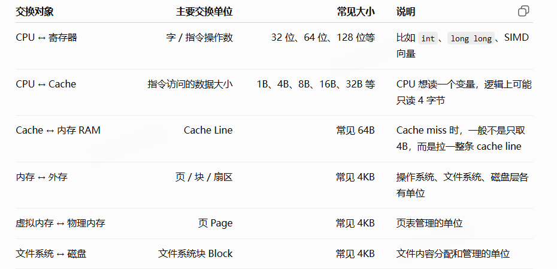
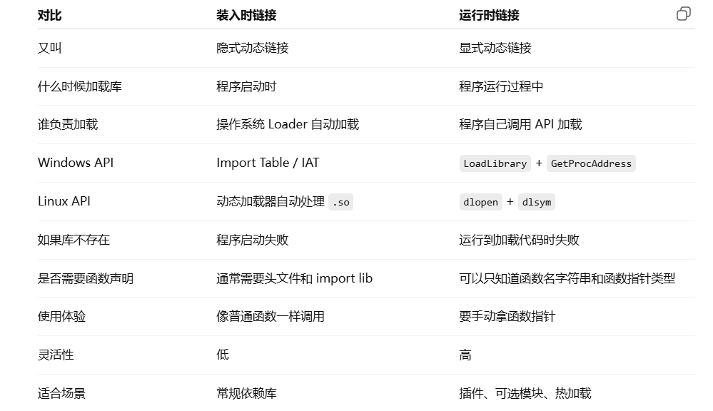
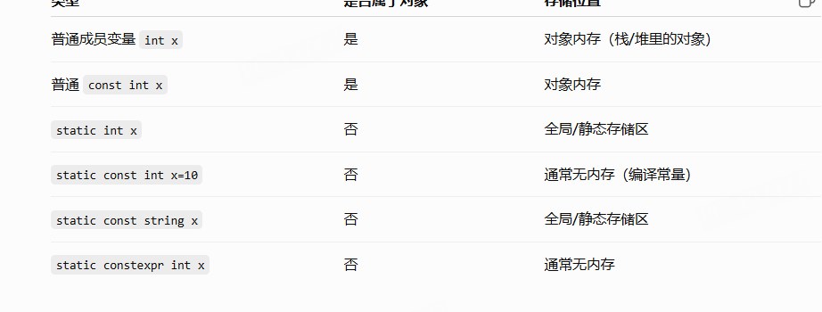

# 内存模型与编译管线

这篇要串起三个问题：程序里的地址怎样对应到内存，`.cpp` 怎样变成能运行的程序，以及 `new` 出来的对象究竟由谁分配、构造和释放。

先区分“内存模型”的几种用法。代码区、静态区、堆、栈等描述的是**常见进程内存布局**；C++ 标准规定的是对象、存储期、生命周期及线程间的内存关系，并不要求进程必须分成固定五区。硬件缓存、操作系统虚拟内存和 C++ 对象规则需要接起来理解，但不能互相代替。

## 1. 地址到底指向哪一层

### 从存储介质到地址空间

常见存储层次为“CPU 寄存器 → CPU Cache → 主存 RAM → SSD/HDD”。Cache 多用不需周期刷新、延迟较低的 SRAM，主存多用需刷新的 DRAM。ROM/Flash 一类非易失存储常用于固件。介质特性详见[计算机组成原理](computer-architecture.md)。

| 名称 | 这里具体指什么 |
| --- | --- |
| 虚拟地址 | 进程访问内存时使用的地址，通常要经过 MMU 转换；不同进程中的同一数值不必映射到同一物理位置 |
| 物理地址 | 硬件地址空间中的位置，可能对应 RAM，也可能对应设备映射或保留区域；有 16 GB RAM 不代表所有物理地址恰好是一段无孔洞的 0～16 GB |
| 逻辑地址 | 依语境而定。教材可能泛指程序使用的地址；x86 分段语境中特指“段选择子 + 偏移” |
| 磁盘块地址 | 存储设备/文件系统定位数据块的信息，不是可直接解引用的 C++ 指针 |
| 文件偏移 | 文件内从开头起算的字节位置，由文件系统进一步映射到存储块 |

x86 可按“逻辑地址 → 分段得到线性地址 → 分页得到物理地址”理解。现代 x86-64 的常见平坦布局弱化了普通分段的作用，但不能因此说所有段机制都消失，例如 FS/GS 仍有用途。

每个进程有自己的虚拟地址空间；**有一套地址编号，不等于每个地址都已经分配，也不等于物理内存连续**。代码、堆、栈、共享库和未映射区可以分散在其中。操作系统维护映射与权限，页表只是这些管理信息的一部分。

### 页、页框、块不是同一种单位

虚拟内存按页划分，物理 RAM 中对应的单位称为页框。页表记录“虚拟页 → 物理页框”以及有效、读写、执行等属性。文件系统按块或 extent 管理文件，设备还有逻辑/物理扇区；一次页读入可能对应多个磁盘扇区，不能因为常见配置里大小接近就把它们混为一谈。

分段则按逻辑用途划出可变长区域，例如代码、数据；段页式可先通过段定位，再对段内地址分页。现代通用 64 位系统主要用分页管理，这与源文件的代码段/数据段命名也不是一回事。

## 2. 一次内存读取：MMU、TLB、Cache 各管什么

### 先理解两条不同的路径

普通内存访问的概念路径是：

```text
CPU 指令使用虚拟地址
        ↓
MMU 查询 TLB；必要时遍历页表，检查映射和权限
        ↓
得到物理地址
        ↓
在 CPU 缓存层次查找目标数据
        ↓
缓存层次未能提供时，向内存系统请求
```

这是便于理解的依赖关系。真实处理器可能让 L1 的部分查找与地址翻译重叠进行，并不是每一步都严格串行。

普通文件读取则是：

```text
程序调用 read(fd, buf, count)
        ↓
进入内核，根据文件偏移定位文件内容
        ↓
检查 Page Cache
        ↓ 未命中时
文件系统定位存储块，发起 I/O，把内容读入内存
        ↓
把所需字节复制到用户缓冲区 buf
        ↓
程序再用普通内存指令读取 buf
```

普通 `read` 并不是“CPU 发现 Cache 没有，就直接去硬盘读”。内存映射文件 `mmap` 的访问可由缺页触发文件读入；普通文件读取通常由系统调用发起。用户缓冲区本身也可能需要缺页处理，这不改变二者的区别。

### TLB 缓存的是映射，CPU Cache 缓存的是字节

TLB（Translation Lookaside Buffer）保存近期使用的地址翻译和相关权限信息。它本身是一种硬件缓存，但不保存变量的原始数据。常见处理器有指令 TLB、数据 TLB，以及进一步的共享翻译缓存；具体层次依处理器而定。



TLB miss 后，如果页表中存在有效映射，硬件页表遍历器可以取得结果并填入 TLB；某些体系结构由软件参与处理 TLB miss。**TLB miss 本身不等于缺页。**

新映射需要进入已经满的组时，才涉及 TLB 项替换。直接映射、组相联、全相联是放置/查找组织方式；随机、FIFO、LRU 或近似 LRU 等是替换策略，二者不要混在一栏。“LFU”也是缓存策略概念，但不能默认某款 TLB 必然实现它。

操作系统更新内存中的页表项后，还必须按架构规则处理相关 TLB 缓存，必要时通知其他核心失效旧映射。普通数据缓存已经看见新页表项，不代表 TLB 自动同步更新。

### 进程切换为什么会影响 TLB

运行某个地址空间前，内核配置该地址空间的页表根等硬件状态。页表根相关信息保存在进程的内存管理结构中；多级页表通常由多块内存构成，并非从头到尾一整段连续表。

切换地址空间可能使旧 TLB 项失效，带来重新填充的开销。有 ASID/PCID 等标记时，TLB 可保留属于多个地址空间的项，按标记区分。这个标记由操作系统管理，并不一定就是进程 PID；映射变更、标签复用等仍需要适当失效。见 [Linux 页表文档](https://www.kernel.org/doc/html/latest/mm/page_tables.html)与 [Intel 手册的地址翻译缓存说明](https://www.intel.com/content/www/us/en/developer/articles/technical/intel-sdm.html)。

### 多级页表为什么节省空间

平铺页表为整个虚拟范围预留表项，稀疏使用时很浪费。多级页表把空间分层，没用到的大片地址范围可以不分配下级表。x86-64 常见有四级或五级分页；页大小和架构模式会改变实际遍历层数。大页可提前结束遍历并扩大单个 TLB 项覆盖的范围，但也会改变分配粒度等代价。

### “访问一次数据要读几次内存”必须先限定模型

下面只数**读取 DRAM 的次数**，不把读寄存器、Cache 或 TLB 算成 DRAM 访问；假设单核普通标量读取、没有缺页、没有跨页/跨行、没有其他核心提供数据，也暂不计写回和额外事务。

| 情况 | 简化模型中的 DRAM 读取 |
| --- | --- |
| 数据已经在寄存器里，无需访存 | 0 次 |
| TLB 命中，L1 命中 | 0 次 |
| TLB 命中，L1 未命中、L2 命中 | 0 次 |
| TLB 命中，L1/L2 未命中、L3 命中 | 0 次 |
| TLB 命中，所有数据 Cache 都未命中 | 需要一次目标数据读入 |
| TLB 未命中，但页表项与目标数据都在缓存里 | 0 次 |
| 四级页表遍历，四个表项都需读取 DRAM，目标数据在缓存里 | 最多按 4 次表项读取计算 |
| 同上，目标数据也需读取 DRAM | 按 4 次表项 + 1 次数据，共 5 次计算 |
| 发生需 I/O 的缺页 | 还要经过内核和存储设备，不能用上面的次数回答 |

真实执行可能命中页表遍历缓存、由别的核心供数，也可能有嵌套分页等额外访问。因此“64 位最多五次访存”只在上述简化假设下成立，不是通用上限。

## 3. 缺页、按需分配与文件缓存

### 三类常见访问情况

**第一类：地址不合法或权限不允许。** CPU 产生缺页异常等保护异常后，内核检查映射与权限；如果不能修复，向程序报告错误。例如 Linux 用户态非法访问通常收到 `SIGSEGV`。不合法地址并不一定都是“页不在内存”。

**第二类：地址合法，但内容暂时不驻留。** 例如匿名页已换出到交换区，或文件映射尚未把数据读入：

```text
访问虚拟地址 → 发现页不在场 → 进入内核
→ 确认映射合法、找到后备数据
→ 获得页框并读取内容
→ 更新页表及相关翻译缓存
→ 返回并重试引发异常的访问
```

**第三类：已经保留合法虚拟空间，但首次使用时才获得物理页。**

```cpp
int* p = new int[1'000'000];
p[0] = 1;
delete[] p;
```

`new` 先从分配器取得存储。如果这段地址对应尚未实际分配的按需页，第一次写入可能触发缺页：内核确认映射合法，提供清零的物理页框，建立可写映射，然后重试写入。不能说每次 `new` 都如此：分配器可能返回已驻留的内存，对象初始化也可能提前触碰页面。内核记录的是映射区域，并不会为每个 C++ 变量单独建立“变量页表项”。

栈也可能按需提交或增长，但必须在操作系统允许的地址范围与大小限制内；越过限制、保护页处理失败时仍会发生栈溢出。

### 零页与写时复制

对于部分匿名内存，系统可以在首次读取时映射共享只读零页；写入时再分配自己的物理页。`.bss` 或 `calloc` 提供的零值语义可能利用这类机制，但不是“申请任何大小都免费”：虚拟地址、页表、提交限制、实际触页和系统策略仍有成本。

写时复制 COW 的一般思路是先共享页面，把写权限收紧：

1. 某一方尝试写入，硬件发现权限不满足并进入内核。
2. 内核确认这是合法 COW 情形，而不是任意只读页都能改。
3. 如需保留原副本，分配新页并复制内容；零页的情况可直接获得清零新页。
4. 更新发起写入者的映射和权限，处理 TLB 后重试。

如果已经只有一个使用者，某些实现可以直接恢复可写，不必每次都复制。`fork` 后的私有内存和私有文件映射都可以利用 COW。

### 三种“缓存”放在哪里

| 名称 | 维护者 | 保存的内容 | 常见位置 |
| --- | --- | --- | --- |
| TLB | CPU/MMU，OS 配合管理 | 地址翻译与权限 | CPU 内部 |
| CPU Cache | 硬件 | 代码和数据字节 | CPU 芯片/封装中的缓存层次 |
| Page Cache | 操作系统 | 文件内容 | 主存 RAM |


L1 通常区分 I-Cache 和 D-Cache，L2/L3 的共享方式取决于处理器。预取器尝试提前搬入未来可能用到的行；流水线、乱序执行尝试在等待某次 load 时完成其他独立工作，它们能隐藏部分延迟，不能消除所有依赖。

普通文件读写和文件映射通常经过 Page Cache，直接 I/O 等存在例外。文件系统怎样把文件偏移转为块地址，见[操作系统](operating-systems.md)。[Linux Page Cache 文档](https://www.kernel.org/doc/html/latest/mm/page_cache.html)明确区分了这一软件缓存与 CPU Cache。

## 4. 从 .cpp 到目标文件

### 四个常用阶段与翻译单元

常见工具链可概括为“预处理 → 编译 → 汇编 → 链接”。它们是职责划分，不要求每一步都启动一个独立程序、生成一个中间磁盘文件。例如集成汇编器可以直接输出目标文件。

对于传统 `#include` 方式，翻译单元可理解为“一份 `.cpp` 经预处理后的结果”：包含头文件展开、宏展开，以及条件编译筛选后保留下来的内容。每个翻译单元通常独立编译，再由链接器连接外部符号。

### 预处理：先处理编译条件与文本

主要工作包括处理 `#include`、`#define`、`#if/#ifdef` 等指令，以及注释处理等翻译步骤。此时尚未完成 C++ 的类型、重载和对象语义分析。

`#pragma` 是预处理指令，允许实现定义额外行为；不能泛化成“源码里任何带 # 的文字都是有效预处理指令”。不认识的 pragma 通常忽略其语义，但编译器可以发警告，项目将警告视为错误时也可能使构建失败。

- `#pragma once`：让同一头文件在**当前翻译单元**中避免重复展开，不是整个工程只编译一次。文件身份识别依赖实现，路径别名等情况需考虑；标准 include guard 更可移植。
- `#pragma pack`：许多编译器支持的布局扩展，可调整成员打包对齐，必须配对恢复。

```cpp
#pragma pack(push, 1)
struct PackedHeader {
    char type;
    int length;
};
#pragma pack(pop)
```

压紧布局可能制造未对齐访问和 ABI 不兼容，不是所有结构体都应该默认使用。可参考 [GCC pragma 文档](https://gcc.gnu.org/onlinedocs/gcc-14.1.0/cpp/Pragmas.html)。

### 编译前端：从 token 到语义

| 阶段 | 要解决的问题 | 原笔记中的反例 |
| --- | --- | --- |
| 词法分析 | 字符能否组成合法的 token | `int a = 10 @ 3;` 中的 `@` 不属于这里合法的 C++ 表达式符号，前端会诊断 |
| 语法分析 | token 能否组成声明、表达式和语句 | `int = a 10 + ;` 不能构成合法声明 |
| 语义分析 | 名字、类型、作用域和调用是否合法 | 未声明变量、类型不匹配、无匹配重载等 |

真实编译器的阶段可能交织，不必把某条错误固定到所有实现的同一个内部步骤。语义分析过程中会建立或推导：

- 符号与声明信息：名字对应哪些实体、哪些声明需要外部定义。
- 类型与作用域信息：表达式是什么类型、名字在当前位置是否可见。
- 类布局：对象的成员、基类、对齐等布局信息。
- 重载决议与模板实例化结果：调用哪个候选，以及需要生成哪些具体实例。

### 名字查找先找到候选，再做重载决议

不能把名字查找记成永远固定的一条“局部 → 派生 → 基类 → 命名空间 → 全局 → ADL”流水线。查找规则取决于限定/非限定名字、类成员、模板和调用表达式；ADL 是满足条件的非限定函数调用还会搜索参数关联的类/命名空间，不是查不到后才随意补查。

派生类声明同名成员时，会隐藏基类中的同名成员，即使参数不同：

```cpp
struct Base {
    void func(int);
};
struct Derived : Base {
    void func(double);       // 隐藏 Base::func 的名字
    // using Base::func;     // 加上这行可把基类重载引入候选集合
};
```

先找到了哪个名字集合，再判断哪一个重载能匹配。名字根本找不到时是声明/查找问题，不用等到最后机器码生成才检查类型。

### 名称重整与 ODR

C++ 需要在链接层区分许多同名实体，常见 ABI 会将作用域、函数名、参数类型等编码进符号名，称为名称重整。语言层面先定义重载规则，ABI 再负责如何表示这些实体。

```cpp
int func(int);
int func(double);  // 参数不同，可以重载

// int same();
// void same();    // 不能仅靠返回类型重载
```

“返回值不参与普通函数的重载区分”不等于所有 ABI 的所有重整规则都绝不编码返回类型，函数模板等存在区别。原笔记把 `_Z4funci` 当成 `int func()` 的符号也不准确：在 Itanium ABI 中结尾 `i` 是参数 `int` 的编码，不是在描述返回类型。

ODR（单一定义规则）解释了常见的重复符号错误：若在头文件中定义具有外部链接的普通非 inline 函数或变量，多个 `.cpp` 包含后就可能得到多个定义。典型做法是在头文件声明，在一个源文件定义；适合放头文件的模板、inline 函数和 C++17 inline 变量则必须满足相应 ODR 条件。不是所有 ODR 违例都保证由链接器诊断。

### 中间表示、优化与汇编

编译器通常把前端结果转换为 IR，再做常量折叠、常量传播、死代码删除、公共子表达式消除、内联和循环优化等。后端根据目标 CPU 选择指令、分配寄存器并生成代码。可输出 `.s` 汇编文件，再由汇编器产生 `.o/.obj`；也可在集成工具链内部直接完成。

## 5. 目标文件、链接与装入

### 先区分格式，再看各节

Linux 工具链常见 ELF `.o` 和 ELF 可执行文件；Windows 常见 COFF `.obj` 和 PE `.exe/.dll`。不能给所有 `.obj` 都安上 ELF Header，也不能因为后缀相近就当成同一种文件格式。

以 ELF 为例，常见内容如下，名称和是否存在依工具链而变：

| 内容 | 作用 |
| --- | --- |
| 文件头 | 标识架构、位宽、字节序、文件类型等 |
| `.text` | 机器指令 |
| `.rodata` | 只读数据，例如某些字符串字面量 |
| `.data` | 需要在文件中保存初值的可写静态数据 |
| `.bss` | 通常保存零初始化静态数据的空间需求，文件不用为每个零存一个字节；原笔记的 `.dss` 应为 `.bss` |
| `.symtab` | 定义和引用的符号、所属节、值/偏移等链接信息 |
| `.rel.*` / `.rela.*` | 重定位项，描述哪里需要根据符号和重定位类型修正 |
| 节头表 | 描述各节的位置、大小和属性 |

编译器内部的“符号表”和目标文件的“链接符号表”用途相关，但不是同一张表原样写入。

### 符号表回答“是谁”，重定位表回答“哪里用到它”

假设 `main.o` 调用 `foo`，而 `foo.o` 定义 `foo`：

```text
main.o 的符号表：
main     已定义，属于 .text
foo      未定义，等其他目标文件提供
g_value  未定义，等其他目标文件提供

main.o 的重定位表：
.text 某个偏移使用了 foo，需要按指定方式修正
另一位置使用了 g_value，也需要修正
```

重定位可能填绝对地址、相对位移或其他编码，不能一概理解为“把 4 个字节改成最终物理地址”。它处理的是目标文件/模块的布局与引用，尚未决定实际 RAM 页框。

### 链接器主要做什么

1. **解析符号**：把引用和定义对应起来，检查缺失或冲突。
2. **安排并合并节**：按属性和布局要求组织代码、数据，可能删除未使用内容、保留合适对齐。虚拟地址连续不要求物理页连续。
3. **应用重定位**：修正能够在此阶段确定的引用。
4. **处理库与输出信息**：从静态库选择所需对象，或记录动态依赖、导入等；生成入口及装载所需元数据。

输出可执行文件仍可能保留动态重定位或基址重定位，不能说“链接后绝没有重定位表，直接交给 CPU 就能跑”。加载器还需映射、设置权限并完成必要绑定。ELF 的加载段与链接节不是完全同一个概念；Windows PE 也有自己的导入和重定位结构，见 [Microsoft PE 格式说明](https://learn.microsoft.com/en-us/windows/win32/debug/pe-format)。

### 静态链接与动态链接

静态库通常是目标文件的归档，链接器把需要的对象/节纳入最终输出，并非一定把整个库原封不动复制进去。Windows 的 `.lib` 既可能是静态库，也可能是动态库的导入库。

静态链接减少对应库的运行时部署依赖，但不等于程序没有任何系统依赖。多个程序静态带入同一库时，磁盘和内存可能重复保存代码，具体还受操作系统共享策略影响。

动态库作为独立模块映射到进程虚拟地址空间。不同进程可共享其干净的代码页，可写数据通常各自私有；更新要保证 ABI 和行为兼容，不是替换任意版本的 DLL 就必定成功。动态调用可能需要间接寻址和绑定，也不是每次都发生昂贵的额外操作。

- **装入时动态链接**：启动时根据依赖加载库并进行必要绑定。Windows 常见导入表；ELF 动态链接也可能采用延迟绑定。
- **运行时显式加载**：执行到需要的位置时，程序调用加载库与查找符号的 API，例如 Windows 的 `LoadLibrary`/`GetProcAddress`、POSIX 的 `dlopen`/`dlsym`。



### 装入、入口和 ASLR

一个典型启动过程是：建立进程和地址空间 → 映射可执行文件与依赖库 → 配置权限、初始栈等 → 完成必要重定位/动态绑定 → 运行启动代码 → 进入用户 `main`。加载器通常先建立映射，页面可在真正使用时才读入，未必启动时把整个文件复制进 RAM。

程序入口通常是运行库启动代码，并不直接等于 `main`。非局部静态对象的静态初始化在动态初始化之前完成，动态初始化通常发生在进入 `main` 前，但标准允许某些延迟；函数内静态对象通常首次执行到声明时初始化。自动对象和 `new` 对象在执行到相应构造操作时初始化，也可能出现在 `main` 前执行的其他代码中。

链接器安排模块内部布局，加载器决定本次运行的映射位置；ASLR 随机化部分区域的位置。例如：

```text
第一次运行：基址 0x50000000，Foo 地址 0x50002000
第二次运行：基址 0x71000000，Foo 地址 0x71002000
模块内偏移均为 0x2000
```

位置无关代码、相对寻址和加载重定位帮助模块适应不同基址。ASLR 增加地址预测难度，但不是单独防住所有溢出利用的保证。

```text
目标文件产生引用
→ 链接阶段确定模块内布局、修正可确定的引用
→ 装入阶段根据实际位置、动态符号等处理剩余修正
```

“链接重定位”和“装载重定位”不代表每个地址都固定重写两次，有的引用一次即可确定，有的使用相对编码无需随基址变化。

## 6. 运行时的内存布局与 C++ 存储期


图只表示一种常见布局。地址高低、增长方向、区间间距和共享库位置受操作系统、ABI、ASLR 与分配器影响；没有一张适用于所有 C++ 程序的固定地图。

### 低地址保留区、代码与静态数据

低地址附近通常不建立普通用户映射，用于帮助捕获空指针访问。不过 C++ 解引用空指针本身已经是未定义行为，不能依赖“必定立即崩溃”来保证程序逻辑。

代码区保存最终保留下来的机器指令。函数可能被内联、优化删除，或位于单独映射的动态库中，所以源码中的每个函数不一定对应主程序 `.text` 里的一段独立代码。

静态存储期对象包括非线程局部的全局对象和静态局部对象。常见实现把非零初值数据放进 `.data`，把适合全零表示的静态数据放进 `.bss`。BSS 在文件中主要记录大小，运行时提供零初始化内容，物理页可以按需建立。零初始化是语言语义，文件段如何实现它是平台选择。

`static const` 不能直接推导为“必定在只读段”：还要看类型、是否有动态初始化、是否实际需要存储，以及实现安排。普通 `const` 标量需要适当初始化，类类型可由构造完成；类静态成员还涉及类内声明、类外定义和 inline static 等规则，不能用一句“类内可以不初始化”概括所有情况。

### 只读数据、编译期常量与虚表

编译期常量指值可以在编译时确定，不等于它一定占据一个“常量区地址”；优化后可能直接变成指令立即数。字符串字面量和某些常量对象通常放只读区域。



虚表是常见 ABI 的实现机制，C++ 不规定必须存在名为“虚表”的内存区。含动态地址的表项可能需要装载重定位；例如某些 ELF 实现把需要先修正、后只读的数据放在 `.data.rel.ro`，完成重定位后再保护。不能因此说所有 `.rodata` 都必然需要临时可写。

### 堆、映射区域与未分配空间

“堆”可泛指分配器管理的动态存储，也可特指 Linux 中通过 program break 管理的连续区域，这两种含义要区分。

传统 `brk` 堆有起始位置，program break 标识其边界。分配器空间不足时可能使用 `brk` 等接口扩展，也可能用 `mmap` 获取独立区域。映射变化并不意味着所有物理页立刻分配。Windows 使用不同的虚拟内存和堆 API，不能直接套 Linux 的 `brk` 过程。

`mmap`（原笔记的 `mmp` 应为 `mmap`）既可做文件映射，也可申请匿名映射。共享库、线程栈、大块动态分配等都可能采用映射；它们不必集中在一段固定“高位向下增长区”。地址空间中的未映射空洞也不一定只位于一个“堆顶与栈底之间”。

独立映射便于单独释放，而 `brk` 连续堆中间释放出一块，未必能把边界缩回来。原笔记提到的大于 128 KB 改用 mmap，是部分 glibc 配置的初始阈值示例；阈值可调且可能动态变化，其他分配器策略不同。系统调用、映射管理等会增加成本，但不能仅按大小固定判断。见 [glibc 内存分配参数](https://sourceware.org/glibc/manual/latest/html_node/Malloc-Tunable-Parameters.html)。

### 栈、栈帧与调用约定

每个线程有自己的调用栈，用来保存部分局部对象、返回信息和溢出到内存的寄存器值。自动对象也可能一直放在寄存器中，或被优化消除。

栈指针 SP 标识当前栈的位置，具体指向最后已用位置还是边界依 ABI 而定。帧指针 FP 可作为当前函数栈帧的稳定参照，便于定位局部数据和回溯；它不是整个线程栈的固定“栈底”。编译器可省略帧指针并用 SP 相对位置及展开信息管理栈帧，从而多出一个可用寄存器。

以常见 x86 调用为例，可分成四步理解：

1. 调用者按 ABI 把参数放进寄存器或栈，保留必须的状态；`call` 保存返回地址。
2. 被调用者按需保存寄存器、建立帧指针。
3. 调整 SP，为需要落在栈上的局部数据留空间，并执行函数体。
4. 析构应销毁的局部对象，恢复寄存器和 SP，执行返回。可能使用 `leave/ret`，也可能使用等效指令序列。

这些主要由编译器生成的调用序列完成，不是 CPU 自动为所有函数创建 C++ 栈帧。现代 x64 也不是所有参数都压栈，例如 [Microsoft x64 调用约定](https://learn.microsoft.com/en-us/cpp/build/x64-calling-convention?view=msvc-170)优先使用寄存器传前几个参数。

多数固定大小局部数据的栈需求可编译期计算，但递归深度、动态栈分配和优化会改变运行时总占用。栈按后进先出释放，通常没有堆那样长期存在的外部碎片，仍会有对齐填充。

### 主线程栈、子线程栈与保护页

主线程栈通常由进程启动机制建立；子线程栈由线程库/操作系统创建。在一些 Linux/glibc 环境中子线程栈由 `mmap` 获得，其默认上限受资源限制和实现影响，不能把 8 MB 当成所有平台常数。

栈可预留较大虚拟区域，再按需提交/扩展物理页面，或使用固定映射范围；两者都有上限，因此“栈完全不能扩展”不准确。保护页常用于发现越界或触发合法增长，但并不是堆顶、栈底和每个内存区之间都保证存在一页保护区。触发保护机制也不代表一定还能继续增长。

| 对比 | 常见自动/栈存储 | 动态分配存储 |
| --- | --- | --- |
| 生命周期 | 随作用域或调用过程结束；编译器安排析构 | 由所有者控制，常通过 RAII/智能指针释放 |
| 容量 | 通常受线程栈上限约束 | 通常较大，仍受地址空间、提交、配额和物理资源约束 |
| 分配 | 常用调整 SP 等方式，成本较低 | 分配器查找/拆分块，必要时请求 OS |
| 地址方向 | 常见 x86 栈向低地址增长 | brk 堆常向高地址，但独立映射不遵循统一方向 |
| 碎片 | 通常没有任意释放造成的外部孔洞，仍有对齐等浪费 | 可有内部和外部碎片 |

## 7. 分配器怎样管理动态存储

### 为什么 malloc 不必每次进入内核

操作系统按页等粒度提供映射；用户态分配器把较大区域再切成对象需要的小块。它可能管理多片区域、多个 arena 和线程缓存，并不限于“堆底到堆顶一段地址”。

一次典型分配可以这样看：

1. 检查已有空闲块或相应大小的桶，有合适块就取出，必要时拆分、满足对齐。
2. 若不足，向 OS 申请或扩展区域，再纳入管理。
3. 如果无法取得满足请求的存储，按接口规则失败；`malloc` 返回空指针，普通抛出式 `new` 通常抛 `std::bad_alloc`。

`free` 常先把块还给分配器以供复用，不必立即归还操作系统。

### 空闲链表、大小分类与元数据

隐式空闲链表可在每块头部记录大小和占用标记，通过块大小找到下一块。若块大小按 8 字节对齐，其低 3 位为 0，就可在这种实现中拿若干低位保存标记。

显式空闲链表只链接空闲块，可以复用空闲块的用户区存放 `next/prev`，查找不必扫描已分配块。大小分类则把例如 8、16、32 字节等不同尺寸的块放在相应桶中，减少搜索；真实尺寸等级未必都是 2 的幂。

元数据可能包含当前块大小、前块大小和状态，也可能放在页/跨度级别的外部结构中。`free(ptr)` 不需要调用者给出大小，是因为分配器有自己的追踪办法，不能默认所有实现都简单读取 `ptr` 前固定几个字节。

### 内部碎片、外部碎片与对齐

内部碎片是已经分给某个对象/请求的空间中未被有效利用的部分，例如按尺寸等级向上取整。结构体 padding 也体现布局中的空间浪费，但它不等于操作系统意义的页面分配碎片。

成员地址要满足 `alignof(成员类型)`，结构体大小通常需满足自身对齐以支持数组；**对齐值不总等于 sizeof，结构体大小也不是“最大成员大小”的倍数规则**。按较大对齐要求的成员优先排列，常能减少中间填充，但不是所有类都保证最优，尾部填充仍可能存在。

```cpp
struct alignas(64) AlignedData {
    int value;
};
// alignas 作用在类型上，要求对象满足相应对齐。
// alignas(512) A* p 只会提高指针变量 p 自身的对齐，不会改变 new A 的对齐。
```

额外提高对齐会占用更多空间；`#pragma pack(push, 1)` 可减少某些布局填充，但有未对齐和兼容性代价，结束用 `#pragma pack(pop)` 恢复。

外部碎片则是空闲空间分散成小孔洞。用抽象的 1 B 块举例：连续分配三个 1 B，中间释放出 1 B，不能满足需要连续 2 B 的请求；这个孔洞仍可给足够小的请求使用，并非永久不可用。真实分配器有最小块和对齐限制，不会照这个示例恰好只占 1 B。

内存池预先取得较大存储，按固定块或桶管理，分配时弹出空闲块，释放时挂回。它能减少重复分配成本并控制特定场景的碎片，但会增加管理责任，也可能保留不用的内存。

## 8. C++ 的分配、构造与销毁不能混为一件事

### malloc/free、new/delete 各负责什么

| 接口 | 主要行为 |
| --- | --- |
| `malloc(bytes)` / `free(ptr)` | 获取/归还原始存储；不执行一般 C++ 类的构造/析构 |
| `new T(args...)` | 通过分配函数取得适当存储，再在其上初始化 T，返回 `T*` |
| `delete p` | 销毁对象，再调用匹配的释放函数 |
| `operator new` / `operator delete` | 可替换/重载的分配与释放函数，与完整 new/delete 表达式区分 |

普通 `new` 可以在底层使用 `malloc`，也可以用其他分配器，标准没有要求它必须是 malloc 的包装。默认的抛出式分配失败通常抛 `std::bad_alloc`；`new (std::nothrow)` 的分配失败可返回空指针，但构造函数自身抛出的异常仍可能传播。

分配失败可能来自资源耗尽、地址空间/配额限制、无法找到足够连续的虚拟块或不合理的大请求；不是任何逻辑错误都转成 `bad_alloc`。`delete nullptr` 不销毁任何对象，可以安全使用。

`malloc/free`、`new/delete`、`new[]/delete[]` 必须按各自契约配对，不能把章节名称写成 `new/free` 后混用。

### placement new：在已有存储上构造

预留字节空间和其中存在一个完成初始化的对象，是两件事。placement new 用已有地址进行构造，不负责另申请这块存储：

```cpp
#include <cstddef>
#include <new>
#include <string>

void placement_example() {
    alignas(std::string) std::byte storage[sizeof(std::string)];
    using Text = std::string;
    Text* text = ::new (static_cast<void*>(storage)) Text("hello");
    // 使用 text；构造完成后才能按这里的 Text 对象使用。
    text->~Text();  // 只析构；storage 自身由作用域管理，不能 delete text。
}
```

原来的 `char a[4]; new(a) int(1);` 没保证 `int` 的大小和对齐。改成 `alignas(int) std::byte a[sizeof(int)]` 才表达清楚。平凡类型不需要执行有实际工作的析构；非平凡对象要在合适时机显式析构或用正确封装管理，字节缓冲区离开作用域不会自动识别里面手工构造的类对象。

内存池与容器常把“取得存储”和“构造元素”分开。`vector<T>` 的 `capacity()` 是可容纳的元素数量，真正已构造的是 `size()` 个；`reserve` 增大容量不等于构造 capacity 个 T。

### new A 与 new A()

前者执行默认初始化，后者执行值初始化。对类类型，值初始化会检查所选默认构造函数是否是 user-provided，不能只问“代码里有没有写构造函数”。

```cpp
struct A {
    int value;
};
A* a = new A;    // value 未被初始化；不能直接读取其值
A* b = new A();  // 值初始化，value 为 0

delete a;
delete b;

struct B {
    int value;
    B() {}      // 用户提供的默认构造函数，没有初始化 value
};
// new B 和 new B() 都不会替这个构造函数自动把 value 设为 0。
```

默认成员初始化器、继承、构造函数定义方式等会影响结果。规则依据是[默认初始化与值初始化](https://eel.is/c++draft/dcl.init.general)，不应把值初始化统一描述为“对任意对象内存直接 memset 清零”。

### sized delete 能帮分配器省什么

某些释放函数可接收大小：

```cpp
void operator delete(void* ptr, std::size_t size) noexcept;
```

当语言规则和实现选择了这种重载，编译器提供相应大小，分配器可能更容易确定尺寸等级、避免部分元数据查询。这是可利用的优化条件，并不是每次 delete 都必然走这个签名，也不保证性能一定提升某个数量级。是否使用还与重载集合、类型信息及 ABI 有关。

### new[]、delete[] 与数组 cookie

`new A[10]` 通常是一次取得整块数组存储，再逐个构造 10 个元素；它不是简单执行 10 次彼此独立的 `new A`。若中间构造抛出异常，已成功构造的元素要按规则清理。

为在 `delete[]` 时知道需要销毁多少元素，ABI 可能在元素之前保存数组 cookie。以一种带 cookie 的布局为例：

```text
分配器自己的元数据（若该分配器有）
数组分配得到的区域：[数组 cookie / 对齐填充][A0][A1]...[A9]
new[] 返回的指针 ────────────────────────↑ 指向 A0
```

对应过程：

1. 编译器确定元素区需求，以及该 ABI 需要的 cookie/对齐开销。
2. 调用数组分配函数，获得一块存储，并记录元素数量等信息。
3. 从元素区开头依次构造 A0～A9，返回首元素指针。
4. `delete[]` 获取必要信息，逆序析构 A9～A0，然后把正确的分配地址交给释放函数。

cookie 不一定总有，也不保证总是 8 B；`std::size_t` 是适合表示对象大小的无符号整数类型，其宽度由平台决定。有平凡析构的类型通常可省去逐个实际析构调用，但有时 cookie 是否需要还受释放函数规则影响。标准保留的 placement `new[]` 形式不分配这类额外存储，调用者自行管理构造和销毁。这里的具体 cookie 条件可参考 [Itanium C++ ABI 2.7](https://itanium-cxx-abi.github.io/cxx-abi/abi.html#array-cookies)；MSVC 等 ABI 不能直接照搬其布局。

## 9. 内存内容与可执行文件是什么关系

代码、只读数据以及部分静态初值来自可执行文件或共享库；BSS 主要表达零初始化需求。匿名堆页、栈页等不要求在原可执行文件中有对应内容，所以“RAM 中所有数据都是外存副本”不成立。

程序修改私有可写映射中的静态变量，不会把初值写回 `.exe`。私有文件映射的修改可经 COW 形成匿名副本；共享文件映射的写入则可能最终写回对应文件，两者语义不同。

匿名页也不是“绝不会去外存”：系统配置交换区时，部分匿名页可被换出；没有交换区时回收方式不同。释放内存是否立即归还物理页，还要经过分配器和 OS。虚拟范围可以远大于 RAM，但成功保留地址不能保证未来任意写入都一定有资源支撑。

### 缓存中的副本与 relaxed 原子写


两个核心都读过 `std::atomic<int> x{0}` 后，缓存行可能处于共享状态。核心 A 执行 `x.store(1, std::memory_order_relaxed)`，硬件可能经 Store Buffer 暂存写入、申请独占权限、使其他核心的旧行失效，再完成更新。流程次序与具体协议有关；其他核心之后应通过一致性机制获取合法的新数据。

`relaxed` 没有关闭缓存一致性，它放宽的是 C++ 跨地址的同步顺序。锁也不是把所有脏数据立刻冲到 DRAM；对象间的先后与可见性要用同步关系解释，完整讨论见[进程、线程与同步](processes-threads-and-synchronization.md)。

## 10. 回到几个常见 C++ 问题

### lambda 捕获 this 与 *this

`[this]` 保存的是指针，不延长被指向对象的生命周期；异步执行前原对象已经销毁，就可能悬空。C++17 的 `[*this]` 把对象复制进闭包，闭包拥有该副本，但复制可能有成本，类中的指针/句柄也未必是深拷贝。它不是自动解决所有异步生命周期问题。

### extern、inline、define 分别在哪起作用

`extern` 是 C++ 声明/链接属性相关语法，不是预处理指令。比如 `extern int g;` 可声明一个在别处定义的变量；需要生成外部引用时，目标文件留下符号供链接器解析。函数声明通常不必显式写 extern。带初始化器的 `extern int g = 1;` 仍是定义，不能见到 extern 就认作“只声明”。

`inline` 参与正常的 C++ 类型与语义检查。它允许满足条件的函数/变量定义出现在多个翻译单元，同时仍表示同一个实体；不保证机器码一定内联展开。`#define` 在预处理时展开 token，没有函数参数那样的类型检查和求值一次保证。

```cpp
#define SQUARE(x) ((x) * (x))
inline int square(int x) { return x * x; }
```

宏要加括号避免优先级问题，也不要在定义尾部额外塞分号。即便括号完整，`SQUARE(i++)` 仍会重复展开有副作用的表达式，而调用 `square(i++)` 只对实参表达式求值一次。这里解释的是宏展开差异；整数乘法本身仍要考虑范围和溢出。
