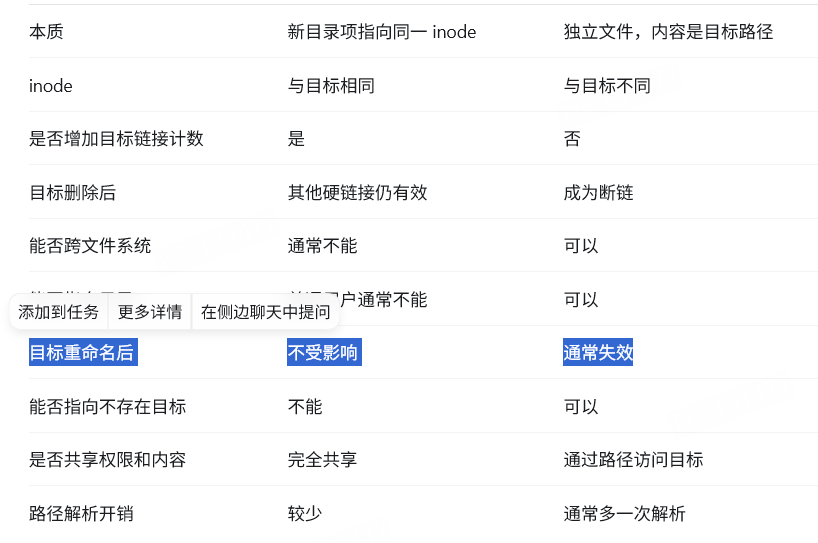

# 操作系统：
### 操作系统基本：
我们使用手机电脑中，有软件存在，也有硬件如内存\CPU的存在，我们需要一个管理器来协调他们之间的数据流动与资源控制，并提供与使用者的接口，这就是操作系统。功能：进程管理、内存管理、设备管理、文件管理、用户接口。
### 系统调用：
应用程序要使用硬件资源时，使用的操作系统提供的接口。用户程序运行在用户态调用系统调用可以进入到内核态。
计算机操作系统通常是存储在硬盘上的，但在计算机启动时，通常会将操作系统的一部分代码程序即内核 kernel 加载到内存中以便于执行
### 用户态内核态：
CPU的两种状态，状态不同，对硬件有着不同的操作权限，后者可以执行特权指令：。eg：直接访问设备寄存器、发 IO 指令修改页表（改变内存映射）关中断、改系统关键配置随意读写物理内存、读别的进程地址空间，这样，运行在用户态的应用程序即使崩溃，也只影响自己。    
### 四大特征：并发、共享、异步、虚拟
## 内核：
操作系统里最核心、最高权限的那部分代码，运行在内核态，负责直接管理硬件资源，并向上提供系统调用等接口给应用程序用
### 作用：
进程调度、内存管理、IO管理、文件系统与存储、网络协议栈
### 启动：
预备：在内存的ROM（主板上的非易失内存）中存放着BIOS，启动操作系统最开始的程序
## 文件管理：
块（block）”指的是文件系统在磁盘上进行分配与读写的基本单位，也常叫磁盘块 / 文件系统块。磁盘（SSD/HDD）存储空间被切成一块一块固定大小的区域 4kb
```
按关键字找到记录
        ↓
确定记录在文件中的字节偏移
        ↓
确定它属于文件的第几个逻辑块
        ↓
操作系统找到对应的物理磁盘块
```
#### 一次读的系统调用：

##### open：
```
open/openat：进入内核。
内核解析路径，逐级查目录和文件。
检查文件是否存在、访问权限是否满足。
创建内核文件对象，放进进程的文件描述符表。
返回文件描述符fd。
```
##### read:
根据fd从pagecache（物理内存，RAM）或者磁盘I/O来读取

##### close
关闭fd


### 逻辑结构：文件内部的记录怎么组织
第一类为顺序结构，即每条记录是按顺序存储的，对于文件的记录其分为定长记录文件和不定长记录文件，对于顺序结构来说，显然定长记录的文件更加适合这种方式，能过进行随机存取。
```
顺序文件适合：
批量处理。
日志。
按时间或编号遍历。
经常读取全部记录的场景。
```
第二类为索引结构，即对每个文件都建立一个索引表，用此索引表来记录该文件中的所有记录，能够快速查找，但是比较浪费空间。
```
索引文件额外建立一个“关键字 → 记录位置”的索引。
例如：
索引表
学号      记录位置
1001  →   地址A
1002  →   地址B
1003  →   地址C
查询学号 1003 时：
在索引中查找 1003
        ↓
得到记录地址C
        ↓
直接读取对应记录
```
第三类则为索引顺序文件，对于索引顺序文件是索引文件和顺序文件的集合体，即将一个文件中的记录按几个分成一段，对于每段的开头都作为一个索引表项目，在索引表中进行顺序查找，再在各个块中也进行顺序查找，对于索引表中的各个项目是需要有序的\n
```
索引顺序文件是“记录有序排列 + 稀疏索引”的结合。
假设记录按学号排序，并按块分组：
数据块1：1000～1099
数据块2：1100～1199
数据块3：1200～1299
只为每个数据块建立一个索引项：
索引表
1000 → 数据块1
1100 → 数据块2
1200 → 数据块3
```

### 物理结构：
1.顺序分配方式，即在外存的磁盘块中找到一片连续的磁盘块空间并分配出去，此种方式对于读取的速度会比较快并且能支持随机访问，但是缺点在于会造成外部碎片，即使有空闲的空间但是不连续就不能分配。
2.链接的方式，主要分为两类，第一类为隐式链接，即在每个文件的每个磁盘块的末尾添加一个指向下一个磁盘块的指针，这样的方式对于目录项会存储文件的控制信息和文件名，隐式链接分配只能顺序查找，查找速度比较慢，但是增加和删除较为方便其次是显示链接分配，即在外存中专门设置一张FAT，FAT中记录所有块位置
```
FAT 可以被缓存到内存，因此比每次读取磁盘块末尾的指针更快。但从算法上说，查找第 \(n\) 个块仍可能需要沿链走 \(n\) 次。
```
3.索引：可以多级索引，即查找文件块，里面存储的是下一层所有文件块的位置。
```
索引分配为每个文件保存一张“逻辑块号 → 物理块号”的表。
例如：
文件索引
逻辑块0 → 物理块80
逻辑块1 → 物理块12
逻辑块2 → 物理块37
查找文件逻辑块1时，可以直接得到物理块12，不需要沿链遍历。
优点：
支持随机访问。
文件块不需要连续。
文件扩展比连续分配方便。
一个数据块损坏通常不会切断整条链。
缺点：
索引本身占空间。
大文件需要保存大量块地址。
小文件可能用不完整个索引块，造成浪费。
```
4.多级索引：

### 文件的读写访问控制
为读写控制表，对于每个用户都标注出来其访问权限，对于每一项都消耗一位。其次另两种分别为密码和口令
### 文件共享
```
在 Unix/Linux 文件系统中，文件名通常不存放在 inode（索引节点）里。目录主要保存：
文件名 → inode 编号
inode 再保存：
inode
├── 文件类型
├── 权限
├── 所有者
├── 文件大小
├── 时间信息
├── 硬链接计数
└── 数据块地址
因此：
目录项负责“名字”
inode 负责“文件本体和元数据”
```
硬链接是指多个目录项所带的索引节点号是相同的，即多个目录项指向同一个索引节点，此种方法肯定也是要有引用值的。本质：在另一个目录中增加一个新的“文件名 → inode 编号”映射。inode 中有硬链接计数，当硬链接计数为 0，并且没有进程继续打开这个文件时，文件系统才真正回收 inode 和数据块。
```
硬链接通常不能跨文件系统：
文件系统1的 inode 100
不等于
文件系统2的 inode 100
inode 编号只在所属文件系统内部有意义，所以不能让一个目录项直接指向另一个文件系统的 inode。
普通用户通常也不能为目录创建硬链接，否则容易形成目录环：
```
软链接是指，设置一个文件，这个文件成为链接类文件，类似快捷方式一样，这个文件和正常的文件一样，只不过它的磁盘块中存储的共享的文件的路径，通过访问这个文件从而获得要共享文件的路径，从查找这个路径去访问这个文件，这种方式显而易见，会多次访问磁盘速度较慢。
```
/tmp/b.txt
    ↓
inode 200（符号链接）
    ↓
路径字符串 "/home/a.txt"
    ↓ 重新解析路径
/home/a.txt
    ↓
inode 100（普通文件）
    ↓
数据块
```

### 文件空闲空间的管理
第一种是分区表法，类似与动态分区分配，分区表的每个表项中都存储中分区的起始块和有多少块。

```
优点：
连续空闲空间较多时，表非常小。
容易一次分配多个连续块。
适合 extent 分配。
缺点：
磁盘碎片严重时，表项会非常多。
分配时可能需要遍历空闲表。
释放时需要进行相邻空闲区合并。
```
第二种方式则是分区链法和分块链法，对于这两种都是将空闲的块或者分区链接在一起，但是若是块太多了则会导致链太长了查找比较麻烦。

```
优点：
实现简单。
分配、释放单个块很方便。
指针存在空闲块自身，不需要大型独立表格。
缺点：
要寻找很多块时，必须沿链表遍历。
链表可能很长。
很难快速找到一批连续空闲块。
遍历链表可能造成多次磁盘访问。
某个链指针损坏可能导致后续空闲块丢失。
```

第三种方式是位示图法，对于此种方式，是设置一个大的表格，表格的每一项表示一个块，若是1则为空闲若是0则是非空闲，但实际存储中还是由一个个块存储的，只是逻辑上是图表的形式，对于每一个块只需要一个byte位来存储。
```
每个块只占一个 bit，空间利用率高。
可以使用 CPU 位运算快速扫描。
容易统计空闲块数量。
比链表更容易寻找连续空闲块。
可以随机检查某个块是否空闲。
缺点：
位图大小与磁盘总块数成正比，即使磁盘几乎没有空闲空间，位图仍然一样大。
超大文件系统的位图无法始终全部放在内存中。
扫描接近全满的位图可能耗时。
修改位图后必须保证它与实际块分配状态一致。
```

第四种方式是成组链接法，对于此种方式会设置一个盘块栈，每个盘块栈也是一个盘块，此种方法中每个盘块栈的第一个盘块会指向下一个盘块栈的位置并标识那个盘块栈中盘块的数量
```
避免逐块遍历很长的链表。
大多数分配和释放只操作内存中的空闲栈。
只有组用完或栈满时才需要读写链接块。
不需要单独建立覆盖整个磁盘的大表。
缺点：
实现比普通链表复杂。
不适合快速寻找大量连续块。
链接块损坏可能影响后续空闲组。
现代大规模文件系统通常更倾向位图、extent 树等结构。
```