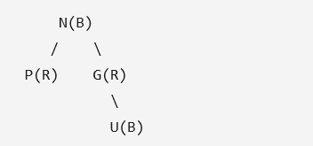

# 1.9 STL 与常用算法

<!-- course-navigation:start -->
[上一节：1.8 模板](templates.md) · [本章目录](README.md) · [下一节：1.10 进程、线程与同步](processes-threads-and-synchronization.md) · [手册首页](../README.md)
<!-- course-navigation:end -->

STL 把“如何存数据”和“如何处理数据”分开：容器保存元素，迭代器描述访问位置，算法处理迭代器区间；函数对象提供比较等行为，适配器改变接口，分配器管理存储。先根据访问模式选容器，再检查算法要求和失效规则，比只记复杂度更有用。

本篇前半是标准库容器和算法，后半保留堆、空间划分、编码与寻路的复习笔记。实现结构会标为常见实现；复杂度与接口保证不能和某份标准库源码混为一谈。

建议先带着“背包放物品、成绩按名字查、移除无效元素”三个问题阅读容器接口，再学习迭代器和算法。红黑树修复、Robin Hood 哈希、空间结构与寻路是进阶部分，需要先掌握相应的树、图概念。[C++17 语言实验](../examples/course/cpp-language-labs.cpp)的 `stl_labs` 把本篇新增的状态推演写成断言，不会依赖某个库恰好采用的扩容倍数或内存布局。

## 1.9.1 顺序容器：数据顺序由程序维护

| 容器 | 存储与访问特点 | 常见取舍 |
| --- | --- | --- |
| `vector` | 元素连续，随机访问 | 尾部操作高效，中间插删要搬移 |
| `deque` | 随机访问，常见实现分块 | 两端操作方便，不保证整体连续 |
| `list` | 双向链表 | 已知位置插删稳定，查找和缓存局部性较弱 |
| `forward_list` | 单向链表 | 节点开销较低，只能向前遍历 |
| `array` | 编译期定长、连续 | 大小不变，保留数组长度信息 |
| `string` | 字符串对象，可按字符序列访问 | 有连续字符接口及字符串专用操作 |

### 1.9.1.1 `vector`：区分大小、容量和对象自身

普通 `vector<T>` 的常见实现用三个边界描述连续存储（`vector<bool>` 特殊）：

```text
start               finish                 end_of_storage
  ↓                    ↓                         ↓
  [ 已构造的元素 ... ] [ 已分配但未构造的容量 ... ]
  └──── size ────────┘
  └──────────────── capacity ────────────────────┘
```

libstdc++ 的一些实现字段名是 `_M_start`、`_M_finish`、`_M_end_of_storage`。不能断言 vector 永远“只有三个指针”，分配器和调试检查等也可能影响布局。vector 对象可以是局部变量、成员或动态对象，其元素存储通常另由分配器取得；不是“指针固定在栈上，数据固定在堆上”的语言规则。

尾插 `push_back` / `emplace_back` 的复杂度摊还为 O(1)，单次扩容仍可能为 O(n)；中间插入、删除需要移动后续元素，通常为 O(n)。连续布局有利于遍历、批量处理和缓存预取。

#### 1.9.1.1.1 `reserve`、`resize` 与缩容

```cpp
std::vector<int> v{1, 2};
v.reserve(8);                   // capacity 至少 8，size 仍为 2
v.resize(4);                    // size 为 4，新增两个 int 元素为 0
v.resize(1);                    // 销毁尾部三个元素，容量不因此自动变小
```

参数的单位是元素数，不是字节。`reserve` 不构造额外元素，因此 `reserve(8)` 后不能把 `[size, capacity)` 当已有对象随意下标访问。

用一个背包把“预留位置”和“放入物品”区分开：

```cpp
std::vector<int> bag{10, 20};
bag.reserve(8);
const auto reserved = bag.capacity(); // 至少为 8，具体值由实现决定
bag.push_back(30);                     // size == 3，内容 10 20 30
bag.resize(5);                         // size == 5，内容 10 20 30 0 0
bag.resize(1);                         // size == 1，只剩 10
// bag.capacity() == reserved；不能访问 bag[1]。
```

预留之后这些操作没有超出容量，所以无需重新分配；但 `resize(1)` 已销毁末尾元素，旧槽位仍有内存不等于对象仍可访问。实验 [vector_state()](../examples/course/cpp-language-labs.cpp) 检查每一步内容、大小与容量关系。若需求是生成 8 个可访问的元素，应该 `resize(8)`，不是只 `reserve(8)`。

`shrink_to_fit()` 是非强制请求：实现可以忽略；若发生重新分配，元素地址会变化。新建较紧凑的 vector 再 `swap` 也是常见释放多余容量的办法，但会有复制/移动与分配成本，容量也不应脱离实现要求假设恰好等于 size。

原笔记提到“每次插查删搬一部分旧数据”，这是自定义表的渐进迁移思路，不能直接套进标准 `vector`：它必须持续提供连续元素区间和相应地址语义。降低 vector 扩容峰值的常用办法是预估并 `reserve`，或改用分块等更合适的数据结构。

#### 1.9.1.1.2 迭代器、指针、引用何时失效

| 操作 | 失效范围 |
| --- | --- |
| 扩容等导致重新分配 | 所有元素的迭代器、指针、引用，以及旧 `end()` |
| 插入但未重新分配 | 插入位置及其后的迭代器、指针、引用，包括旧 `end()` |
| 擦除 | 被删除位置及其后的迭代器、指针、引用，包括旧 `end()` |

vector 没有 `rehash`，那是无序关联容器的操作。[标准草案：vector 修改与失效规则](https://eel.is/c++draft/vector.modifiers)

#### 1.9.1.1.3 `push_back` 与 `emplace_back`

`push_back` 接受已经形成的 T 对象，再拷贝或移动到末尾；`emplace_back(args...)` 把参数转发给目标位置的 T 构造函数。后者不是任何情况下都更快：传入现有左值仍会拷贝，传入现有右值仍可能移动。

```cpp
struct Player {
    explicit Player(int hp) : hp(hp) {}
    int hp;
};
std::vector<Player> players;
// players.push_back(10);       // 错误：不允许隐式转为 Player
players.push_back(Player{10});  // 显式创建临时对象，再移动/拷贝
players.emplace_back(10);       // 在目标位置直接调用 Player(int)

Player p{20};
players.emplace_back(p);        // 仍是拷贝 p
```

`emplace_back` 不是“无视 explicit”，而是直接初始化本来就允许调用 explicit 构造函数。扩容时对旧元素的搬迁也不会因为使用 emplace 而消失。

#### 1.9.1.1.4 扩容为什么关心 `noexcept`

异常会沿调用链寻找处理器：

```cpp
void B() { throw 123; }
void A() { B(); }
int main() {
    try { A(); }
    catch (int error) { /* 此处 error == 123 */ }
}
```

强异常保证表示操作失败后，受保证的状态不变。例如 vector 在新存储里逐个复制旧元素，复制到一半失败，可以销毁已复制的新元素、释放新存储，而旧元素未被修改。

移动则可能已经改变源元素，途中抛异常时难以完整回滚。因此当 T 可复制但移动可能抛出时，vector 常选择拷贝；若移动不会抛出，便可放心转移。`std::move_if_noexcept` 表达了类似选择：不抛移动或不可拷贝时提供右值，否则提供 `const T&`。

```text
复制失败：销毁新区域的已构造元素，原区域通常可保持不变
可能抛异常的移动失败：原区域可能已经有部分元素被移走
noexcept 移动：正常完成；若异常逃出，则调用 std::terminate
```

`noexcept` 的承诺是异常不能逃出函数，不是函数内部绝不能抛：

```cpp
void B() noexcept {
    try { throw 123; }
    catch (...) { /* 内部处理，不让异常逃出 */ }
}
```

若 T 不可复制且移动可能抛异常，vector 仍可能必须使用移动，此时某些操作的强保证不再成立；不能写成“没 noexcept 就一定拷贝”。上述行为也依具体操作的标准条款，不能推广为容器任何失败都能回滚。[标准草案：异常终止](https://eel.is/c++draft/except.terminate)

#### 1.9.1.1.5 `vector<bool>`：为什么取不到 `bool&`

`vector<bool, Allocator>` 是为 bool 提供的特殊版本，允许空间优化，常见实现按位压缩。普通 `vector<int>` 存的是 int 对象，`sizeof(int)` 不一定是 4；普通 `vector<char>` 中每个 char 占一个 C++ 字节；压缩 bool 则不是每个元素都对应一个可寻址 bool 对象。

```cpp
std::vector<int> values{1, 2, 3};
int& x = values[0];
x = 10;

std::vector<bool> bits(10);
bits[0] = true;
// bool& b = bits[0];           // 错误：返回的是代理引用
// bool* p = &bits[0];          // 不能据此取得 bool 元素地址
```

`std::vector<bool>::reference` 代理“存储单元里的某一位”，赋值时修改位，读取时转换成 bool。`auto x = bits[0]` 也可能保留代理而不是独立 bool 值，复习时要和普通 T 引用分开记。[标准草案：vector<bool>](https://eel.is/c++draft/vector.bool)

### 1.9.1.2 `deque`：分块存储支持双端操作

常见实现有两层：一个中控目录保存数据块指针，每个块内部连续，但块之间不必连续。随机访问会计算“第几个块 + 块内偏移”，所以能做到 O(1)，却没有 vector 那种单段连续保证。

尾部块未满时直接构造；满时增加新块。头部插入类似，通过起始位置/偏移管理前面的可用空间。目录不够时可能重新分配并复制块指针，已有元素所在的数据块不必因此整体搬迁。块大小、备用块策略、目录布局由标准库实现决定，常参考 `sizeof(T)` 选择块内元素数。

标准规定单元素两端插入为常数复杂度，但真实系统仍有分配和目录管理延迟，不能把 O(1) 理解成任何一次插入都耗时相同。

- 两端插入：既有元素的引用/指针保持有效，迭代器失效。
- 中间插入：既有元素的迭代器、引用/指针可能全部失效。
- 两端擦除：失效主要涉及被删元素；删除末元素还会影响旧 `end()`。
- 中间擦除：会使所有相关迭代器/引用失效，不能套用链表规则。

这些是接口保证，不能只靠“这次目录没有扩容”自行判断迭代器还能用。[标准草案：deque 修改规则](https://eel.is/c++draft/deque.modifiers)

如果队列最大容量已知，可考虑预分配 ring buffer：读写索引绕回，省去不断分配；需要另外处理满/空区分、覆盖策略和并发，不能仅用“两个指针取余”就认为完整。

### 1.9.1.3 `list` 与 `forward_list`

`list` 常见为双向链表，`forward_list` 为单向链表。已知正确位置时，单个节点插入/删除不需要像 vector 那样搬移整段元素；插入一般不影响既有迭代器，删除只使被删元素的迭代器/引用失效。

“中间插删快”的前提是位置已经找到。为了找第 n 个元素而遍历仍是 O(n)，没有随机下标访问。每个节点有链接和分配开销，地址离散导致缓存不友好。

工程里常优先考虑 vector：遍历和批处理频繁，很多所谓“频繁插入”实际是尾插。中间插删是否值得换链表，要结合元素搬移成本、规模和访问模式测量，不能只比较一个 O(1) 与 O(n)。

### 1.9.1.4 原生数组、`array` 与 `vector` 的区别

```cpp
int raw[10]{};
std::array<int, 10> fixed{};
std::vector<int> dynamic(10);
std::array<int, 3> a{1, 2, 3};
```

原生数组和 `std::array` 的元素直接位于对象内部；对象放哪里取决于它的存储期，不必一定在栈上。vector 的元素通常单独分配，默认分配器下上面的 10 个 int 会初始化为 0，同时产生初始化写入和可能的分配成本。

`array` 保留固定长度和对象类型，传参不自动退化成指针；按值传参会复制整个数组。支持迭代器、范围 for、`size()` 等接口，`at()` 越界抛异常，`operator[]` 仍需要调用方保证合法下标。原生数组也支持指针迭代和范围 for，并不是完全不能使用标准算法。

常见 `array` 实现就是包装一个原生数组，通常没有额外动态分配。但不能跨平台断言 `array<int, 10>` 恰好 40 字节：int 大小和布局由实现决定，零长度数组还有特殊情况。

`string` 可作为连续字符容器使用，其 `data()` / `c_str()` 细节放在后面的迭代器与连续访问部分。

## 1.9.2 有序关联容器：键的顺序是接口的一部分

| 容器 | 存什么 | 是否允许等价键 |
| --- | --- | --- |
| `set` | 键 | 否 |
| `multiset` | 键 | 是 |
| `map` | 键值对 | 否 |
| `multimap` | 键值对 | 是 |

这里的顺序由比较器定义，不必都是数值升序；“重复”按比较器的等价关系判断。键查找、按键插入和按键定位通常具有对数复杂度，遍历按键序进行。

```cpp
std::set<int> s{3, 1, 2};
for (int x : s) { std::cout << x << ' '; } // 1 2 3

std::map<std::string, int> scores;
scores["a"] = 1;
scores["b"] = 2;
std::cout << scores["a"];
```

`map::operator[]` 在键不存在时会插入，不是纯只读查找。`multimap` 没有同样的单值下标语义。

查一个未上榜的玩家时，两种写法会留下不同状态：

```cpp
std::map<std::string, int> scores{{"Ninja", 10}};
auto missing = scores.find("Mage");
bool found = missing != scores.end(); // false，size 仍为 1
int default_score = scores["Mage"];   // 0，插入新键，size 变为 2
```

`find` 返回尾后位置表示没有找到，必须先检查再解引用；`operator[]` 则为缺失键创建一个默认初始化的 `int`，此处为 0。只读查询优先选不插入的接口；确实需要“没有就建立记录”时，下标才符合意图。[map_lookup()](../examples/course/cpp-language-labs.cpp) 验证两次操作对容器大小的影响。

插入不使已有元素的迭代器/引用失效；删除只使被删元素对应者失效，`clear()` 当然会使所有元素访问失效。原先“绝对不会失效”只能用于相应的插入保证，不能推广到任何操作。[标准草案：关联容器](https://eel.is/c++draft/associative.reqmts)

### 1.9.2.1 红黑树：常见实现，而非标准指定的唯一结构

二叉搜索树通过键序组织节点，中序遍历有序；普通二叉搜索树可能退化为链，查找降为 O(n)。AVL 树要求左右子树高度差不超过 1，是一种严格平衡方式；并非所有“平衡二叉树”都使用这个判据。

红黑树用颜色规则维持足够的平衡，常见性质如下：

- 节点为红或黑；根为黑，空叶哨兵 NIL 视为黑。
- 红节点的孩子不能为红。
- 从同一节点到各后代 NIL 的路径具有相同黑节点数。
- 因此最长根叶路径不超过最短路径的两倍，树高为 O(log n)。

### 1.9.2.2 插入后的修复

按二叉搜索树插入新红节点，常见冲突是父子连续为红；若成为根则最后涂黑。以新节点 N、父 P、祖父 G、叔 U 复习：

1. P 为黑：结束。
2. P、U 都红：P 和 U 涂黑，G 涂红，把 G 当作新的检查节点继续向上。
3. P 红、U 黑，N/P/G 为折线：先绕 P 旋转，把形状变成直线。
4. P 红、U 黑，三者为直线：P 涂黑、G 涂红，绕 G 旋转，使 P 成为该局部子树根。



原图保留为反例：经 `U(B)` 的根叶路径比经 `P(R)` 的路径多一个黑节点，因此这张图本身还不满足黑高一致性。图中的字母也未采用上文“新节点/父/祖父/叔”的相对命名，不能直接照字母套插入修复步骤。

部分实现用 header/sentinel 节点缓存根、最小和最大节点，以便 `begin()` 等操作；header 是否红色、各指针具体含义属于实现细节，不是所有 STL 必须采用的结构。

### 1.9.2.3 为什么小型只读映射可能选有序数组

树节点分散分配，会增加指针追踪、缓存未命中和分配器负担。若数据“一次构建、多次读取”，可把 `std::vector<std::pair<Key, Value>>` 按键排序，再二分查询，获得连续存储的局部性。

代价是插入/删除要搬移，自己还要维护排序和重复键规则，地址也不稳定。几百或几千个元素并不是固定分界线，是否更快取决于键/值大小和读写模式。需要范围查询、前驱后继、稳定迭代器或持续有序更新时，有序关联容器仍很适合。

## 1.9.3 无序关联容器：平均查找速度与分布有关

`unordered_set`、`unordered_map`、`unordered_multiset`、`unordered_multimap` 按哈希组织。它们不提供按键排序的遍历；前两者键唯一，后两者允许等价键。平均查找可为 O(1)，最坏可能为 O(n)。

哈希值不是天然的数组下标：哈希函数先把 key 映射为值，再通过桶映射规则定位桶。性能受哈希分布、装载因子、冲突策略和扩容影响。相等比较认为等价的键必须给出相同哈希。

### 1.9.3.1 桶、拉链法与内存局部性

主流标准库常使用节点式哈希表和桶目录。发生冲突的元素通过链式结构等组织，节点地址可以在 rehash 后保持稳定；标准规定桶接口和有效性等要求，没有强制“每桶恰好一个独立单链表指针”的源码布局。

链地址法把同桶元素放在链表、小数组等结构中，装载因子可以超过 1，但链越长，查找越慢。独立节点分配可能带来 cache miss 和碎片。内存池/自定义分配器可把节点集中管理，但需正确处理对齐、构造（例如 placement new）、析构和释放，并不要求“每个哈希值固定对应一整块内存”。

### 1.9.3.2 开放定址与 Robin Hood 哈希

开放定址把元素直接放进槽位数组，冲突后按规则探测其他槽位，局部性通常较好。线性探测容易形成连续占用区，即主聚集；负载接近满表时，查找和插入成本会明显增加，还要设计删除后的空洞/墓碑规则。

Robin Hood 插入比较探测距离 PSL：若当前待插入元素离理想位置更远，就与占位元素交换，让后者继续探测，倾向于均衡各元素的探测距离。它能改善探测长度分布，但不保证不存在最坏情况，也不能“从根本上消除所有拥堵”。这类设计是理解哈希表的补充，不代表 `std::unordered_map` 必须这样实现。

### 1.9.3.3 `rehash` 与失效规则

装载因子是 `size / bucket_count`。插入可能为满足 `max_load_factor` 增加桶数，也可显式 `rehash` / `reserve`。以节点式表把 8 桶改为 16 桶为例：分配新目录，遍历节点，计算新桶归属，重新连接节点，再释放旧目录。取模只是桶映射的一种方式，桶数也不必恰好翻倍。

rehash 改变桶和遍历结构，使迭代器失效，但既有元素的指针和引用保持有效；删除只使被删元素的迭代器/引用失效；插入未触发 rehash 时，既有迭代器按相应保证保持有效。不能把这个规则移用到 vector。[标准草案：无序关联容器](https://eel.is/c++draft/unord.req)

实验中只保留标准保证仍有效的引用：

```cpp
std::unordered_map<int, std::string> names{{1, "Ninja"}};
std::string& borrowed = names.at(1);
names.rehash(names.bucket_count() + 1); // 请求比当前更多的桶
borrowed += "!";
// names.at(1) == "Ninja!"
```

桶结构改变了，原元素本身仍在；所以 `borrowed` 仍能修改它。不要保留旧迭代器来验证“这次是不是还能用”，失效迭代器不能再按正常位置操作。[hash_reference()](../examples/course/cpp-language-labs.cpp) 验证引用有效性，不假定桶数采用质数或二次幂。

## 1.9.4 迭代器：统一接口，也有能力等级

vector 可以下标随机访问，list 不能，set 和 map 又按键组织。算法不必知道每个容器的内存结构，而是通过迭代器表达“当前位置”和“如何前进”。原生指针是迭代器的一种形式，迭代器也可以是封装节点、块目录等信息的类。

标准算法常用半开区间 `[first, last)`：包含 first，不包含 last。`begin()` 指向首元素，`end()` 是尾后位置，不可解引用；空容器中两者相等。`cbegin()` / `cend()` 返回只读访问的迭代器。

```cpp
std::vector<int> v{1, 2, 3};
auto it = v.begin();
std::cout << *it;               // 1
++it;                          // 下一个位置
if (it != v.end()) { std::cout << *it; }

std::vector<std::string> words{"abc"};
auto word = words.begin();
std::cout << word->size();      // 等价于 (*word).size()
```

“只读迭代器”不等于“迭代器对象不可移动”：`const_iterator` 可以递增，只是不能借它改元素；`const iterator` 限制的是迭代器变量自身。

### 1.9.4.1 分类与原例子

| 类别 | 核心能力 | 典型例子 |
| --- | --- | --- |
| 输入 | 读取、向前，可能是单遍 | `istream_iterator` |
| 输出 | 写入目标、向前，不要求可读取 | `ostream_iterator`、`back_inserter` |
| 前向 | 多遍向前访问 | `forward_list`，无序容器的迭代器 |
| 双向 | 前向能力加 `--` | `list`、有序关联容器 |
| 随机访问 | O(1) 跳转、距离和位置比较 | `vector`、`deque` |
| 连续（C++20 概念） | 随机访问且元素地址连续 | 原生数组指针、普通 vector、array |

这些等级主要描述遍历能力，不意味着前向及更强迭代器一定能写。`set` 的键和 const 容器的元素不能通过相应迭代器修改；`vector<bool>` 也不满足普通 vector 的连续元素模型。

**输入流**保留一次性数据来源的例子：

```cpp
#include <iostream>
#include <iterator>

int main() {
    std::istream_iterator<int> in(std::cin);
    std::istream_iterator<int> end;
    while (in != end) {
        std::cout << *in << '\n';
        ++in;                  // 尝试读取下一个整数
    }
}
```

输入迭代器复制出来的旧位置不能普遍当成独立游标反复遍历；流不是可回到过去的容器。`std::cin` 是标准输入流对象，通常连到终端，也可重定向；输入结束或格式读取失败会结束上面的循环。

**输出流**提供只写目标：

```cpp
#include <iostream>
#include <iterator>
#include <vector>

int main() {
    std::vector<int> v{1, 2, 3};
    std::ostream_iterator<int> out(std::cout, " ");
    for (int x : v) {
        *out = x;              // 输出 x 和分隔符
        ++out;
    }
}
```

`cin >> x` 从流读取数据，`cout << x` 向流写入数据；“流”强调按序处理数据，而不是一次把全部内容交给使用者。标准流可能有缓冲，不意味着每个表达式都立即发生物理 I/O。

**前向和双向**：

```cpp
std::forward_list<int> fl{1, 2, 3};
auto forward = fl.begin();
std::cout << *forward;          // 1
++forward;
std::cout << *forward;          // 2
// --forward;                  // 不支持

std::list<int> lst{10, 20, 30};
auto both = lst.begin();
std::cout << *both;             // 10
++both;
std::cout << *both;             // 20
--both;
std::cout << *both;             // 10
// both + 2;                   // 不支持随机跳转
```

**随机访问与连续**：

```cpp
std::vector<int> v{10, 20, 30, 40, 50};
auto it = v.begin();
auto last = v.begin() + 4;
std::cout << *it;               // 10
std::cout << *(it + 2);         // 30
std::cout << it[3];             // 40
std::cout << last - it;         // 4
if (it < last) { /* it 位置靠前 */ }

int* p = v.data();
std::cout << p[0] << ' ' << p[1] << ' ' << p[2];
int arr[]{1, 2, 3};
int* raw = arr;
std::cout << *(raw + 1);        // 2
```

相减和位置比较需满足相应迭代器的有效范围条件，不能随便比较不同容器的位置。deque 能随机跳转，但不能用一个元素地址加 n 来跨越整个容器。

### 1.9.4.2 `.data()`、`c_str()` 与生命周期

连续容器的 `data()` 提供底层元素指针，并不转移所有权；容器销毁或使地址失效的修改后，借出的指针也不能继续用。

C++11 起 `std::string::data()` 提供以空字符结尾的连续字符序列，`c_str()` 也提供 C 字符串接口；C++17 起非 const string 的 `data()` 还返回可写字符指针，但不能越过合法范围写，也不能通过它自行扩容。

```cpp
const char* p = "hello";
std::string s = p;              // 从以空字符结尾的序列构造
const char* borrowed = s.c_str();
```

如果原数据可能含内嵌 `\0`，要结合长度使用，不要把“字符容器长度”与“C 字符串扫描到的长度”混淆。

## 1.9.5 算法与容器配合

### 1.9.5.1 查找、排序和逆序

```cpp
std::vector<int> v{3, 1, 2};
auto it = std::find(v.begin(), v.end(), 2);
if (it != v.end()) { /* 找到 2 */ }
std::sort(v.begin(), v.end());    // 1 2 3
std::reverse(v.begin(), v.end()); // 3 2 1
```

`find` 对一般区间逐个比较，O(n)。`sort` 要求随机访问迭代器，不能直接拿 list 的迭代器调用；list 自己有成员 `sort()`。`reverse` 要求双向迭代能力。

`std::sort` 不保证稳定，即等价元素的原相对顺序可能改变。常见内省排序实现先快速划分，递归深度达到阈值时改用堆排序，小区间用插入排序。标准要求相应的 O(n log n) 比较复杂度，但不强制这个算法组合。[标准草案：sort](https://eel.is/c++draft/sort)

### 1.9.5.2 二分边界和树容器的成员查找

按默认升序比较时：`lower_bound(x)` 找首个不小于 x 的位置，`upper_bound(x)` 找首个大于 x 的位置。区间必须针对相应比较条件已分区，整体按同一规则有序是常用充分条件，不能在任意乱序数组上二分。

```cpp
std::vector<int> values{1, 2, 3, 3, 5};
auto lower = std::lower_bound(values.begin(), values.end(), 3);
auto upper = std::upper_bound(values.begin(), values.end(), 3);
// [lower, upper) 对应两个 3。

std::set<int> s{1, 2, 3, 4, 5};
auto it = s.lower_bound(3);
```

原生数组、vector、deque、string 都方便使用通用二分。list 等前向/双向迭代器也可用于相应算法，比较次数仍可为 O(log n)，但迭代器前进总成本可能是 O(n)。set/map 应优先用成员 `lower_bound` / `upper_bound`，它们可沿树结构直接查找。

### 1.9.5.3 函数对象：给算法传行为

```cpp
struct Add {
    int operator()(int a, int b) const { return a + b; }
};
```

函数对象有具体类型，可携带状态，编译器也更容易看到调用目标并尝试内联，但内联不是保证。常用的 `std::less<T>`、`std::greater<T>` 就是比较函数对象。

```cpp
std::priority_queue<int, std::vector<int>, std::greater<int>> pq;
// 最小元素在 top()，greater<int> 指定比较关系。
```

Lambda 也是函数对象的一种；需要统一存放不同可调用类型时，可读[关键字与可调用对象](cpp-keywords-and-callables.md)。排序比较器等必须满足相应的严格弱序，不能用 `<=` 随意替代 `<`。

### 1.9.5.4 `erase-remove`：删除元素而不只是改区间

```cpp
observers_.erase(
    std::remove(observers_.begin(), observers_.end(), &observer),
    observers_.end());
```

这里的 `remove` **把需要保留的元素向前移动**，保持它们的相对顺序，返回新的逻辑末尾。它不改变容器 size，也不保证把所有待删值整齐搬到末尾；返回位置到旧 end 的元素处于有效但未指定状态。随后 `erase` 才真正销毁尾部元素并缩小容器。

例如 `[1, 2, 3, 2]` 删除 2 后，逻辑前段是 `[1, 3]`，不要依赖尾段具体内容。C++20 对相应容器可用 `std::erase` / `std::erase_if` 简化常见写法。[标准草案：remove](https://eel.is/c++draft/alg.remove)

把组合调用拆开，观察谁真正改变了大小：

```cpp
std::vector<int> values{1, 2, 3, 2};
auto logical_end = std::remove(values.begin(), values.end(), 2);
// size 仍为 4；[begin, logical_end) 是 1 3；尾段内容不作假设。
auto kept = std::distance(values.begin(), logical_end); // 2
values.erase(logical_end, values.end());
// size 变为 2，整个容器的内容才是 1 3。
```

算法拿到的是迭代器区间，无法借这个通用接口替容器释放尾部元素；成员函数 `erase` 才拥有调整容器大小的职责。实验 [erase_in_two_steps()](../examples/course/cpp-language-labs.cpp) 只检查第一步的有效前段，不检查未指定的尾段。之后 `logical_end` 已因擦除失效，不再继续使用。

## 1.9.6 适配器、分配器与堆

容器适配器拥有一个底层容器，对外限制为特定接口；不是“自己完全不存数据”。`stack` 默认使用 deque，只暴露后进先出；`queue` 默认使用 deque，提供先进先出；`priority_queue` 默认使用 vector，维护优先级堆。它们不提供普通容器的 `begin()` / `end()` 遍历接口。

迭代器适配器则包装位置或输出方式，例如 `reverse_iterator` 改变遍历方向，`back_inserter` 把输出赋值变成容器尾插。这部分原先只有空标题，现在与容器适配器放在一起区分。

分配器把“取得原始存储”和元素的构造/销毁等操作接到容器实现上。分配器感知容器通过 allocator 接口管理存储，默认一般用 `std::allocator`；这不等于所有标准容器都动态分配，比如 array 内嵌元素。

### 1.9.6.1 堆与优先队列

二叉堆维护父子优先级关系，不保证整个数组有序。大根堆的最大元素在根，小根堆的最小元素在根。priority_queue 的 `top()` 通常 O(1)，`push` / `pop` 的堆调整为 O(log n)；底层 vector 偶尔扩容还会带来额外搬迁成本。

堆排序可记成“建堆 → 根与末元素交换 → 缩小有效堆并下沉”：

- 逐个插入建堆是 O(n log n)。
- 从最后一个非叶节点（0 下标时 `n/2 - 1`）向前自底向上下沉，建堆为 O(n)。低层节点多但下沉高度小，高层节点少。
- 逐次取出极值并下沉，整体排序 O(n log n)，通常原地但不稳定。

## 1.9.7 空间数据结构与编码笔记

### 1.9.7.1 四叉树、八叉树与松散边界

四叉树通常递归把二维区域分为四块，八叉树对应三维八块，用空间层次缩小查询范围。具体如何放跨边界物体、何时继续细分，需要实现规则。

动态物体在边界附近往返，可能频繁迁移节点。松散四叉树/八叉树会把节点的有效包围区域扩大，相邻区域可以重叠，让物体在小幅移动时仍能保留原节点。查询时也必须使用扩大后的边界，不能只改插入逻辑。

原笔记的“入口边界 inner boundary、出口边界 outer boundary”可以作为带滞回的维护策略理解：首次插入按较小边界选择；已有对象只有越过较大边界才重分配，减少反复切换。这是相关实现思路，不是所有 loose tree 的唯一定义；还需明确物体包围体而非只看中心点，以及重叠区域中的归属规则。[Hanan Samet 团队的空间索引与 Loose Quadtree 示例](https://donar.umiacs.umd.edu/quadtree/)

### 1.9.7.2 BVH 与 KD 树

BVH（Bounding Volume Hierarchy）把对象分组，再为每组计算包围体，形成层次结构。包围体可以是 AABB、球等；子组包围体可能重叠，不要求像空间网格那样主动均分整个空间。

KD 树的 K 表示维数；每层通常选一个坐标轴和切分值，用轴对齐超平面分为两部分。在三维中切分面是一个平面，因此结构通常是二叉树。它与八叉树的区别主要是每次如何划分，不是“只有三维才能用”。

### 1.9.7.3 哈夫曼编码

哈夫曼编码按符号频率构建变长前缀码：高频符号倾向于使用短码，任何完整码字都不能是另一个码字的前缀，因此可以无歧义解码。

构建时反复合并两个最小权重节点，通常用小根堆维护候选。对给定频率，它在相应的逐符号前缀编码模型下优化平均码长；但不能保证任何文件都“大幅压缩”，还要算上码表、频率分布和已有压缩程度。

## 1.9.8 寻路：先看边权条件，再选算法

设 V 是顶点数、E 是边数。算法还需要图表示、距离数组和前驱记录；优先队列里的优先级通常由距离或估价决定。

| 算法 | 主要条件 | 核心顺序 | 常见复杂度 |
| --- | --- | --- | --- |
| BFS | 无权图或所有边权相同且非负 | 队列按层推进 | O(V + E) |
| Dijkstra | 边权非负 | 取暂定距离最小者 | 二叉堆版本 O((V + E) log V) |
| A* | 通常为非负代价，启发满足所需条件 | 取 g + h 最小者 | 与启发和重新展开策略有关 |
| Bellman-Ford | 允许负边 | 多轮松弛所有边 | O(VE) |
| DAG 最短路 | 有向无环，可有负边 | 拓扑顺序松弛 | O(V + E) |

### 1.9.8.1 BFS：最少边数就是最短距离的条件

BFS 用队列从起点逐层扩展，对无权图取得最少边数路径。所有边权都是相同正数 c 时，路径边数乘 c 就是距离。若边权不同，仅凭层数不足以比较代价，不能继续套用普通 BFS。

### 1.9.8.2 Dijkstra：每次确定当前距离最小的点

维护已确定距离和暂定距离。每次取出当前未确定的最小距离节点 u，再用它松弛所有出边：若 `dist[u] + w(u,v) < dist[v]`，就更新 v 的距离和前驱。

保留原例：

```text
A → B：4
A → C：1
C → B：2
B → D：1
C → D：5

初始化：A=0，B=∞，C=∞，D=∞
处理 A：B=4，C=1
取 C：B=min(4,1+2)=3，D=min(∞,1+5)=6
取 B：D=min(6,3+1)=4
取 D：结束
最终：A=0，C=1，B=3，D=4
```

非负边权保证一个已取出的最小距离不会被更晚经过其他点的路径降低。负边会破坏这个前提，即使当前距离较大的节点，之后也可能反过来提供更便宜的路径。允许边权为 0，但不允许普通 Dijkstra 任意处理负边。

使用不能 decrease-key 的优先队列时，常把新距离再次入队，并跳过过期条目。不同堆和图表示影响精确复杂度，不能只背一个公式当所有版本的上界。[Boost.Graph：Dijkstra](https://www.boost.org/doc/libs/latest/libs/graph/doc/html/graph/algorithms/shortest_paths/dijkstra_shortest_paths.html)

下面把原来的四个点落到 C++17 代码中。先学会 `vector`、`pair`、最小优先队列，再看这个综合实验；节点编号为 `A=0, B=1, C=2, D=3`：

```cpp
using Edge = std::pair<int, int>; // {终点, 权重}
std::vector<std::vector<Edge>> graph{
    {{1, 4}, {2, 1}}, // A -> B、C
    {{3, 1}},         // B -> D
    {{1, 2}, {3, 5}}, // C -> B、D
    {}                // D 没有出边
};
constexpr int infinity = 1'000'000; // 此教学小图的距离远小于它
std::vector<int> distance(4, infinity);
using Entry = std::pair<int, int>; // {暂定距离, 节点}
std::priority_queue<Entry, std::vector<Entry>, std::greater<Entry>> queue;
distance[0] = 0;
queue.push({0, 0});

while (!queue.empty()) {
    auto [cost, u] = queue.top(); // C++17 结构化绑定，复制后才能 pop
    queue.pop();
    if (cost != distance[u]) { continue; } // 较旧、较差的记录
    for (auto [v, weight] : graph[u]) {
        int candidate = cost + weight;
        if (candidate < distance[v]) {
            distance[v] = candidate;
            queue.push({candidate, v});
        }
    }
}
// distance 按 A B C D 的顺序为 {0, 3, 1, 4}。
```

需要 `<vector>`、`<utility>`、`<queue>`、`<functional>`。处理 A 时把 B 的 4 入队；经过 C 后又把 B 的 3 入队。两份记录都会存在，但弹出旧的 4 时，`distance[B]` 已为 3，于是跳过。D 的旧记录 6 也会被跳过。实验 [dijkstra_small_graph()](../examples/course/cpp-language-labs.cpp) 检查四个距离和这两次跳过，帮助理解“堆里记录”与“距离数组里的当前最佳值”并非同一份状态。

此代码跑到队列为空，计算所有可达点的距离；只求某个终点时，可在它以当前最佳距离出队后结束。本例固定节点编号有效、边权非负、加法不会溢出；接收外部图数据时必须验证这些前提，并按距离范围选择类型、处理溢出。它没有保存前驱，因此只得到距离；要输出实际路线，还需在成功松弛时记录前驱并回溯。不要直接改成允许负边的通用最短路函数。

### 1.9.8.3 A*：用剩余代价估计减少探索

```text
g(n)：目前已知的起点到 n 的最佳代价
h(n)：n 到目标的剩余代价估计
f(n) = g(n) + h(n)
```

Dijkstra 优先取 g 最小者；A* 取 f 最小者。启发函数不是凭方向随便加分，而要与移动规则和代价单位一致。

令 `dx = |x1-x2|`、`dy = |y1-y2|`，常见网格启发是：

| 移动规则 | 启发距离 |
| --- | --- |
| 四方向、每步 1 | 曼哈顿：`dx + dy` |
| 八方向、直走和斜走都为 1 | Chebyshev：`max(dx, dy)` |
| 八方向、直走 1、斜走 √2 | Octile：`max(dx,dy) + (√2-1)*min(dx,dy)` |
| 路径代价至少为欧氏长度 | 欧氏距离：`sqrt(dx*dx + dy*dy)` |

原先把 `max(dx,dy)` 泛称为所有八方向的对角距离，缺少斜走代价条件。欧氏距离也不能无条件套到所有“任意方向移动”游戏：传送门、加速地块或其他低价边可能使它高估。

**可采纳性**要求 `h(n)` 不超过真实剩余最短距离，并通常取 `h(goal)=0`。真实还要 10 时，估 7 或 10 都可，估 15 就不满足条件，可能使更好的路径被过早忽略。

**一致性**要求每条边满足 `h(u) <= w(u,v) + h(v)`，相当于与边代价匹配的三角不等式。这样沿路径的 f 不下降，标准图搜索中节点出队扩展后可按规则关闭。仅可采纳但不一致时，可能需要在找到更小 g 后重新打开已经扩展的节点；不能一边禁止重开，一边只凭可采纳就保证最优。

`h=0` 时 A* 退化为 Dijkstra。更接近真实下界的启发通常能减少搜索，但计算启发也有成本；即使完全准确，仍可能存在很多同代价候选，不能保证只扩展唯一最优路径。[Boost.Graph：A*](https://www.boost.org/doc/libs/latest/libs/graph/doc/html/graph/algorithms/shortest_paths/astar_search.html)

### 1.9.8.4 Bellman-Ford：允许负边，但要检测负环

它不提前永久确定某个节点，而是反复扫描所有边做松弛。在不存在从起点可达的负环影响时，最短路径可取简单路径，最多 V-1 条边，因此 V-1 轮后得到所需距离。

```text
第 1 轮后：至少覆盖所有最多经过 1 条边的最短路径
第 2 轮后：至少覆盖所有最多经过 2 条边的最短路径
……
第 V-1 轮后：无可达负环影响时，最短距离已确定
再做一轮仍可松弛：存在从起点可达的负环
```

使用上一轮副本更新时，可严格对应“最多 k 条边”的动态规划；原地扫描可能在一轮内传播多条边，所以“第 k 轮只找到 k 条边”并不精确。若某一轮没有更新可以提前结束。

可达负环允许不断绕圈降低代价，受它影响的目标不存在有限最短距离；算法不是“有负边就什么图都能给正常答案”。[Boost.Graph：Bellman-Ford](https://www.boost.org/doc/libs/latest/libs/graph/doc/html/graph/algorithms/shortest_paths/bellman_ford_shortest.html)

### 1.9.8.5 DAG：按拓扑顺序一次松弛

有限有向图存在拓扑排序，当且仅当它无环。可用带环检测的 DFS 逆后序，或用入度队列的 Kahn 算法；不是只有 DFS 一条路。

DAG 最短路按拓扑序处理节点和出边，可以有负边，因为没有环，不会需要回头反复改善已经处理的上游。包含拓扑排序在内，复杂度为 O(V + E)。

最后把接口和算法连起来检查：

1. 背包 `reserve(100)` 后 `size()` 为 0，能否写 `bag[0]`？不能，先构造元素；已分配容量不等于已有对象。
2. 删除指定值后容器长度没变，最可能漏了哪一步？只执行了 `remove`，还没执行成员 `erase`。
3. 原寻路图中 `A → B` 的 4 为什么不是 B 的最终距离？更晚发现的 `A → C → B` 总代价是 3；优先队列按暂定距离推进，B 的旧记录需要被识别并跳过。
