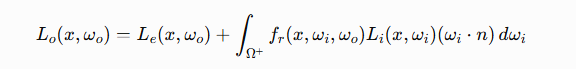
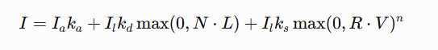
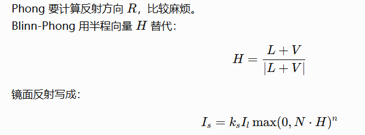

# 图形学相关知识


### MVP变换：
（1）首先要讲几个空间，首先是模型空间，就是自身的坐标系，然后是世界空间，是世界的一个原点的坐标系下，就相当于绝对坐标。随后是相机空间，基本上就是以相机为原点，相机视椎体中心射线为-z轴的坐标系，最后是透视坐标，因为相机人眼一般是视椎体，要把视椎体压成长方体，做归一化为正方体，这样就可以方便的做深度测试。（归一化设备坐标空间）
（2）MVP三个变换，就是从模型到世界，从世界到相机，从相机到透视空间的变化矩阵。
（3）具体怎么求：
```
M矩阵：先统一尺度，得到S，再旋转坐标系，得到R，最后移到原点，得到T，三个矩阵相乘就是M
V矩阵：计算出相机坐标系向世界坐标系变换的结果，求个逆，就是V矩阵。
P矩阵：三个条件：
视椎体内任意点经过矩阵变化后，x,y会具有相应变化，如相似三角形，
远平面点经过变化还是位置不变。
近平面中心点经过变化还是近平面的中心点。
方程联立，推出投影部分。
正交部分计算简单，已经是一个长方体了，只要给他移到原点，缩放乘1*1*1的正方体就好。
```

(4)屏幕空间：是最终将图形渲染到屏幕上所使用的坐标系统。屏幕空间的坐标通常以像素为单位，原点位于屏幕的左上角，x轴向右为正，y轴向下为正。这也是我们进行最后一步，视口变换的结果
(5)存在的问题：需要进行透视矫正
由于透视投影的“近大远小”效应，屏幕上均匀的步进在真实的3D空间中对应的距离是不均匀的,必须考虑深度Z 值的非线性变化，将屏幕空间的插值映射回真实的3D空间
通俗而言：屏幕上的三角形内部一个点，计算出p=aA+bB+（1-a-b)C,但这个参数在原本的空间中是不对的。需要重新计算参数。计算方法：计算一个透视矫正的插值，计算出点的真正深度。

### w
三维顶点最初用 (x,y,z,1) 表示，其中 w 是齐次坐标的尺度，不是实际的第四个空间轴。Model 和 View 变换后 w 通常仍为 1；经过透视投影矩阵后，w 会被设置为与相机空间深度相关的值。
P矩阵最后一行00-10，是唯一一个会影响到w值的，所以最后的w变成了-z，
##### 为什么要除以w：
近大远小，相同的物体，w大说明远，就给他缩小，其实就是把视椎体压缩成长方体必要的除法。

GPU先在以 ±w 为边界的齐次裁剪空间中进行裁剪，再用 x、y、z 分别除以 w 得到 NDC。正是这次除法让远处顶点被压向屏幕中心，产生近大远小的透视效果。


### 渲染管线：
#### 前向：
```
1.应用程序阶段：空间加速算法、视线锥体剔除（将一些明显不在范围内的物体去除）从而确定需要绘制的图元、绑定着色器参数。
2..几何处理阶段：顶点变换（MVP矩阵）（定点着色器处理）除以w（固定流程）-》NDC、顶点着色计算、裁剪（将视锥体外的图元全部剪掉）、屏幕映射。

顶点着色器输出 gl_Position
        ↓
图元组装
        ↓
齐次裁剪：-w ≤ x,y,z ≤ w
        ↓
自动透视除法
(xc/wc, yc/wc, zc/wc)
        ↓
NDC 标准立方体
        ↓
视口变换
        ↓
光栅化

3.光栅化阶段：片元划分（即我们所说的将不规则的物体划分为多个三角形）、片元遍历（会插值计算片元覆盖像素的相关信息如法线深度，存储在缓冲区中）。
4.像素处理阶段：片元着色（片元着色器遍历片元，计算颜色（包括计算光照））、对片元测试（裁剪、ALpha、模板、深度）从而绘制。
```
光照的两种算法：
```
在顶点着色器计算光照：每个顶点算一次，再插值颜色，速度快但较粗糙。
在片元着色器计算光照：顶点着色器只传世界坐标、法线等，每个片元计算，效果更细腻，更常见。
```

#### 为什么每个偏远都要计算信息存储，还是存的比延迟渲染少：
即使这一帧先后生成了 1000 万个片元，GPU 同一时刻可能只让有限数量的线程批次处于执行状态。临时空间不会随着整帧片元总数持续增长。


#### 几种测试：
```
裁剪测试
强制限制渲染区域。应用场景： UI 渲染。比如在一个滚动列表里，你只想让文字显示在列表框内，超出框外的部分即便在屏幕内也要切掉。
透明度测试
片元着色器计算出的颜色包含 Alpha 值（透明度）。Alpha 测试会将这个值与一个参考值进行比较渲染草丛、树叶、栅栏。这些物体的建模通常是简单的片状，通过贴图的透明通道来抠出形状
模板测试
后视镜/传送门： 先在后视镜区域刷一层模板值，后续只在模板值匹配的区域渲染镜中场景
深度测试
必须开启深度写入（Depth Write），测试结果才能被记录
比较当前片元的深度值 $Z_{new}$ 与深度缓冲区已有的值 $Z_{buffer}$
```

#### 延迟渲染：
相比前向渲染，有两个pass
##### 流程：
Geometry Pass（几何阶段）： 渲染所有不透明物体，但不计算光照。只是把物体的属性按像素写入到多张纹理中，这些纹理合称为 G-Buffer。
Lighting Pass： 绘制一个全屏的四边形。此时，对于屏幕上的每一个像素，着色器直接去 G-Buffer 中采样该像素对应的法线、位置、材质信息，然后结合光源进行一次光照计算
##### 优缺点：
完美解决了光照计算的 Overdraw 问题。复杂度降为 N + M。无论场景里有多少物体相互遮挡，光照计算只针对最终屏幕上可见的那一层像素进行
G-Buffer 需要占用大量显存，并且在 Geometry Pass 会疯狂写入，在 Lighting Pass 会疯狂读取
传统的硬件 MSAA 是在光栅化阶段对多边形边缘进行多重采样，但延迟渲染的光照是在全屏 Quad 上计算的，G-Buffer 的多重采样解析起来非常昂贵且复杂
G-Buffer 每个像素只能存一个不透明表面的信息，无法处理半透明混合。因此半透明物体必须在延迟渲染完成后，再用前向渲染单独画一遍


#### 基于tile的渲染：
##### 流程：
屏幕被划分为一个个网格，提取这个 Tile 内的最小深度和最大深度，结合相机的视锥体，可以为这个 Tile 构建一个 3D 的子视锥体包围盒输出一个该 Tile 受影响的光源索引列表。Tile 内的像素只需要遍历这个精简后的灯光列表即可，极大地减少了无用的光照计算
#### 移动端TBDR：
GPU 会逐个 Tile 进行完整的渲染 解决带宽问题

#### Early-Z
Early-Z 是一项硬件级别的优化技术。现代 GPU 会在光栅化之后、执行片段着色器之前，利用插值得到的深度值提前进行一次深度测试。如果此时发现该片元会被遮挡，就直接剔除（Kill），从而省去了昂贵的片段着色器开销 缺点：片段着色器中不能有对于深度的操作、渲染顺序从后到前时没用。
#### Zprepass：
Pass 1： 遍历场景中所有不透明物体，使用一个极其简单的着色器（只输出位置，不输出颜色，不计算光照）渲染一遍。此时会得到一张完美的、包含场景最前端表面深度的 Depth Buffer。
Pass 2 ： 再次遍历场景所有物体，使用包含完整光照计算的着色器渲染。同时将深度测试设置为 Equal（相等）或 Less/Equal。

### 几何问题：

#### 三角形：
1.点在三角形内外：插值，看是否有参数是负。连线用点积来计算。
2.如何判断光线是否与三角形相交？：判断光线与平面相交，交点是否在三角形内。
3.光线与三角形交点：Moller - Trumbore 算法，通过克莱姆法则。
原理：利用重心插值，三角形内每一个点P都能用三个顶的加权平均表示，如果三个系数小于0，则说明在外.假设这个点坐标，与直线和三角形联立
#### 多边形：
如何判断点在多边形内外？A：右手定则法（将多边形拆成一个个三角形逐个判断）B：连线法：从点连接多边形的某一边中点发出射线，计算交点个数，奇数个在内，偶数个在外。
与光线相交：也是先求交点在判断是否在里面。
#### bvh：
用四叉树、八叉树进行管理，优化：SAH，计算代价，选择代价最小的。
#### AABB 
可以看作是三对平行的平面。射线分别求与 X, Y, Z 三对平面的交点，得到三组进入时间和离开时间，进入时间最大值如果大于离开时间最小值，说明有交点。

### mipmap：
将纹理贴图进行等比缩小，1024*1024，512*512......每次采样前计算层级，决定在哪一级进行采样。
#### 应对场景：
采样精度完全没有这么高，比如10*10，采样1024*1024，就会发现疯狂渐变，还会产生摩尔纹。
防止性能灾难：GPU 纹理缓存未命中
屏幕上相邻的两个像素点，去采样一张远处的 1024 贴图时，它们需要的纹素在显存物理地址上相隔极其遥远（比如差了数百行）GPU 刚把一块纹理数据载入高速缓存，发现下一个像素根本用不上它，只能丢弃并重新去慢速的显存（VRAM）里捞数据。这导致缓存命中率断崖式下跌，内存带宽被瞬间榨干，渲染管线被迫停机等待数据


### 全局光照算法：
#### RSM：
通俗点来说，就是先对光源做shadowmap，但这张shadowmap上除了深度，还记录着点的几何信息，再然后，当求x点光照时，先判断它与直接光源之间的光照，如果没有，再考虑x与shadowmap上所有点之间的光照
#### SSAO：
这里开始便不需要光源方向的深度信息（因为真正到了屏幕空间中），而是将深度缓存作为判断一个点能否被遮挡的依据（近似于shadowmap），对一个点，判断周围的被遮挡程度，计算出一个比例，乘以环境光常数。
#### SSDO：
上面不同，认为环境光贡献不同，同时认为被遮挡的点才是能反射间接光照的来源，对于每个被遮挡的点的遮挡点，视作间接光源，计算对该点的光照贡献。
### 光线追踪
一种昂贵，但效果好的渲染技术，思想是从摄像机点开始，向屏幕空间每个像素打出一根光线，模拟这根光线在场景内的运动，计算一个最终值，作为这个像素的结果，一般为了降噪，会打出很多根光线。

### 渲染方程：
一个点看到的光 = 自己发出的光 + 从所有方向来的光，经过材质反射后，朝观察方向反射出去的总和。

	
### 光照模型
#### 1.phong：

漫反射：跟光线方向与法线方向有关。 镜面反射：和反射方向与人眼观察有关。
#### 2.blinnphong：

将反射方向优化成半程向量。
#### 3.pbr ：现代的光照模型，物理近似，和经验模型不同。
Cook-Torrance BRDF：最常见

```
D：微表面法线分布，决定高光形状
F：菲涅尔项，决定不同视角反射强度
G：几何遮蔽项，决定微表面互相遮挡
```

### shadowmap
核心思想是，对于渲染的点，如果它在光源方向上被遮挡，他就接受不到这个光源的光线，如果它接收不到所有光源的光线，直接可以认为它在阴影中，直接为黑。原理是，类似于渲染成相，只不过相机点换做为光源，如果是点光源，进行MVP变换，渲染出场景的深度图，也就是它的光在每一个方向上能照到的最近深度。在每个片元上的点计算着色时，先将它使用光源的MVP变换，得到它在光源视角的方向，然后比较深度来得到它是否被遮挡，从而判断是否在阴影中。这个预先渲染出的场景深度图就是shadowmap
#### 对光源的处理：
方向光不用透视,聚光灯使用透视投影,点光源要用6个方向的透视投影。
拿连续的几何表面，去查一张有限分辨率的贴图
高精度shadowmap、pcf、pcss
我做的是，将光源放在高处，实时照向场景中心，角度为90度

#### 硬阴影的问题：
1. 锯齿和走样、阴影边缘很硬
2. 阴影粉刺 片元去和 shadow map 比较深度时，由于：深度精度有限浮点误差  depth bias
3. 分辨率不够，远处阴影很差  CSM
4. 多光源尤其点光源时开销较高 限制数量 给点光源做阴影更新缓存 对影响小的做精度低的shadowmap
   
#### bias：
使用原因：当一个面都在某个像素中时，这个面可能有角度，从而这个像素中各个位置的实际深度不同，然而shadowmap做出的深度在中间，就会导致前一半正常不被遮挡，后一半被自遮挡，所以解决办法就是，对这个深度加一个bias，避免出现这种情况。
方法：
加一个固定值
加一个自适应的bias ：表面越“擦着光线”，越容易出问题。\n所以会让 bias 随着表面法线和光线方向夹角变大而增大，乘以一个固定的bias
normalbias
是把接收点沿表面法线方向轻微推开它更像在几何上改了“采样点的位置”  问题：漏光：不是每一处都需要这些bias的，而且对于比较薄的墙壁，会出现诡异的漏光。
解决办法：不是用过薄的墙体/记录shadowmap时仅渲染背面，实际就是将深度图信息姬路城表面深度加物体厚度，也是一种bias

### PCF
在比较时，不止比较方向上的shadowmap深度和渲染点深度，还比较方向上shadowmap点周围一圈深度和渲染点深度，算出一个结果之后，取平均值，作为阴影的程度。
#### 采样方法：
3*3采样
泊松圆盘分布采样效果更好：
给一个最小距离 r 采样点都在原点的r范围之外，再给一个最大范围，得到采样的范围。
思想：
随机生成点，但新点只有在“离已有点都足够远”时才接受。
流程：
先定最小距离 r
把平面切成小格子，格子边长通常取：r/2，检查一个新点是否合法时，不用和所有点比，只要检查它附近少量格子里的点就行，每个格子里面放一个采样点，放到结果集中，并放入放进“活动列表” active list 从活动列表里随机挑一个点 p围绕它随机生成若干候选点。注意不是在整个平面乱扔，而是在 p 周围的一个环带【r，2r]里生成：检查候选点是否合法，如果合法：加入结果集和活动列表如果连续尝试 k次都找不到合法点：就把这个活动点从活动列表移除
一直重复到活动列表为空结束后得到的就是一组泊松圆盘分布点

#### 为什么不对shadowmap做滤波
结果还是大于小于的二值，而不是软化的阴影。

### PCSS:软阴影核心原因：光源有面积

我们在PCF采样的时候，需要输入一个半径范围，这个范围决定了阴影的模糊化程度，半径越大，阴影越模糊，半径约小，阴影越硬，一般而言，遮挡物与阴影成像面越近，阴影越硬，反之，阴影越软，所以，我们应该按照这个规律来决定PCF中采样的半径

计算过程：
	1.dblocker：
		dblocker，也就是遮挡物深度，我们不能简单把一个投影点变换成Shadow Map的坐标后，直接拿单个坐标采样 ShadowMap 的深度来作为 dBlockerdBlocker 。这是因为投影点的单次采样实际上就是单一直线连向了光源面的中心，而这条直线要是没有碰到遮挡物（即 dBlocker=dReceiverdBlocker=dReceiver ），从而得出该投影点为全亮的结论
		我们可以对 ShadowMap 的一定范围内进行多重采样，每次采样得到的深度若小于 dReceiverdReceiver 则认为遇到遮挡物并算入平均遮挡深度的贡献，这样多重采样之后得到的平均遮挡深度就作为 dBlockerdBlocker。
	2.PCF

#### 问题：
进行了大量的采样，会使计算量翻倍
解决办法：
VSSM  思想是根据切比雪夫不等式，在渲染shadowmap时记录下深度的方差和均值，通过数学计算计算出概率，直接获得dblocker
### CSM
对主摄像机的视锥体范围进行了划分，然后对每个划分区域采用相同分辨率大小的 Shadow Map，这意味着：离主摄像机比较近的地方往往区域面积是比较小的，这样 Shadow Map 能够表示的深度信息就更精确些，看到的阴影效果也更真实；离主摄像机比较远的地方往往区域面积是比较大的，虽然使用相同分辨率的 Shadow Map 能够表示的深度信息比较不精确


### MSAA ：多重采样抗锯齿
不是每个像素都进行计算颜色，而是算一个覆盖率，把原先颜色乘以覆盖率。
```
分辨率不变，在光栅化时候生成四个位置的掩码，计算最终颜色。
```

### SSAA :超采样抗锯齿
一个像素不要只采样一次，而是在像素内部采样多次，最后取平均颜色。 4x采样四次

```
创建高分辨率缓冲区
        ↓
顶点处理
        ↓
在高分辨率上光栅化
        ↓
产生约四倍片元
        ↓
执行约四倍片元着色
        ↓
得到高分辨率图像
        ↓
降采样到最终分辨率
```


### BVH和AABB
BVH是一棵树，管理AABB的树

### Möller-Trumbore：光线与三角形求交
基于几何的算法。


## GPU底层
无论 CPU 还是 GPU，最底层都离不开：
```
读取指令
  ↓
读取操作数
  ↓
执行加减乘除、比较、访存
  ↓
写回结果
```
它们都包含：计算单元 ALU；寄存器；指令调度单元；Cache；内存接口；控制逻辑。
真正的区别在于：有限的晶体管、芯片面积和功耗应该花在哪里。

### CPU和GPU的任务：

#### CPU：看中低延迟，更关心怎么让一个任务尽快完成
```
if (Player.IsAlive())
{
    UpdateAI();
    UpdatePhysics();

    if (Player.HasWeapon())
    {
        FireWeapon();
    }
}
```
这段代码包含：
复杂分支；前后依赖；不确定的内存访问；各种类型不同的工作。
CPU 为了让这种代码快速运行，会投入大量硬件资源：
分支预测：提前猜测下一条执行路径；
乱序执行：后面的指令准备好了就先执行；
推测执行：预测结果出来前先做可能需要的工作；
大容量 Cache：尽量避免等待内存；
强大的单线程执行能力。
所以 CPU 核心数量相对较少，但每个核心都很复杂。

#### GPU:追求高吞吐量,怎样在单位时间内完成尽可能多的任务
```
例如为每个像素调整亮度：
OutputPixel[x][y] = InputPixel[x][y] * Brightness;
4K 图像大约有 830 万个像素。不同像素之间通常没有依赖，可以同时处理：
像素0：颜色 × 亮度
像素1：颜色 × 亮度
像素2：颜色 × 亮度
……
像素8294399：颜色 × 亮度
```
GPU 会把更多芯片面积交给计算通道，而不是让每个通道都具备 CPU 那么复杂的控制能力。
因此它适合：像素着色；顶点变换；矩阵运算；图像处理；粒子模拟；神经网络；大规模数值计算。


#### GPU的内存延迟
线程组A：等待数据……
GPU 通常不会让计算单元干等，而是执行另一批已经准备好的线程：
线程组A：等待显存
线程组B：执行乘法
线程组C：执行加法
线程组D：等待纹理数据
这叫做延迟隐藏。
CPU 的思路更像：用大缓存和乱序执行，让当前线程少等待。
GPU 的思路更像：当前线程在等待，那就执行别的线程。
这里的线程切换是 GPU 硬件调度，不等同于操作系统中重量级的 CPU 线程切换。


### GPU相关
显卡不等于 GPU，GPU 是显卡上的核心芯片。
而gpu每次从接收到命令到最终完成的流程如下：
#### 命令：
CPU会给GPU下达命令，不会逐条使用，而是准备一批命令放入command buffer，提交到gpu queue，通知有新任务后，读取并执行。

#### GPU 前端：工厂的调度中心
通常包括
```
Command Processor；
Queue 管理；
图形或计算任务分发；
同步和依赖处理；
部分几何前端功能。
```
任务分发，决定启动哪一类任务，把任务分发给后面的计算集群。

#### Shader CLuster主要计算发生的地方
计算单元，大规模并行计算能力的主要来源。
GPU 会根据当前工作负载，把 Shader 任务动态分配到通用计算单元。这可以提高利用率。例如某个场景顶点数量少、像素数量多，GPU 就可以把更多计算资源用于像素着色。
##### 既然 SM/CU 能写程序，为什么不让它完成所有事情？
因为有些操作高度固定，使用专用电路会更加高效，例如：
```
图元装配；
三角形裁剪；
光栅化；
纹理寻址和过滤；
深度、模板测试；
颜色混合；
视频编解码；
显示扫描输出。
```
这个问题每帧需要执行大量次数，而且算法规则相对固定。制作专门的光栅化硬件，通常比使用通用 Shader 指令执行更快、更省电。
现代 GPU 是两部分的结合：
可编程 Shader 核心
        +
高效率固定功能单元

#### 缓存：寄存器 L1 L2 显存
```
Shader
  ↓
寄存器
  ↓
L1 Cache / Shared Memory(后者是程序员可以显示管理的片上的共享内存)
  ↓
L2 Cache
  ↓
显存控制器
  ↓
GDDR/HBM 显存
```
寄存器属于每个 SM/CU，速度最快；
L1 通常属于单个计算单元或一小组计算单元；
L2 通常在整个 GPU 范围内共享；
显存容量最大，但访问延迟最高；
显存控制器负责把请求分发到不同显存通道。

#### 一次 Draw 的硬件旅程
假设调用：DrawIndexed(...);
它大致会经历：
```
1. CPU 将 Draw 命令写入 Command Buffer
2. GPU 前端读取命令和管线状态
3. 从显存或 Cache 读取顶点和索引
4. 在 SM/CU 上运行 Vertex Shader
5. 固定功能单元进行图元装配、裁剪和光栅化
6. 光栅器生成待处理的像素片段
7. 在 SM/CU 上运行 Pixel Shader
8. Texture Unit 完成纹理采样和过滤
9. Render Backend 进行深度、模板、混合等处理
10. 最终颜色写入渲染目标
```

#### SM:一组共享调度器、寄存器、缓存和计算流水线的硬件集群
NVIDIA:SM计算单元 ThreadBlock线程组 Warp线程束
##### Warp：32个线程
读取一次加法指令
      ↓
让一个 Warp 中的多个活动线程执行该指令
逻辑上是 32 个线程，但它们以 Warp 为单位被调度和发射。这就是 SIMT 思想的基础

##### 线程组：
一个 Thread Block/Workgroup 通常会整体分配到一个 SM/CU，并在那里运行到结束。

因为同一线程组需要：
共享 Shared Memory；使用组内同步；共享一部分执行资源。
分配一个线程组时，SM 必须为它预留：
每线程寄存器数量 × 线程数量
+
整个线程组需要的 Shared Memory
+
Warp、线程组和线程数量名额
如果一个 SM 的寄存器容量有限，能同时驻留的线程组数量就会受到限制。 所以 GPU 性能不只取决于线程数量，还取决于每个线程消耗多少资源。

##### SM：包括多个线程组，有驻留warp，主要负责warp的调度