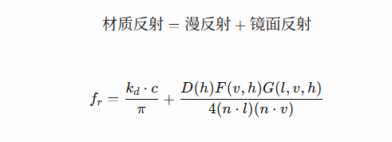
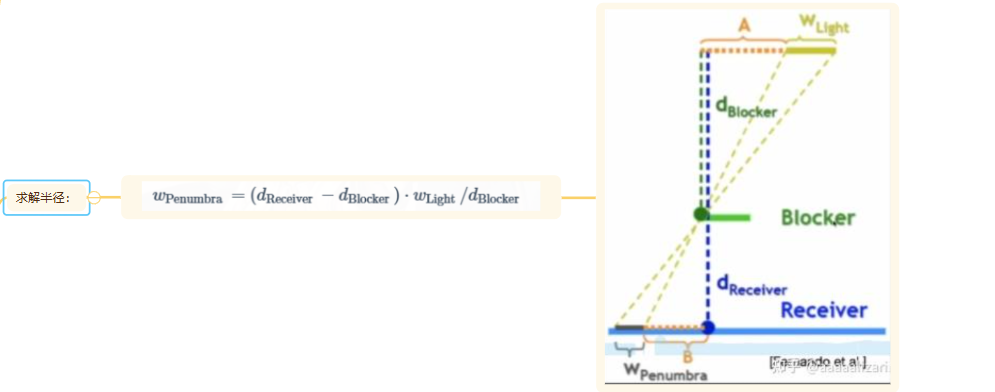
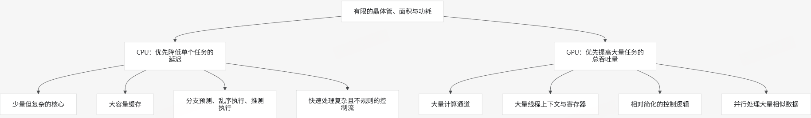
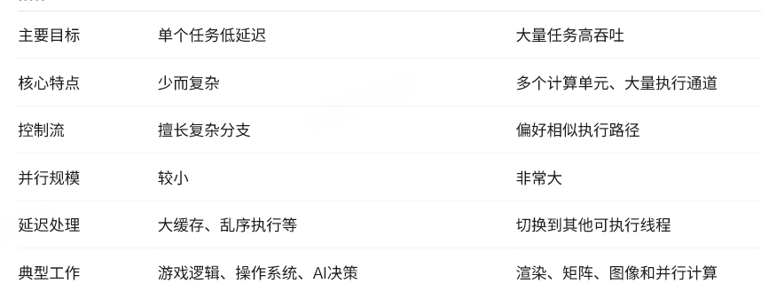

# 2.2 渲染管线与 GPU

<!-- course-navigation:start -->
[上一节：2.1 平移、旋转、缩放与蒙皮](transforms-and-skinning.md) · [本章目录](README.md) · [下一节：3.1 UE 垃圾回收与反射](../03_UE/garbage-collection-and-reflection.md) · [手册首页](../README.md)
<!-- course-navigation:end -->

渲染可以沿三个问题理解：几何怎样落到屏幕，屏幕上的点怎样得到颜色，这些工作怎样交给 GPU。本文按这条链整理原笔记，再把求交、阴影、抗锯齿和硬件放回相应阶段。

## 2.2.1 顶点从模型空间走到像素

### 2.2.1.1 MVP 只完成了哪些变换

| 空间 | 坐标相对什么定义 | 到下一空间的操作 |
| --- | --- | --- |
| 模型空间 | 模型自身原点与轴 | Model：放进世界 |
| 世界空间 | 场景统一参考系 | View：改用相机坐标 |
| 相机/观察空间 | 相机位置与轴 | Projection：得到齐次裁剪坐标 |
| 裁剪空间 | 投影后的齐次坐标 | 裁剪，再做透视除法 |
| NDC | 归一化设备坐标 | 视口变换 |
| 屏幕空间 | 渲染目标中的像素/采样位置 | 光栅化与后续处理 |

世界空间不是物理意义上的绝对坐标，只是场景约定的公共坐标系。相机向前是 `-Z`、屏幕原点在左上角等，也都依赖图形 API 和引擎约定。

采用列向量时，一种常见写法是：

```text
p_clip = P * V * M * p_model
M = T * R * S     // 先缩放、再旋转、最后平移
V = inverse(CameraToWorld)
```

Model 把模型按要求放入世界，不是一定“移到原点”。View 则是相机到世界变换的逆。

透视矩阵的设计目标是让 X、Y 在除以深度相关的 w 后满足相似三角形关系，并把近平面、远平面的深度映射到 API 规定的范围。原稿的“远平面点位置不变、近平面中心不变”缺少坐标与映射定义，不能直接作为通用推导条件。

正交投影没有近大远小，通过平移与缩放把一个长方体映射到规定范围。NDC 不总是边长为 1 的立方体：例如 X、Y 常为 `[-1, 1]`，Z 的范围还随 API 约定变化。

### 2.2.1.2 w 与透视除法

点最初常用 `(x, y, z, 1)` 表示。w 是齐次坐标的尺度分量，不是现实中的第四条空间轴。普通仿射 Model/View 变换后 w 仍为 1；透视投影让 w 与观察空间深度相关。

原笔记采用的投影矩阵最后一行为：

```text
[0, 0, -1, 0]
```

在这一列向量、相机朝 `-Z` 的约定下，`w_clip = -z_view`。这是具体约定，不是所有引擎投影矩阵的固定形式。

```text
顶点着色器输出裁剪坐标（例如 gl_Position）
→ 图元组装
→ 齐次裁剪
→ (x_clip / w_clip, y_clip / w_clip, z_clip / w_clip)
→ NDC
→ 视口变换
```

OpenGL 默认裁剪约定可写成 `-w ≤ x,y,z ≤ w`；使用零到一深度范围的约定则有 `0 ≤ z ≤ w`。**先裁剪，后除以 w**，不能把顺序反过来。除法使远处相同大小的几何投影更小。

### 2.2.1.3 透视正确插值

屏幕空间均匀步进不对应原三维表面上的均匀距离。若屏幕三角形的重心权重是 `λ_i`，某个需要透视插值的属性为 `a_i`，则：

```text
a = [Σ λ_i * (a_i / w_i)] / [Σ λ_i * (1 / w_i)]
```

因此不能直接用屏幕上的 `p = aA + bB + (1-a-b)C` 的权重，对三维表面的纹理坐标等属性线性插值。校正并非只是“算出真正深度”，而是为这些插值属性补偿透视投影。

### 2.2.1.4 算一次透视校正，观察它与直接平均的差别

取三角形一条边的中点，屏幕权重各为 0.5；两端纹理坐标分别为 0、1，裁剪空间 w 分别为 1、2：

```cpp
double lambda0 = 0.5, lambda1 = 0.5;
double u0 = 0.0, u1 = 1.0;
double w0 = 1.0, w1 = 2.0;
double u = (lambda0 * u0 / w0 + lambda1 * u1 / w1)
         / (lambda0 / w0 + lambda1 / w1); // 1/3
```

直接平均会得到 0.5，透视校正却得到约 0.333。屏幕中点并不是原表面参数的中点；w 相同时公式才退化成普通线性插值。这里假设已经裁剪且 w 非零。[数学实验](../examples/course/math-labs.cpp)会核对这个结果。

## 2.2.2 光栅化管线：图元怎样变成可见样本

一条基本图形管线可按职责分成：

1. **应用阶段**：空间加速、视锥剔除、收集可绘制对象、绑定资源和管线状态。
2. **几何阶段**：读取顶点，执行顶点着色，组装图元，裁剪和视口映射。
3. **光栅化**：判断图元覆盖哪些像素采样点，为后续片元提供插值数据。
4. **片元处理与输出**：着色、测试、混合，写入颜色和深度等目标。

光栅化不是“把模型切成三角形”。三角网格通常此前已经存在；光栅化解决三角形覆盖屏幕哪些位置。片元也不等于最终像素，一个像素可能被多个图元覆盖、产生多个候选片元。

光照可以在顶点处计算后插值颜色，成本较低但细节有限；也可以由顶点传递位置、法线等，在片元着色器中计算，适合更细致的材质与光照。

### 2.2.2.1 测试与混合分别做什么

| 操作 | 解决的问题 | 原笔记中的例子 |
| --- | --- | --- |
| Scissor / 裁剪矩形测试 | 限制渲染区域 | UI 滚动列表不画到框外；区别于前面的齐次几何裁剪 |
| Alpha test / discard | 按透明阈值丢弃片元 | 草、树叶、栅栏用纹理抠形状；现代管线通常在 Shader 中实现 |
| 模板测试 | 根据模板缓冲值控制可绘区域 | 后视镜或传送门的遮罩 |
| 深度测试 | 与已有深度比较，决定是否通过 | 判断前后遮挡 |
| 颜色混合 | 将通过测试的颜色与目标已有颜色组合 | 半透明叠加 |

深度测试与深度写入是独立控制项：关闭写入仍可以做测试；只是通过后不更新深度缓冲。具体比较方向取决于普通 Z 或 Reversed-Z 等约定。[Khronos 深度测试说明](https://wikis.khronos.org/opengl/Depth_Test)

### 2.2.2.2 用两个片元区分深度测试与深度写入

下面是 C++ 数值模型，不是替代 GPU 深度单元的实现。采用普通 Z、越小越近、严格 Less 比较：

```cpp
float storedDepth = 1.0f;
bool firstPasses = 0.3f < storedDepth; // true
if (firstPasses) storedDepth = 0.3f;   // 开启深度写入
bool secondPasses = 0.7f < storedDepth; // false：被前者遮挡
```

若第一遍只测试、不写入，`storedDepth` 仍为 1，后来的 0.7 也会通过。关闭深度写入并不是关闭测试，Reversed-Z 还会改变初值和比较方向。通过测试后颜色怎样与已有颜色组合，则是混合阶段的另一个问题。

### 2.2.2.3 Early-Z 与 Z-prepass

Early-Z 在允许的情况下，提前利用深度排除被挡住的样本，减少昂贵片元着色。Shader 改写深度、discard、副作用及硬件规则都可能影响提前测试或写入；不能简单说某一种指令必然在所有 GPU 上完全禁用 Early-Z。[Khronos Early Fragment Test](https://wikis.khronos.org/opengl/Early_Depth_Test)

从前往后绘制有助于更早建立遮挡；从后往前通常收益较差，但“完全没用”过于绝对。另一种做法是 Z-prepass：

```text
Pass 1：用简化的深度 Pass 绘制需参与遮挡的物体，建立深度缓冲
Pass 2：绘制完整材质，使用与第一遍匹配的深度比较，跳过被挡片元
```

第二遍可使用 Equal 或与深度约定匹配的比较方式。收益是少做片元工作，代价是多一次几何处理；透明裁切材质、顶点形变等还要保证两遍深度一致。它不是没有成本的“完美深度图”。

## 2.2.3 前向、延迟和 Tile：光照工作放在哪里

### 2.2.3.1 前向着色

绘制物体时就计算该物体片元的材质和光照。虽然整帧可能先后产生上千万片元，但临时寄存器等只服务于当前驻留的工作批次，之后会复用；不能把整帧所有片元的临时信息都计成长期显存。

### 2.2.3.2 延迟着色

```text
Geometry Pass
→ 把可见不透明表面的法线、材质等写入 G-Buffer
→ Lighting Pass 读取 G-Buffer 与深度
→ 根据光源计算最终光照
```

Lighting Pass 可画全屏三角形/四边形，也可按灯光体积、Tile 或计算着色组织。位置可以由深度重建，不一定另存完整世界坐标。

它把几何/材质信息生成与光照分开，减少不透明表面被遮挡后仍反复做光照的浪费，但不意味着“完美消除所有 Overdraw”，也不能无条件把复杂度写成 `N + M`：光照成本仍与可见像素、影响它们的灯数、阴影和材质有关。

主要代价是 G-Buffer 的显存与带宽。MSAA 需要处理多采样属性与光照，成本和实现更复杂；经典单层 G-Buffer 也无法完整保存多层半透明表面，因此半透明通常另走前向等专用路径。

### 2.2.3.3 Tiled lighting 与移动端 TBDR 不同

Tiled lighting 把屏幕分成网格，为每个 Tile 建立受影响光源列表。可结合该 Tile 的最小/最大深度构造子视锥或包围体，像素只遍历相关灯光。它可以结合前向或延迟使用。

移动端 TBDR（Tile-Based Deferred Rendering）是硬件组织渲染工作的方式：先组织几何到 Tile，再尽量在片上处理局部颜色/深度，减少外部显存带宽。这里的 Deferred 不等同于前面用 G-Buffer 的 Deferred Shading，具体 GPU 还会有自己的实现差异。

## 2.2.4 采样：纹理与边缘走样

### 2.2.4.1 Mipmap 处理纹理缩小

一张 1024×1024 纹理可以预生成 512×512、256×256 等级别。采样时依据像素覆盖的纹理范围选择合适层级，必要时在层级间过滤。

当纹理只占屏幕 10×10 像素，却直接从高分辨率原图取少量样本，细节会闪烁、产生摩尔纹。Mipmap 用低频预过滤结果减少这种欠采样，还常能改善缓存和带宽表现。

原笔记用“相邻像素访问相隔很远的纹素”解释缓存压力，这个直觉有用，但真实纹理通常有分块布局和专用缓存；不能据此断言每个访问必然跨几百行并让整条管线停机。

### 2.2.4.2 MSAA 与 SSAA 的成本差别

MSAA 在一个像素内保存多个覆盖/深度等样本，片元着色通常以低于每样本一次的频率执行，然后 resolve 成最终像素。四倍 MSAA 可理解为四个子采样位置，但不只是“原颜色乘覆盖率”：边缘后面可能是不同颜色、深度和材质的表面，最终需要合成各样本结果。[Khronos Multisampling](https://wikis.khronos.org/opengl/Multisample)

SSAA 对多个子像素样本都做更完整的着色。四倍总样本数常可用宽高各两倍的缓冲说明：

```text
创建更高分辨率缓冲
→ 顶点处理与高分辨率光栅化
→ 产生约四倍片元工作（实际受覆盖等影响）
→ 高分辨率着色
→ 降采样到最终分辨率
```

MSAA 主要改善几何覆盖边缘，不能自动解决所有着色或纹理走样；SSAA 覆盖范围更广，但成本更高。

## 2.2.5 光照：表面为什么呈现这个颜色

### 2.2.5.1 渲染方程与局部反射模型

一个表面点朝观察方向发出的光，等于自身发光，加上所有入射方向的光经材质反射后的贡献积分。


Phong 使用法线与光照方向计算漫反射，用反射向量与观察方向描述高光：


Blinn–Phong 改用光线方向与视线方向的半程向量来计算高光，它是不同的高光参数化，不能直接把指数不变地当成完全相同的结果：


PBR 是遵循物理约束的建模思路，并非一个唯一公式。常见微表面 BRDF 使用 Cook–Torrance 形式：



```text
D：微表面法线分布，影响高光形状
F：菲涅尔项，影响不同角度的反射比例
G：几何遮蔽项，描述微表面之间的遮挡
```

### 2.2.5.2 直接光、间接光与屏幕空间近似

RSM（Reflective Shadow Maps）从光源视角记录深度、位置、法线和反射光通量，把被直接照亮的表面视作间接光的采样来源。间接项应与直接光贡献相加，不是“只有没有直接光时才算间接光”；也不会实际逐点穷举所有 Shadow Map 像素。

SSAO 从相机深度/法线估计附近几何的遮蔽程度，常用于调制环境或间接照明。它不是完整全局光照，也不是光源方向的阴影图。

SSDO 在屏幕空间遮蔽基础上引入方向性光照，并可近似一次漫反射间接反弹；它不能简单等同于“每个遮挡点都必然是光源”。这些屏幕空间方法都受制于屏幕外信息缺失和有限深度层。原论文：[Approximating Dynamic Global Illumination in Image Space](https://phaazon.net/media/uploads/SSDO.pdf)。

### 2.2.5.3 光线追踪

从相机穿过像素发射光线，求场景交点，再按算法处理阴影、反射、折射或间接反弹。路径追踪通常靠多条随机路径估计光照积分，更多样本能降低随机噪声；并非所有光追都需要对每个像素做相同数量的多次反弹。实时方案也经常与光栅化混合。

## 2.2.6 Shadow Map：从可见性到软阴影

### 2.2.6.1 基础流程与光源投影

先从光源看场景，把最近表面的深度写到 Shadow Map。渲染相机可见表面时，将世界坐标变换到光源裁剪空间，经相应除法与坐标映射后，比较接收点深度和记录深度，判断该光源是否被遮挡。

方向光常用正交投影，聚光灯常用透视投影，点光源常用六个方向的透视深度图组成立方体贴图。被某个光源遮挡，只会减少该光源的直接贡献；还可能有其他光源、间接光或自发光，不能直接判成纯黑。

**我的原实践记录**：把光源放在高处，实时朝向场景中心，角度设置为 90°。这应结合当时的光源类型理解：90° 可能指聚光投影视角，也可能是朝向参数，原稿未说明，需回查实现。

### 2.2.6.2 有限分辨率引起的问题

连续几何去查询离散深度图，会遇到锯齿、硬边、自阴影粉刺以及远处分辨率不足。多光源，尤其点光源多个方向的阴影，还增加绘制和更新成本。对应思路包括提高分辨率、PCF/PCSS、Bias、CSM，以及限制阴影灯数量、缓存静态更新、降低影响较小灯的分辨率。

Bias 处理同一表面因离散采样、斜率和精度产生的误判。可用固定深度偏移、与斜率相关的偏移，或沿法线移动接收点的 normal bias。过大则会让阴影脱离物体、漏光。

使用有厚度的几何、某些情况下仅用背面写阴影深度，可以缓解自遮挡，但后者不适合所有单面/薄片模型，也不等于精确记录“表面深度加厚度”。

### 2.2.6.3 PCF：先比较，再平均

PCF 对一个邻域执行多次深度比较，再平均可见性结果。3×3 是简单例子；泊松圆盘点集可减少规则网格带来的结构感。

普通 Shadow Map 不能直接把深度平均后再只做一次比较来等价替代 PCF。两种顺序计算的是不同量；硬件的比较采样可以内部完成比较结果的过滤。

原笔记记录了生成泊松圆盘点集的过程，整理如下：

1. 设最小点间距 r 和采样区域；r 约束点与点之间，不是要求所有点都离原点大于 r。
2. 用小网格加速邻域检查。二维常见边长为 `r/√2`，使用更小网格也可，但需配套检查范围。
3. 选择初始点，加入结果集和 active list。
4. 从 active list 选 p，在它周围 `[r, 2r]` 环带生成候选点。
5. 检查区域边界及附近已有点；合法则加入结果和 active list。
6. 连续尝试 k 次失败后移除 p，直到 active list 为空。

### 2.2.6.4 PCSS：让滤波宽度随遮挡关系变化

面积光源的阴影通常接触处较硬、远离遮挡物处更软。PCSS 先估计遮挡物距离，再计算半影范围，最后用该范围做 PCF。



```text
1. Blocker Search：在搜索范围内采样
2. 只累计比接收点更近的遮挡深度，求平均 dBlocker
3. 依据光源大小、dReceiver 与 dBlocker 估计半影宽度
4. 将半影宽度换成纹理过滤半径，执行 PCF
```

单次中心采样没找到遮挡物，不代表面积光源的其他部分也完全可见，这就是需要邻域搜索的原因。搜索与过滤都会增加采样成本；具体不是恒定“翻倍”，而由各阶段样本数决定。

VSM 记录可过滤的深度一阶、二阶矩，利用均值、方差估计可见性上界；VSSM 在此基础上进一步近似平均遮挡距离，减轻 PCSS 大范围搜索成本。它们不是存一张“方差图”就能精确反推出所有遮挡物，还需处理漏光等近似误差。[VSSM 原论文](https://jankautz.com/publications/VSSM_PG2010.pdf)

### 2.2.6.5 CSM：把分辨率集中给近处

CSM 把主相机视锥按深度分段，为不同段渲染阴影图。近段世界范围小，同分辨率能分配更多纹素给近处细节；远段覆盖大，单位世界面积分辨率较低。

它解决分辨率分配，不负责自动软化阴影。分段边界、投影稳定性与过滤仍需处理，因此常与其他阴影方法组合。

## 2.2.7 几何求交与加速结构

这些基础算法既服务光线追踪，也用于碰撞、阴影和空间查询。

### 2.2.7.1 三角形与多边形

点 P 在三角形 ABC 的平面上时，可写为 `P = uA + vB + wC`，且 `u+v+w=1`。若三个权重均非负，则在三角形内或边界；任一权重为负则在外。点不在平面上时还须先检查共面条件。

射线与三角形可先求射线和平面的交点，再判断是否在内部。Möller–Trumbore 直接联立射线参数与重心坐标求 t、u、v，避免显式先构造平面；要处理平行、背面规则、边界容差和 `t ≥ 0`。

多边形可以先合法三角剖分，再逐三角形判断；凸多边形也能用一致的边侧判断。原稿称其为“右手定则法”不够准确。一般简单多边形还可向固定方向发射射线，用奇偶交点数判断内外，但必须一致处理顶点和水平边，不能直接对所有交点无条件计数。

### 2.2.7.2 AABB 的 slab 测试

AABB 是三对与坐标轴对齐的平面。射线在 X、Y、Z 三个轴上分别得到进入与离开参数区间，再求交集：

```text
tEnter = max(txMin, tyMin, tzMin)
tExit  = min(txMax, tyMax, tzMax)
存在前向交点：tExit >= max(tEnter, 0)
```

原稿把进入最大值“大于”离开最小值写成相交条件，方向反了。射线平行某个轴的 slab 时还需单独判断其原点是否在该 slab 内。

### 2.2.7.3 用 C++ 处理平行射线与前后方向

对一个轴，先求与两平面的交点参数，再合并到三轴公共区间。完整 `RayBox` 在数学实验中，核心步骤如下：

```cpp
if (direction[axis] == 0.0) {
    if (origin[axis] < low[axis] || origin[axis] > high[axis])
        return false; // 平行且在该轴范围外
    // 平行且在范围内：该轴不收紧区间
} else {
    double a = (low[axis] - origin[axis]) / direction[axis];
    double b = (high[axis] - origin[axis]) / direction[axis];
    if (a > b) std::swap(a, b);
    enter = std::max(enter, a);
    exit = std::min(exit, b);
}
```

取盒子 `[-1,1]³`。从 `(0,0,-2)` 沿正 Z 发射，Z 区间为 `[1,3]`，X/Y 平行且在范围内，因此命中；把起点 X 改为 2，X 轴直接判失败。从盒子前方 `(0,0,2)` 继续沿正 Z 发射，整个交点区间在身后，也应失败。

教学输入假设坐标有限、方向非零、盒子边界有序。生产代码还要明确最大射程、边界容差和极小方向分量的数值策略，不能用任意一个 epsilon 修改后就不再测试边界。

### 2.2.7.4 BVH 与空间划分树

BVH 用层级包围体包住图元集合，AABB 是常见包围体；遍历时先排除整个不相交子树。它不必是四叉树或八叉树，也不是所有 BVH 都只能用 AABB。

四叉树、八叉树偏向按空间区域划分，BVH 偏向按图元集合构造包围层级。SAH 用表面积和测试代价估计划分收益，选择较低预期遍历成本的划分，而非单纯追求各节点数量相等。

## 2.2.8 GPU 怎样执行这些工作

### 2.2.8.1 CPU 与 GPU 都执行指令，但资源分配不同

```text
读取指令 → 读取操作数 → 运算/比较/访存 → 写回结果
```

两者都有 ALU、寄存器、调度、Cache、内存接口和控制逻辑。区别在于有限面积和功耗优先服务低延迟还是高吞吐。



CPU 常要处理这样的依赖和分支：

```cpp
if (Player.IsAlive())
{
    UpdateAI();
    UpdatePhysics();

    if (Player.HasWeapon())
    {
        FireWeapon();
    }
}
```

分支预测、乱序执行、推测执行和缓存帮助单条任务更快推进。GPU 则让大量相似任务并行，例如：

```text
OutputPixel[x][y] = InputPixel[x][y] * Brightness;
4K 图像约有 830 万个像素。
像素 0、1、2……8294399 可以各自执行同一种亮度运算。
```

GPU 将更多资源用于并行计算通道，适合像素着色、顶点变换、矩阵计算、图像处理、粒子、神经网络和大规模数值任务。但存在数据依赖或带宽瓶颈时，并不是线程越多越快。



### 2.2.8.2 延迟隐藏与驻留资源

当某批线程等待显存时，调度器可以选择其他已就绪的驻留线程束执行：

```text
A 等待显存
B 执行乘法
C 执行加法
D 等待纹理
```

这里是硬件对驻留上下文的调度，不是操作系统换 CPU 线程。足够多的可运行工作有助于隐藏延迟，但也要有足够寄存器、共享内存和调度名额。

NVIDIA 中 SM 是共享调度、寄存器、缓存和执行流水线的计算集群，Warp 为 32 个线程。一个 Warp 的活动线程执行发射的指令；出现分支时，部分线程可能被掩码，不能据此假设任意时刻 32 个线程的控制状态完全相同。[CUDA 编程模型](https://docs.nvidia.com/cuda/cuda-programming-guide/01-introduction/programming-model.html)

Thread Block / Workgroup 通常作为一组分配给一个 SM/CU，以使用组内共享内存与同步。驻留需要满足：

```text
每线程寄存器数 × 线程数
+ 线程组共享内存需求
+ 硬件支持的线程束/线程组/线程数上限
```

SM 可以同时驻留多个线程组，并调度其中就绪的 Warp。AMD 的 CU/Wave 等名称和宽度应按架构理解，不能直接把 NVIDIA 的 32 线程规则泛化给全部 GPU。

### 2.2.8.3 从命令提交到一次 Draw

显卡是包含 GPU 芯片、显存等部件的设备，二者不是同义词。CPU 通过图形 API 组织命令，提交到 GPU 队列；GPU 前端读取命令、管线状态和依赖关系，再分发工作。

前端通常涉及 Command Processor、Queue 管理、图形/计算任务分发和同步。可编程 Shader 集群执行不同阶段的计算，固定功能单元则高效完成常见固定操作：图元装配、光栅化、纹理寻址/过滤、深度/模板、混合等。视频编解码与显示扫描还可能由其他专用模块负责，不是 Shader 管线每次 Draw 都经过它们。

```text
DrawIndexed(...)
1. CPU 记录并提交 Draw 和相关状态
2. GPU 前端读取工作
3. 读取索引、顶点等数据
4. 执行 Vertex Shader
5. 图元装配、裁剪、光栅化
6. 生成片元/覆盖信息，可能提前进行深度剔除
7. 执行 Pixel / Fragment Shader
8. Shader 内需要的纹理采样由纹理单元协作完成
9. 执行相应深度、模板、混合与输出操作
10. 写入渲染目标
```

这是一条逻辑路径，不是所有硬件严格串行的十个独立步骤。统一 Shader 资源能在不同阶段间调配，但仍有专用流水线与调度约束。

### 2.2.8.4 存储层次不是单一串行通道

```text
Shader 使用寄存器
Shader 的内存访问 → L1 / 纹理等缓存 → L2 → 显存控制器 → GDDR/HBM
线程组也可显式访问片上 Shared Memory
```

寄存器按线程逻辑分配，物理资源位于计算单元；L1 通常靠近 SM/CU，L2 更大范围共享。Shared Memory 是程序可显式管理的片上存储，虽然某些架构与 L1 共享物理容量，但不能把它当成“每次访问自动经过的下一级缓存”。实际层级和带宽取决于硬件架构。

## 2.2.9 学习检查：把算法放回流水线

先画出“顶点 → 裁剪 → 透视除法 → 光栅化 → 片元 → 测试/混合”的依赖，再标注骨骼蒙皮、法线插值、阴影查询分别发生在哪。接着回答：w 相同时透视插值公式怎样简化？关闭深度写入为何仍能挡住部分片元？AABB 进入参数为 5、离开参数为 3 为什么不能命中？

最后选一项实际优化，说明减少的是几何工作、片元计算还是显存流量。若只写“GPU 更快”而说不出省掉哪部分工作，就还没有把算法与硬件成本联系起来。
