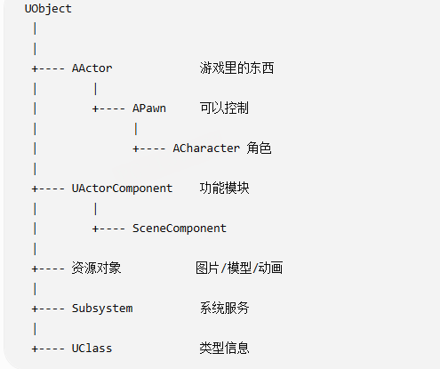
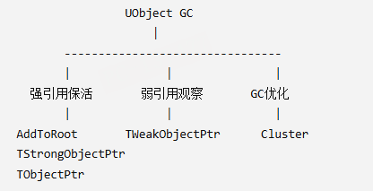

# UE 垃圾回收与反射

[返回本章目录](README.md) · [返回手册首页](../README.md)

UE 的反射描述“对象是什么、有哪些属性和函数”；GC 利用可追踪的引用判断“对象是否仍然可达”。二者相互配合，但反射属性不一定都是对象引用，拥有一个 C++ 指针也不一定能让对象存活。

## UObject 管理的边界

大型游戏的对象关系复杂，手动 `delete` 要同时理清创建者、使用者和释放时机。UE 为 `UObject` 体系提供 GC，并在同一对象体系中支持反射、序列化和编辑器能力。

不是所有游戏数据都应继承 `UObject`。纯值类型、算法结构及某些高频数据可以使用普通 C++ 类型，按自身规则管理生命周期。

下面是对象头的概念模型，不是引擎源码布局：

```text
UObject
{
    Name       名称
    Outer      所属对象/命名与组织关系
    Class      类型元数据
    GC 相关标记
}
```

`Outer` 不能简单等同于“持有者会替我保活”的强引用。判断对象是否存活，要看 GC 能识别的引用关系，而不是只看它的 Outer 是谁。

### 常见对象之间的关系

```text
UObject
├─ UClass                       类的运行时元数据，本身也是 UObject
├─ AActor
│  └─ APawn
│     └─ ACharacter
├─ UActorComponent
│  └─ USceneComponent
│     └─ 具有空间变换的各类组件
└─ 各类资源对象
```

`AActor` 与 `UActorComponent` 是组合关系，不是彼此继承。角色、道具等实体可以由 Actor 承载，移动、渲染等职责则由组件协作完成。



## GC 怎样判断对象是否可以回收

可以先用标记—清扫理解 UE GC，实际引擎还有并行、增量、Cluster 等优化：

```text
从 GC 根及引擎登记的保活引用开始
→ 遍历可识别的强引用，标记可达对象
→ 找出不可达对象
→ 执行销毁流程，最终释放资源和内存
```

Root Set 中的对象是可达性分析的起点。`UWorld` 等运行时对象可以通过引擎持有关系保持存活，但不能把“所有 UWorld 永远都在 Root Set”当成固定规则。对象还会登记到全局 UObject 管理体系，例如 `GUObjectArray`；登记并不表示它永不回收。

引用发现依赖反射描述的对象属性，也可以来自引擎的显式引用收集机制。GC 不会扫描所有任意 C++ 地址并推断其含义。清扫也不是发现白对象就立即对每个对象调用普通 `delete`，而是进入引擎规定的销毁阶段。

引用计数无法独立处理相互强引用形成的环。可达性分析则关心整个环是否还能从根抵达：完全不可达的环可以回收；环中任意部分仍被根可达对象引用，就仍然有保留理由。

## 哪些引用会保活



| 形式 | 是否自动阻止 GC | 用法与注意点 |
| --- | --- | --- |
| 未登记的 `UObject*` | 否 | 只是 C++ 地址，不能因变量还存在就认为对象安全 |
| 反射成员 `UPROPERTY()` + `UObject*` | 在支持这种声明的版本/配置中参与追踪 | 旧代码常见；持有者本身也要可达 |
| `UPROPERTY()` + `TObjectPtr<T>` | 参与强引用追踪 | UE5 常用的 UObject 成员引用；仅把裸指针换成未登记的 TObjectPtr 并不自动保活 |
| `TWeakObjectPtr<T>` | 否 | 用于观察对象；读取前检查有效性，例如 UI 显示玩家但不负责保留玩家 |
| `TSoftObjectPtr<T>` | 否 | 记录可解析的对象路径，适合延迟加载资源；加载完成后仍需考虑保活 |
| `TStrongObjectPtr<T>` | 是 | 可在非 UObject 持有者或局部作用域中显式保活，离开作用域释放这份保活关系 |

`TObjectPtr` 的对象句柄、访问追踪等实现会随版本和构建配置变化，不宜简单说成“支持虚拟化对象，所以比裸指针安全”。对使用者最关键的是：它在哪里声明、是否被 GC 收集、目标是否仍有效。[官方对象指针说明](https://dev.epicgames.com/documentation/unreal-engine/object-pointers-in-unreal-engine?lang=en-US)

软引用不是一声明就发起异步加载。可以通过项目采用的资源管理器、流式加载接口或版本提供的 `LoadAsync()` 等接口加载；应核对所用版本的 API。

### AddToRoot 与作用域保活

`AddToRoot()` 显式将对象放入根集合，直到调用 `RemoveFromRoot()`。它适合确实需要脱离普通持有关系管理的对象，但必须有成对的清理路径：局部函数返回不会自动撤销 Root，遗漏解除就可能长期占用资源。

`TStrongObjectPtr` 用 RAII 表达保活关系，常用于普通 C++ 持有者无法声明 `UPROPERTY` 的场景。它不是所有 `AddToRoot` 用法的无条件“上位替代”；应结合持有范围、开销和对象关系选择。长期的 UObject 成员关系通常用可追踪属性表达更清楚。[官方 TStrongObjectPtr API](https://dev.epicgames.com/documentation/en-us/unreal-engine/API/Runtime/Core/TStrongObjectPtr)

## GC 优化要减少哪部分工作

优化方向包括减少产生的垃圾、减少扫描对象与引用、分散停顿，以及把不必要的 UObject 数据改成更合适的结构。

- **增量处理**：将部分工作分摊到多帧。UE 的增量清理和增量可达性分析不是同一个开关；支持范围与要求按引擎版本确认，不能笼统说 mark 和 sweep 默认都分帧。
- **并行处理**：适合并行的收集任务由工作线程协作，仍有同步与生命周期约束。
- **对象池**：例如反复使用子弹表现对象，降低创建和销毁频率；池自身会保留对象，应限制规模并正确重置状态。
- **Cluster**：将适合一起处理的对象组织成群集，减少逐个遍历成本。Actor 与组件存在关联不代表自动总被组成同一个 Cluster。
- **控制触发时机与频率**：结合游戏场景和生命周期设计，避免用简单降低 GC 频率掩盖持续增长的垃圾。

### 与 Lua GC 对照

二者都可以用可达性分析理解，但所管理的对象和实现不同。UE 管理 UObject 引用图；Lua VM 管理 table、function/closure、thread、string、userdata 等 Lua 对象。

三色标记的概念是：白色尚未发现，灰色已经发现但引用尚未扫描完成，黑色已经扫描完成。

```text
GC 开始
→ 标记根对象
→ 将新发现对象放入灰色待处理集合
→ 扫描灰色对象并传播引用
→ 本轮可达对象完成标记
→ 清理仍不可达的白色对象
```

灰色集合使标记工作可以分步推进；分步期间程序仍可能修改引用，因此实现还需要写屏障等机制。Lua 的具体 GC 模式与版本相关，不能将某一版本的三色增量过程等同于所有 Lua GC 行为。

## 反射信息从哪里来

普通 C++ 编译后的程序通常不能枚举任意类的字段名称、编辑标记或蓝图可调用函数。UE 用 **宏标记 + UnrealHeaderTool（UHT）生成代码 + 运行时元数据** 提供这些能力。

```text
开发者声明 UCLASS / UPROPERTY / UFUNCTION
→ UHT 解析受支持的声明
→ 生成 .generated.h 及相关 .gen.cpp 代码
→ 编译、注册 UClass / FProperty / UFunction 等信息
→ 编辑器、序列化、GC、蓝图和网络模块按需使用
```

原稿将所有内容都写进 `Player.generated.h`，这里需要分开理解：生成头与生成源共同参与，不是一个头文件独自保存所有注册逻辑。属性元数据可以记录名称、类型、偏移和标记，运行时据此访问具体实例；类元数据与对象实例也是不同对象。

### 宏描述能力，具体说明符决定行为

```cpp
UCLASS()
class APlayer : public AActor
{
    // 省略生成宏和其他必需代码，仅作声明关系示意。
    UPROPERTY()
    int HP;

    UFUNCTION()
    void Jump();
};
```

`UCLASS` 让类进入反射体系，关联名称、父类、属性和函数信息；`UPROPERTY()` 让 `HP` 成为反射属性，可对应 `FIntProperty`；`UFUNCTION()` 为 `Jump` 提供函数元数据与调用所需信息。

空的 `UPROPERTY()` **不会自动开启** Edit、Visible 或 Replicated；这些是不同说明符产生的行为。空的 `UFUNCTION()` 也不等于自动暴露给蓝图的所有场景。实例保存实际数据，类型元数据描述如何理解这些数据，不是用一份“类图纸”代替所有实例。

## 反射怎样参与属性复制

以下是传统属性复制系统的概念链；Iris、Push Model 和不同 UE 版本不能一概套用内部类名：

```text
C++ 属性与复制声明
→ UHT 产生反射信息
→ Actor/Component 配置复制并登记要复制的字段
→ 复制系统按相关性、频率、条件检测或接收脏标记
→ 编码变化并发送
→ 客户端解析、更新字段
→ 若配置 RepNotify，按规则调用 OnRep
```

原笔记中的 `RepLayout`、`Shadow State`、Bit 序列化是阅读传统复制代码的线索。仅声明 `UPROPERTY(Replicated)` 不能独自完成复制配置，也不是每个对象的所有属性都必然每个画面帧逐个比较。`OnRep` 对应 RepNotify 机制，并非每个复制属性都有通知函数。

“属性同步”描述同步对象字段；“快照”描述在某个时间点采集一组状态。位置、朝向可以组成快照，快照内部也可以包含属性，二者并非互斥。选择频率要看状态变化速度、带宽和表现需求，不能只用“血量变化少、位置变化多”推出固定实现。
