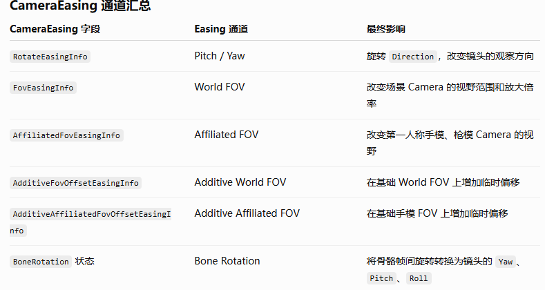

# 4.12 相机系统与射击方向

<!-- course-navigation:start -->
[上一节：4.11 射击框架与开火链路](shooting-pipeline.md) · [本章目录](README.md) · [下一节：4.13 属性系统与网络同步](attributes-and-sync.md) · [手册首页](../README.md)
<!-- course-navigation:end -->

先读 [4.3 武器与弹道](shooter-weapons-and-ballistics.md)和 [4.6 表现系统](shooter-presentation.md)。本篇用于对照原项目的双相机与 Cue 时序；原记录的坐标轴、800 速度、33 ms 等参数不能直接套入 Arena 的米/秒/60 Hz 约定。

相机系统先确定“从哪里看、看向哪里”，射击系统再用镜头与瞄准状态生成射线。两者相关，却不是简单把相机朝向直接当成最终命中方向：后座采样时机、瞄具偏移、散布和弹道分段都会改变结果。

本文记录 S18 / 弥赛亚项目中的类名、字段和流程。它们是原工程约定，仓库没有对应源码；未能证实的公式和参数保留为核对线索，不当成通用引擎结论。

## 4.12.1 两台相机分别交给哪个渲染 Pass

渲染管线已经约定两条入口：

```text
主世界 Pass
→ 读取 EngineCamera
→ 绘制 DEFAULT RenderSet

HUD Sight Pass
→ 从 OpticalSightCamera 取得 HudCamera
→ 绘制 HUD_SIGHT RenderSet
```

`ICamera` 是相机类型接口，不是一台全局唯一的相机。正式战斗主链里的两个实例分别是：

| 实例 | 原项目入口 | Controller 指向 | 主要用途 |
| --- | --- | --- | --- |
| 世界相机 | `MEngine.GetGameplay().Player.Camera` | `_ControlledCamera` | 地图、角色、建筑、敌人、世界特效 |
| HUD 相机 | `genv.hud_camera` | `_AffiliatedCamera` | 第一人称手、枪、瞄具和附属模型 |

第一人称手枪模型被分到对应 RenderSet；切第三人称时隐藏相应集合。原笔记中两台相机最终使用相同位置和朝向，但 FOV 可以不同。这样第一人称枪械的透视表现可以独立调节，不必改变世界镜头的视野。

## 4.12.2 从 space 到 CameraRuntimeInfo

`space` 表示当前玩法场景。原项目在创建 space 后建立相机逻辑对象，再创建相机管理核心 `CameraController`：

```text
CameraController
├─ LocateBlendTree
│  └─ FPS/TPS Placer 或 Blender
├─ SensorBlendTree
│  └─ Checker → TpsCollider → CameraCollider
├─ PostProcessorBlendTree
│  └─ CameraShaker
├─ CameraRuntimeInfo* mCurrentCamInfo
├─ ICamera* ControlledCamera
└─ ICamera* AffiliatedCamera
```

这三棵树分别负责理想机位、环境修正和后处理。Controller 组织更新，把中间结果写入 `mCurrentCamInfo`，最后再统一写给两台 `ICamera`。

### 4.12.2.1 RuntimeInfo 保存什么

原笔记记录的主要字段是：

```text
target       观察目标点
direction    从相机指向 target 的向量，包含距离
roll         镜头侧倾
世界相机 FOV
HUD 相机 FOV
```

这份记录中没有独立 `position`，Controller 由下面的关系求位置：

```text
cameraPosition = target - direction
```

这里的 `direction` 不是单位向量。若把它误当成归一化方向，便会丢掉相机与目标之间的距离。

### 4.12.2.2 Placer 的业务层与几何层

Python 包装器理解游戏状态：当前武器及配置、ADS、换弹、开火、Recoil 状态机、Jitter、RollShake、BurstShake、鼠标输入，以及角色、手模、骨骼等对象。它创建和挂载 Easing、Mover、Blender，把业务参数交给底层。

C++ Placer 保存 `_Direction`、`_Roll`、`_Fov`、Target、offset，推进并消费 `CameraEasing` / Mover，再按机位规则计算本帧 `target`、`direction` 和其他参数。它先回答“暂不考虑碰撞和最终震屏，这帧镜头应当在哪里”。

原项目的 Placer 类型各有用途：

| Placer | 机位规则 |
| --- | --- |
| `FpsPlacer` | 固定在眼睛附近 |
| `TpsPlacer` | 围绕角色观察点 |
| `AimPlacer` | 持续对准目标 |
| `FollowPlacer` | 跟随另一 Camera / Controller |
| `Orbit/PivotPlacer` | 围绕中心旋转 |
| `BonePlacer` | 跟随骨骼 |
| `FreeviewPlacer` | 自由镜头 |
| `FramePlacer` | 读取固定 CameraFrame |

FPS 先固定眼睛附近的位置，再由朝向算目标点；TPS 则先固定角色附近的目标点，再反推相机位置：

```text
FPS:
cameraPosition = 眼睛位置 + offset
target = cameraPosition + direction

TPS:
target = 角色附近观察点
cameraPosition = target - direction
```

所以 FPS 转头主要改变视线，TPS 转向还会让镜头位置绕角色移动。

### 4.12.2.3 混合、碰撞与震屏的执行位置

```text
LocateBlendTree
└─ TpsPlacer
   ├─ _Easing
   └─ _Mover
```

`CameraEasing` 提供随时间变化的参数，Mover 提供连续移动相关结果。原笔记把它概括为速度，具体返回的是速度、位移还是其他量需查各 Mover 实现。



Locate 树可能只有一个 Placer，也可以在 FPS 转倒地等状态切换时同时求多个结果，再由 Blender 过渡。随后 Sensor 树处理碰撞修正，PostProcessor 树下的 Shaker 计算震动并叠加到 RuntimeInfo。最终只在出口把完整结果应用到 ControlledCamera 和 AffiliatedCamera，避免业务模块各自覆盖最终相机。

## 4.12.3 普通枪：先确定基准射线，再加入散布

普通枪由 `GunSpellWorker` 处理，霰弹枪由 `ShotgunSpellWorker` 处理。开火预热和动画 Cue 的上下文见[射击框架与开火链路](shooting-pipeline.md)。

### 4.12.3.1 采样相机时机

普通枪在本发后座逻辑 Tick 前缓存镜头方向，避免刚产生的后座反过来改变同一发的初始方向。每次开火事件都应使用本次约定的采样点，不能拿任意时刻的相机朝向替代。

然后确定射线穿过屏幕哪个点：

- 普通射击使用屏幕中心，由 `EngineCamera` 将二维坐标转换为三维射线。
- ADS 开镜根据 `aimbone` 与相机的相对位置进行投影，计算屏幕 XY 偏移，再加到瞄准点上。
- 使用四倍镜、八倍镜等瞄具时，还会涉及瞄具/HUD 的方向修正；世界相机与 HUD FOV 不同，二者的投影参数不能混用。

原笔记分别记录了“开镜时修正瞄准方向”和“散布后再做 HUD 修正”。其精确调用顺序需查 Worker，不能在没有源码的情况下合成唯一流程。

### 4.12.3.2 散布状态怎样更新

原项目普通枪的记录是 ADS 当前不产生散布，腰射则综合移动、姿态和连发状态。该规则仅适用于笔记所记版本，不是所有游戏的 ADS 规则。

```text
LastScatterAngle       积累的散布状态
ShootScatterAngleMin   最小散布
ShootScatterAngleMax   最大散布

AllScatterRatio = 移动/姿态倍率 × 瞄准状态倍率 × ADS 倍率 × 天赋或配件修正
currentMin = ShootScatterAngleMin × AllScatterRatio
currentMax = ShootScatterAngleMax × AllScatterRatio
```

`SIPS` 是每发带来的散布增量，原记录表示它影响下一发，而不回改当前这一发。以 `SIPS = 0.8`、范围 1～10 为例，若当前积累值为 0，第一发先按下限 1 使用；之后积累为 0.8，第二发仍至少为 1。继续如何钳制、回落或叠加，需查实际更新函数。

### 4.12.3.3 两个随机数分别控制什么

```text
U = GunRandom.NextDouble()  // 方位角
U = 0    → theta = 0°
U = 0.25 → theta = 90°
U = 0.5  → theta = 180°
U = 0.75 → theta = 270°

V = GunRandom.NextDouble()  // 离中心的角度分布
```

原稿中的公式保留为待核对记录：

```text
rawAngle = acos(2V - 1) % 2  // 原稿假设最大偏移为 2
```

它不能直接作为“圆锥内均匀散布”的公式：`acos` 的单位、`2` 表示角度还是弧度、取模的目的都没有说明，而且角度取模通常会改变分布。

若目标是**立体角均匀的圆锥采样**，一种独立的数学对照是 `theta = 2πU`、`cos(phi) = 1 - V(1 - cos(alpha))`，其中 `alpha` 为半角，再把局部方向旋转到 `BaseDirection`。这只是核对实现时的参照，不代表原项目一定使用均匀分布。

## 4.12.4 普通枪弹道：命中方向来自当前飞行段

客户端计算散布、飞行分段、碰撞与命中表现；服务器决定是否接受结果、最终伤害与扣血。子弹初始方向与最终 `hit_dir` 可能不同，因为后者来自发生碰撞时的飞行段。

原数值例子采用 **Z 为初始前进方向、负 Y 为重力方向**，是该笔记的坐标示意，不要直接当作 UE 的 Z-up 世界坐标：

```text
D₀ = (0, 0, 1)
V₀ = (0, 0, 800)
G  = (0, -20, 0)
Δt = 0.01
```

第一段使用恒定加速度运动：

```text
ΔP₀ = V₀Δt + ½GΔt²
     = (0, 0, 8) + (0, -0.001, 0)
     = (0, -0.001, 8)

segmentDir₀ = normalize(0, -0.001, 8)
V₁ = V₀ + GΔt = (0, -0.2, 800)
```

即这一段前进 8 个世界单位，下落 0.001 个世界单位。沿该段做碰撞，下一段再使用更新后的速度继续。若还有速度衰减等配置，就不能只用这组恒定重力公式覆盖全部实现。

每段检查场景、角色受击盒及穿透结果。原记录的终止条件包括：

- 命中不可继续穿透的目标，或穿透能力耗尽。
- 达到最大射程，或速度接近零。
- 玩家/武器销毁，需要取消关联任务。
- 超过保护上限 **512 段**。

碰撞精度直接取决于分段长度和曲率。如果每次恢复使用更长的 Δt，线段对抛物线的近似更粗；若采用固定子步，则画面帧率本身不必决定碰撞精度。原项目的任务定时约 33 ms，是否补子步需回查实现。

## 4.12.5 霰弹枪：一枪生成多条独立弹道

原记录中霰弹枪直接读取当时镜头方向，没有普通枪那套提前缓存；若后座或 Easing 已写入 `EngineCamera`，就可能影响本次中心方向。它与普通枪的主要差异如下：

1. 从配置取得 pellet 总数、内圈数量与外圈数量。
2. 只计算一次整枪主散布半角 `α`。它决定外圈圆环的主要范围，也缩放内圈范围。
3. 内圈每颗弹丸独立取 U、V，按配置范围产生随机偏移。
4. 外圈弹丸先按等角度分布在偏离中心 `α` 的圆环上，再读取 `ShotgunSpreadRandomAngle`，为每颗弹丸添加独立随机扰动。
5. 每颗弹丸独立进行碰撞和穿透。原记录的该实现没有普通枪那套重力下坠流程。

原稿还记录了视觉落点：每颗射线在 **800 m** 范围内命中则取命中点，否则用 **500 m** 的位置触发后续表现。这是视觉效果参数线索，不能直接等同于伤害射程；单位和对应配置也应核对原工程。
