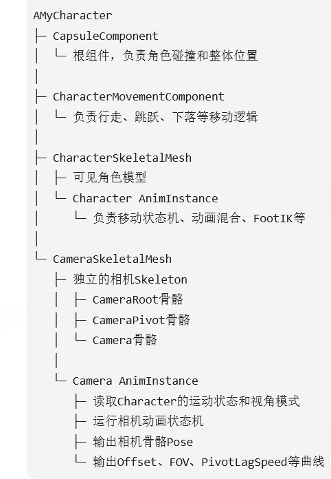

# 简单介绍一下这个项目：
这个项目是UE商城里面的一个示例项目，名为高级运动系统，原项目是基于UE4的纯蓝图项目，主要是一个类似于大世界主角运动系统的项目，如八方向移动，走，跑，跳这些基本运动。我在原项目的基础上，用cpp重构了项目，将大部分逻辑移动到代码侧，并使用UE5的部分新技术来进行优化。主要还是学习UE的动画系统以及一些常用的技术吧。很有趣的一点是，这个项目是我在qq飞车实习的时候闲暇时间做的，但来到了网易这边，我发现他们的底层运动系统就是完全搬了这个项目，甚至很多文件夹还叫做ALS，高级运动系统的简称。

## UE

### 介绍一下UE的动画系统。
UE动画系统的核心，是把角色状态转换成最终骨骼姿势。
基础资源包括 Skeleton、SkeletalMesh 和 AnimSequence。运行时由 AnimInstance/Animation Blueprint读取角色速度、加速度、是否落地、朝向等数据，再在 AnimGraph中通过状态机、BlendSpace和动画混合生成基础姿势。

### 调用链：

#### Mycharacter：Acharacter
自定义 ACharacter主要负责：
处理输入、移动模式和角色状态。保存站立/蹲伏、步态、旋转模式、视角模式等事实数据。控制相机、胶囊体和 MovementComponent。向 AnimInstance提供角色状态。
```
EGait DesiredGait;             // 期望走、跑、冲刺
EGait ActualGait;              // 当前实际步态
EStance Stance;                // 站立、蹲伏
ERotationMode RotationMode;    // 朝移动方向、朝视角方向
EViewMode ViewMode;            // 第一/第三人称
FRotator AimingRotation;       // 当前瞄准方向
bool bHasMovementInput;        // 是否有移动输入
```

#### MyAnimInstance : public UAnimInstance
保存动画计算结果,每一帧tick会在charactertick后，计算下列：
```
float Speed;
float Direction;
float AimYaw;
float AimPitch;
float StrideBlend;
float WalkRunBlend;
float LeanAmount;
```
```
Speed = Character->GetVelocity().Size2D();
bIsInAir = Character->GetCharacterMovement()->IsFalling();
Direction = CalculateDirection(
    Character->GetVelocity(),
    Character->GetActorRotation()
);
```
#### Blueprint:继承instance，运行时产生实例
根据instance里面的结果，来更新自身逻辑，从而输出骨骼的姿势。

#### 输出：
```
FCompactPose     当前帧需要的骨骼局部Transform
FBlendedCurve    动画曲线值
CustomAttributes 自定义动画属性
```
#### compactpose:
由LOD生成的紧凑数组，删去此LOD下不需要更新的骨骼。 skeletonmesh下面会保存不同LOD下需要的映射，以及全套骨骼完整的映射。
```
FCompactPoseBoneIndex
↔ MeshPoseBoneIndex
↔ SkeletonPoseBoneIndex
```
但仍需要逐骨骼更新。
##### 意义：
只计算当前LOD需要的骨骼。只评估当前有权重的动画节点。CompactPose是连续内存，遍历和混合效率更高。支持Cached Pose，避免相同分支重复计算。Pose评估可以放到工作线程并行执行。CPU只生成骨骼矩阵，逐顶点蒙皮通常交给GPU。
对于某一次角色绘制，GPU必须先拿到这一帧的骨骼矩阵才能蒙皮。但CPU和GPU整体是流水并行的：CPU可能正在计算下一批动画，GPU同时处理之前已经提交的角色，并不是整个CPU计算全部结束后GPU才统一开始。

## 结构：


## 讲一下相机。
项目中为相机单独创建了一个 SkeletalMesh 和 Camera AnimInstance。Camera AnimInstance 每帧读取角色的运动状态、步态、视角模式和特殊动作等数据，再根据这些状态驱动相机动画状态机。
不同相机状态会输出不同的动画曲线，例如 CameraOffset_X、CameraOffset_Y、CameraOffset_Z、FOV 和 PivotLagSpeed。部分曲线来自相机动画资源并随着动画状态一起混合，部分参数也可以通过 Modify Curve 节点动态修改。
相机更新时再从  AnimInstance 中读取当前帧最终混合后的曲线值，将其转换成相对于角色 Pivot 的局部偏移，计算理想相机位置。最后通过球体扫描处理环境碰撞，得到最终镜头位置。

### 为什么要给相机写CameraSkeletalMesh + Camera AnimInstance
为了把镜头运动也放进动画系统，而不是全部用代码硬算，让策划通过动画资源和曲线调手感，减少修改C++。相比直接把相机挂在角色骨骼上，这套独立骨架不会继承角色动画中的剧烈抖动；相比纯代码插值，它能复用状态机、动画混合和曲线系统，复杂动作也更容易与角色动画对齐。适合表达绕Pivot旋转、位置偏移以及翻滚、攀爬时的复杂镜头轨迹

### 怎么过渡？
在相机的动画蓝图中，画出和角色相同的状态机框架，在里面modify曲线。uE自动处理过渡。

### 物体遮挡怎么计算：
相机的位置是根据人物身上的一个固定的插槽来进行求值的，这个插槽肯定不会在墙里面，因为这是物理引擎计算的，有了这个插槽的位置，我们用球体探测，朝着目标点扫描，如果扫到点，则稍稍往前一点，就是相机的位置。
###  球体检测球体直径：
球体半径理论上由近裁剪面尺寸决定，用于覆盖摄像机视锥体前端，但实际工程中通常采用固定安全半径，并根据游戏镜头需求调节，在保证不穿模和避免镜头过度靠近之间取得平衡。
###  复杂的环境下，剧烈推拉怎么办：
1. 通过Collision Channel阻挡型结构（墙壁、地板、大型岩石）才设置为 Block Camera。而所有的植被（树叶、草）、铁丝网、小型可破坏物、甚至 NPC 和其他玩家，统统设置为 Ignore Camera
2. 非对称插值：向前推，机必须立刻、无延迟地拉近，避免穿模，向后退极其缓慢，利用半衰期缓缓移到位置。
3. 如果还解决不了：半透明化
相机依然做射线检测，但当它打到特定的物体（比如柱子、特定的墙体）时，不改变相机位置将扫到的物体材质替（抖动掩码）的半透明材质，或者通过传递参数改变其 Opacity，让遮挡物在玩家眼前平滑溶解掉。

### 如何防止camera类不更新：
CameraMesh->VisibilityBasedAnimTickOption = EVisibilityBasedAnimTickOption::AlwaysTickPoseAndRefreshBones;
### 为了保证相机曲线能正常输出，我必须在相机的 C++ 构造函数中强行覆写它的可见性 Tick 策略：
相机和角色更新顺序： mesh调用AddTickPrerequisiteComponent(Character->GetMesh());

### skeletonmesh性能：
原因：多在Actor下挂载一个SkeletonMesh，就多一份Tick和动画树结算，这个开销需要优化：
1.关闭不需要的渲染和物理：
bHiddenInGame = true，关闭碰撞与物理： SetCollisionEnabled(ECollisionEnabled::NoCollision);，关闭 Cloth（布料模拟），关闭 Generate Overlap Events 只做一个纯粹的计算：
职责：负责真正计算最终相机结果，比如位置、旋转、FOV、碰撞避让、肩膀切换、第一/第三人称切换等
### animationinstance
职责：负责把角色当前状态喂给相机动画蓝图，让动画蓝图产出一组曲线值；这些曲线再被 UAlsCameraComponent 读取，用来控制相机行为
动画序列驱动：还烘焙了自定义的动画曲线。 UAlsCameraComponent 每一帧读取这些曲线值，直接叠加到最终的相机 Transform 上
为什么放在这里：放在角色和相机蓝图中其实都可以，但放在这里逻辑感觉会更清楚一些。

## 运动基础相关：

### 资产：
#### 1.走跑资产：
共6个，前后左前左后右前右后，做成blendspace，用walkrun的比例加上strideamount去采样（后者对应速度范围，原始的速度范围固定）
walkrun计算:0，1的开关，直接根据gait来计算strideBlendAmount：用当前速度和走路、跑步速度做插值，算出结果。
playrate：根据当前走路速度的设置和动画资源预先的标准走路速度资源除法，再除以上面的strideblendAmount。
##### 缺点：走200跑400，但实际中走300跑500  引入stridewarping
#### 2.冲刺资产
常态冲刺循环动作、刚开始冲刺时的爆发动作。
#### 3.倾斜动画
做成二维blendspace
### 基本移动：
#### 八方向移动
主要是为了解决不同方向移动之间的脚的前后移动，以免出现穿模现象。我这里设置了六个方向，分别是前后左前左后右前右后，把左右拆分。
##### 穿模原因：
可以想一下，向左移动，可以是朝着左前进，也可以是朝着右向左后退，这就是问题所在，从前进过渡到向左前进会很自然，从后过渡到向右左后也很自然，但前过渡到左后，中间两条腿插值的结果就会打架，导致穿模。所以设置了前到左前到左后到后这样的过渡链，保证动画融合不会出现穿模现象。
左前左后之间的过渡也需要调整，最好的处理办法就是在左前左后，两条腿迈的最开的时候，在左前左后动画中去画一条曲线，叫做feetcrossing，将过渡不会有太多问题的阶段画成在人物动画实例每一帧去读取对应的值存到一个变量中，过渡条件中对这个变量进行判断。
#### 冲刺动画怎么添加的：
先获取真实物理加速度，对其映射，开始时的最大加速度接近1，后续接近0，根据这个值对循环动作和爆发动作进行插值，根据角色身上的tag标签选择播放这个还是走跑动作。
#### 不同状态下的最大速度设置：
在character更新自身状态后根据状态去setting内读数据，修改CMC的MaxWalkSpeed，MaxWalkSpeed控制不同运动状态的速度上限，实际速度过渡仍由CMC的加速度、制动减速度和摩擦力控制
#### 起步
根据 局部加速度（会存储上一帧速度与本帧速度，进行计算） 计算出leanstate，取blendspace采样出一个姿势，最后添加到跑步的状态上根据方向上的加速度来对blendspace采样，获得一个姿势，把这个姿势作为附加加到运动姿态上。
#### 倾斜
倾斜动画：
根据输入，对四个方向的起步动画进行混合，添加上去。
与倾斜一样都是身体的倾斜，但上一个依靠加速度来算，这一个是运动时的常态。

#### 7.原地旋转：
代码驱动+自由角度 原理：
制作了四个动画：小旋转大旋转左右，曲线存累计旋转量，AddActorWorldRotation等函数来控制角色的旋转，动画呢就让角色的脚动两下，做出一幅“正在挪动脚来旋转”
charater内保存：
##### 条件：
检查玩家转动视角的速度会不会过快、以及检查角色旋转与控制器旋转的夹角（Yaw值）是否超过45度
动画减速播放造成的曲线值累和误差要小于加速播放，是由于当加速变快时取点的间隔会越来越大
##### 流程：
根据本次要旋转的角度量来制定旋转延时，转动的角度越大延时越短将45~180度的目标旋转量映射成0.75~0秒的旋转延时
弄一个变量当计时器，当满足延时后就触发Turn In Place函数
曲线值根据实际的旋转量进行修正的。因此第一步修正便是将曲线值/90（或者/180），曲线值 ÷ 游戏帧率 x 默认动画帧率
运动时转移视角：
设置一个半衰期，每帧衰减部分旋转，当小于一定角度直接对齐。

 
## IK
### 定义：
IK就是反向运动学。普通动画一般使用FK，也就是先确定大腿、小腿等父骨骼的旋转，再计算脚最终落在哪里；IK则是先确定脚需要到达的目标位置，再反向计算大腿和小腿应该如何旋转，主要是为了解决，有些情况下，直接用动画会有偏差，比如下楼梯，脚和台阶之间如果不做ik，会有破绽，这也是最常见到的脚步ik
```
Character Actor
└── CapsuleComponent        ← 碰撞和真实移动
    └── SkeletalMesh
        └── root
            └── pelvis      ← 动画中进行IK偏移
```
### 脚步ik怎么做
首先说一下为什么要做脚步ik吧，以我在UE中为例。UE的character是包括一个胶囊体的，这个胶囊体是角色用来做碰撞物理的，所以它一般会包裹整个人物模型。用普通的走路动画，在上楼梯时，当角色应该左脚在上，右脚在下的时候，胶囊体则是与台阶碰撞，把角色往上抬了，所以视觉上看，会是左脚踩在台阶上，右脚悬空，所以要想办法让左右脚都和台阶贴合，就需要ik。
首先，第一步，肯定是让角色往下移，因为胶囊体往上抬了，右脚碰不到地，现根据左右脚往下做射线检测，算出应该把模型往下移动的量，应用，确保低的脚能碰到地面。
然后，第二部，是让高的那只脚连着小腿，大腿进行一个弯曲，不然穿到台阶下去了，这个也很简单，大腿小腿两根骨骼，相当于做个twoboneik。
最后一步，往往不是台阶，脚不是水平的，所以要靠着向下碰撞的法线，来对脚踝进行旋转，贴合斜面的情况。
基本的脚步ik就是这个。
#### ik抖动原因：
```
一个过程是：12345台阶，左脚在1，右脚在3，左脚要从1移动到5，这个过程，pelvis会有剧烈的抖动，主要是解决这个问题。吧pelvis插值进入整个过程中。
```


### 虚拟骨骼与ik骨骼：
#### 虚拟骨骼：
提取相对向量。 比如你想知道“脚踝现在距离骨盆有多远、在哪个方向”，你建一个起点是 Pelvis、终点是 Foot_L 的虚拟骨骼
#### ik骨骼：
父节点永远死死地绑在 Root（根骨骼）上包含了动画师纯手工烘焙（Bake）的关键帧数据。\n想象一下角色的持枪跑动动画。手在疯狂摆动，但动画师希望左手永远精准地握在枪管的某个位置。动画师会在 Maya 里把左手的绝对空间坐标，一帧一帧地烘焙到 ik_hand_l 这根骨骼上

### UE中的ik原理：
#### twoboneik： 余弦定理
#### 长链ik：前后向迭代 IK
第一次：从末端往根部调整
第二次：从根部往末端调整
不断来回迭代，直到末端足够接近目标。
#### fullbodyik：
FBIK 从一个 Root 出发，同时处理 Root 与多个 Effector 之间的所有骨骼
```
每个 Effector 一般包含：
目标骨骼
目标位置
目标旋转
位置权重
旋转权重
影响强度
```

### polevector：
twoboneik需要确定所在面，通过polevector确认。polevector一般是用根据初始大腿小腿，获得一个三角形。ABC三个点，B是膝盖，C是脚踝。将B垂直投影到AC上，得到垂足P点，将PB这个向量获得，就是膝盖的朝向，然后从膝盖沿着这个方向出发，我设置的是40cm，得到的result是极向量目标点。
### 什么时候做IK
这个我之前做的是看了Foot IK 通常每个动画帧持续更新，但通过动画曲线控制左右脚的 IK 权重。脚处于支撑期时权重较高，摆动期时降低或关闭。pelvis主要看权重高的那只脚。但不是很好，我之后复盘的时候，想到一个办法是，每一帧做，但不是每一帧贴地，而是把目标的位置做成地面加上动画对应脚的高度，这样不让每一帧锁地，

### 存在的问题：
#### 上下台阶时表现很烂，会因为pelvis的突变导致摄像机突变，镜头抖动。
当左脚在高台阶，右脚在低台阶，右脚抬起向前迈的过程，会扫过两个台阶，那么pelvis的高度会经过两次跳变，这是摄像机抖动的根源。如果使用平滑的话，会导致严重的穿模，在实时 IK 下，平滑度和防穿模是互斥的。实时 Foot IK 容易在凹凸地形上出现垂直抖动，核心原因是它每一帧都直接用当前地面检测结果去更新脚底目标点，而地形高度本身是不连续变化的，比如台阶、石块、坡面边缘这些场景，射线结果会在相邻帧之间突然跳变。这样一来，脚底 IK 目标会瞬间上移或下移；如果骨盆高度又是根据双脚落点一起算的，那骨盆也会跟着被带动，最终就会出现整个人上下抖的感觉。比如上台阶时，脚从较低台阶跨到较高台阶，如果只做实时检测，就可能在某一帧突然把脚抬高一个台阶的高度，看起来非常突兀。这也是引入预测ik的原因。

### 预测ik：
#### 用了哪些曲线
1.剩余时间曲线
2.摆动相曲线 ：当为0的时候，即为锁定，即将抬起即为1，
3.左右脚落地相对位置曲线。
#### 动画特点：当左脚正好开锁，右脚脚尖正好离开地面。
#### 流程
1.预测位置计算：我先在动画里面k了一个剩余时间曲线，然后根据当前速度乘以读取到的剩余时间，加上root的位置，再加上预测脚落地时距离root的xyz坐标，用这个来当作预测脚的最终落点。

##### 剩余时间曲线怎么画：
我那个动画中都是单次循环动画，也就是一次迈左右脚的动画，以左脚为例，我以它刚开始锁在地面上的哪一帧作为开始，设置时长为动画时长，然后处理一下边界，右脚也是如此。
##### 为什么不直接用foot位置计算：
运动过程中脚位置一直变化，如果使用foot位置预测会出问题。

##### 脚路径预测：

记录初始点和落地点，两条之间，打相向射线，记录关键点，运行时插值。

##### 具体怎么计算：
1.将x偏移乘以向前向量+y偏移乘以右向向量，获得最终的x、y位置
2.计算跨时空的未来坐标位置，获得撞击点高度、撞击点法线，当前预测脚的下移、上升量，同时也能计算出pelvis的目标下移/上升量。
3.弹簧插值，得到pelvis当前帧应该下降/上升的高度。
4.只在脚步起步的时候，根据当前脚的位置与预测位置，之间去算一个脚步轨迹
具体做法：从预测落地和当前位置，分别向中间打射线，记录所有碰撞点，放到一个数组中，在每一帧实际的计算中，根据这个数组去计算当前脚要额外抬起的高度（插值）。
5.根据目标值压低/抬高盆骨、根据是否脚锁去做ik
#### 什么时候做：画一个摆动相曲线
#### 剩余时间动画曲线怎么画 自己写了个动画曲线生成器
#### 遇到哪些问题，怎么解决
曲线绘制问题：最开始为了画曲线，我写了一套逻辑，但我用foot_r，发现这个脚的高度完全不对，后来才发现，这个获得的是组件空间，是相对于父骨骼而言的所以几乎不变，因为小腿长度固定的，后面换了ik骨骼，正确获得。
##### 还有哪些问题？
过程中的变相失效问题：
1.偏移角算法。
在预测的时候，计算一个朝向向量，每一帧去比较这个向量和当前forward的差距以及角速度是否大于某个值，如果大于，判定全部失效。
第二种情况，直接不预测。
第一种情况，进行路径重建和重预测，先保存当前数据，再预测，根据当前数据进行插值。
2.实时预测，脏标记路径重修：
加上脏标记： 在每帧的计算中，对比 当前帧新算出的预测位置 和 起步时算出的原始预测位置。
触发重算： 如果两者在 XY 平面上的距离差超过 15cm，立刻清空老数组，重新执行一次打射线逻辑，生成新数组。

## stridewarping
解决问题：对于一段动画，他预设的速度是200，但实际的速度变化很多，一般只能通过改变动画播放速度来匹配不同的步速，但比如一个拿刀自然摆动的动画，改变播放速率会使原本自然的摆动变得不自然，因此考虑引入stridewarping。项目中通常将两者结合：小范围速度差用Stride Warping修正，较大速度差同时调整Play Rate，并对 StrideScale做限制和平滑，避免腿部过度拉伸或瞬间跳变。
##### 要求源动画的ik_foot有运动数据
### 怎么做：
我自己做了一个小的模块来了解原理，因为实际就相当于向前迈步，在controlrig中，我输入放缩倍数，以及前向向量。这个controlrig作用是计算出最终脚应该在的位置，并赋值给对应的虚拟骨骼。
详细计算，先根据是否抬脚来决定对这脚做不做步态的放缩，如果做，那就是用虚拟骨骼-root的位置得到向量，算他在前向向量上的投影，并且加到虚拟骨骼上，得到结果。
### 问题：
最大的问题是：pelvis的移动，迈大步pelvis应该会低，否则会碰不到地面。
#### 1.原模块原理：
计算缩放比例：
StrideScale = 角色实际移动速度 / 动画 RootMotion 速度
例如动画速度是 300，角色实际速度是 450，步幅比例就是 1.5。
根据 StrideDirection，计算每只脚相对 IK Foot Root 的位移，只缩放位移在行进方向上的分量，然后得到新的 IK 脚目标位置。比例大于 1，两脚迈得更远；小于 1，两脚收得更近。
根据 FK 大腿、FK 脚和腿长限制目标位置，避免腿被拉得超过可达范围；必要时调整大腿旋转。
两条腿调整后可能够不到目标，因此内部 Pelvis Solver 会迭代下压骨盆，让腿保持可达。
最终输出修改后的骨盆、大腿和 IK 脚骨骼 Transform，后面的 Leg IK 再根据 IK 目标解算大腿、小腿和脚的最终姿势。
#### 2.pelvis解算：
思想是，要对pelivs进行调整，但不可能光使用ikfoot位置就能计算出准确的，因此只去计算一个大概位置，符合左右脚的，迭代几次，误差小了或者超过迭代次数，就用这个结果。
将原foot到pelvis的长度作为量，在新foot与pelvis的连线上使用，获得新的pelivs值，左右脚的pelvis值加权取平均，就是结果，计算变换误差。
```
Pelvis Bone：骨盆骨骼。
左右腿的 Thigh Bone。
左右脚的 FK Foot Bone。
左右脚的 IK Foot Bone。
输入 StrideScale和 LocomotionAngle。
节点内部以骨盆或Root为支点，把脚部IK目标沿移动方向缩放：
```


## distancematching
### 引用原因：
以起步为例，动画起步速度和实际的起步速度不一致，比如一帧动画可能前进0.4m但胶囊体前进0.5m，这0.1m就是滑步，因为胶囊提要把mesh拖到对应的位置。
### 原理：
动画前进是rootmotion的前进，因此，只要根据胶囊提前进的距离，去查动画rootmotion对应的值，直接强制将动画设置到这一帧就好。相当于对一段动画进行快慢播放，只不过每一帧播放速度不同而已。
### 流程：
1.画distance曲线：
2.匹配：
Distance Match，需要距离坐标，有明确起止点的动画，应对起步、停步，每一帧输入距离彻底停下还有多远，然后查表set
### 起步剩余距离怎么算：
CMC有个高级节点Predict Ground Movement Stop Location，可以通过V*V/2*A计算
### 起步：
在动画蓝图的 Event Graph 里，当侦测到角色速度从 0 变成大于 0 的那一瞬间。获取角色的当前位置：Get Actor Location，一减Advance Time By Distance Matching
### 循环：
在播放一个循环向前跑的动画（Run_Forward），你永远跑不到尽头，所以你不能用绝对距离输入口要的是**“从上一帧到现在，你往前挪了多少？，加上当前值，去查下一个值。每一帧记录位置。
### 底层原理：
#####曲线怎么画：
以起步动画为例：它会遍历每一帧，计算当前帧的根骨骼位置 与初始时root 之间的欧几里得距离
#### 复杂动画怎么查：
多维度存储，除了distance再存一个别的变量。
#### 分类
##### Distance Match To Target
根据剩余距离直接选姿势
Sequence Evaluator\nDistanceToTarget\nDistanceCurveName
停步
##### Advance Time By Distance Matching
UpdateContext\nSequence Evaluator\nDistanceTraveled\nDistanceCurveName
起步\n连续移动中的过渡段\n希望动画推进量跟真实位移一致时


## 攀爬：
### 流程：
1. 每一次按下跳跃，都会触发一个trymantle函数，这个函数会向去检测当前移动方向上是否有可攀爬物体，这个检测方向是优先速度方向，然后允许根据输入偏移一点，如果没有速度就使用角色朝向方向，使用的检测办法是胶囊体sweep
2. 将人物朝向目标，再次进行碰撞检测，获得hit点，.对碰撞得到的结果位置，向上一点，分别向上向下检测高度，求出障碍物高度以及是否障碍物上方能站人，如果高度在攀爬范围且上面能站人，就准备。
3. 根据之前的碰撞结果，可以获得目标落脚点相对当前胶囊体底部的高度、攀爬类型以及目标落点。
4. 我重写了rootmotionsource类，命名为mantlesource，创建一个这个结构体，将上述数据都存入。
### 攀爬前旋转：
我当时用的是直接 SetActorRotation，因为这个 align 阶段本身很短，目标是尽快把角色调整到适合进入攀爬蒙太奇的朝向，保证后面的抓边动画关系稳定。 
#### 缺点：
这个做法的优点是简单直接、可控性高，但缺点是如果角度差过大，转向会比较硬。所以后续如果要继续优化，我会考虑加一个阈值：角度差小的时候直接设，大的时候用一个很短的快速插值，这样能兼顾稳定性和观感。
### RMS原理：
USkeletalMeshComponent::TickAnimation()时，UAnimInstance::ConsumeExtractedRootMotion()，会计算当前动画中的根运动。
UCharacterMovementComponent::TickComponent()，CMC会去拿出计算好的根运动（位移插值），运行到自身的PerformMovement()中，在这里，他会看自身有没有RMS，对RMS去获得另外的根运动，并且根据设计的规则算出最终的根运动，，在performmovement中继续执行。
#### 几种策略：
RootMotionSource->AccumulateMode
Override
Additive
#### RMS内
组成：
Montage、MotionWarpingTimeRange、StartLocation / StartRotation、TargetLocation / TargetRotation、MontageStartTime、duration
#### 计算：
获取每一帧的rootmotion，加上终点差值的插值，就是该帧最终的rootmotion，计算速度传给CMC
### motionwarp：
#### 对象高度绑定动画蒙太奇：原因：
如果放在状态机里： 状态机是一个极其混沌的系统。在任意一帧，角色可能同时处于跑转停”、“受击同时移动”等状态，底层往往是 2 到 3 个动画在做平滑混合。如果你要对这时候的根运动进行 Warping，引擎根本不知道该去拉伸哪个动画的位移，计算结果会彻底崩溃
#### 底层：
UMotionWarpingComponent 这个类的内部实现它调用的接口是去查当前角色身上的 FAnimMontageInstance（动画蒙太奇实例）。它会紧紧追踪这个蒙太奇播放到了哪一秒，从而计算出对应的拉伸比例。
#### 组成：
UMotionWarpingComponent
1.管理参数：FName，对应的变换
2激活/停用 modifier（基于时间窗口、蒙太奇是否还在播）每帧把 Root Motion 交给 modifier 处理
#### UAnimNotifyState_MotionWarping
1.声明配置：时间窗口，warp类型。
2.将所有配置交给component用于创建modifier，并根据时间窗口激活、停用。
#### URootMotionModifier
对根运动进行改写。
#### 原理：
1.上一帧 USkeletalMeshComponent 会执行 TickComponent
UAnimInstance 运行动画蓝图,计算出当前那一帧所有骨骼的位置,同时： 如果动画资产开启了 Enable Root Motion提取根运动，计算出root骨骼相对于上一帧的唯一
Delta Transform 被存放在 UAnimInstance 内部的一个结构体 FRootMotionMovementParams 中
会不会少一帧：CMC 醒来，发现缓存里还有第 100 帧留下的“最后一块位移”。CMC 毫不犹豫地把它拿出来，推动胶囊体走完了最后一段路
2.CMC的tickcomponent
CharacterOwner->GetMesh()->GetAnimInstance()，使用ConsumeRootMotion().\n这个操作是破坏性读取：一旦 CMC 拿走了这一帧的 Delta Transform，UAnimInstance 里的那个暂存结构体就会被清空（Clear）。这保证了同一帧位移不会被应用两次

在转换成世界坐标的前后，引擎会触发两个委托事件ProcessRootMotionPreConvertToWorld   ProcessRootMotionPostConvertToWorld 
Modifier 介入运算：挂载在角色身上的 UMotionWarpingComponent 听到了呼唤，立刻激活对应的 URootMotionModifier
篡改 Delta：Modifier 会拿走这 5 厘米的世界坐标向量，对比目标点（比如还需要移动 10 厘米才能碰到墙）。经过它的数学扭曲算法计算后，Modifier 直接覆写了这个变量，把它强行改成了 8 厘米（即这一帧被扭曲放大后的位移）。
归还数据：Modifier 悄悄退场，CMC 拿回了控制权，认为动画系统原本就是要它移动 8 厘米。
#### 使用：
0.在攀爬蒙太奇中，画出rootmotion的范围
1.计算出root点，MotionWarpingComponent->AddOrUpdateWarpTargetFromTransform("ClimbTop", Target);
在播放动画（通常是 PlayMontage）之前，调用组件的 Add Or Update Warp Target 节点
2.PlayAnimMontage(MantleMontage);
算出目标位置，使用AddOrUpdateWarpTargetFromTransform更新同步点，选定策略，会自动更改根运动。
#### 分类：
SkewWarp
在窗口结束时，强制根骨对齐到 Target（位置+朝向），并把误差“分摊”到整个窗口里
Warp
你不需要 100% 精确落点，但希望动作总体朝目标修正\n或者你希望比 Skew 更“自然”、更少强制感（代价是末端可能略有误差）
Scale
不改变根运动的“形状/方向变化趋势”，只把位移/旋转整体乘一个比例，让总位移长度更匹配目标距离。（也会错过目标）
_PrecomputedWarp
把某些 warp 行为提前预计算/预定义（比如按曲线、按特定采样点），运行时只按进度查表/应用
#### 注意：
蒙太奇必须真的有 root motion没有根运动，Warp 无东西可改\nWarp window 要覆盖上升阶段如果 window 只覆盖收手阶段，那高度匹配会很弱
#### 和RMS区别：
RMS用于程序化/过程化的位移，比如自由攀爬、滑行
Motion Warping 用于动画驱动的一次性动作
#### 问题：
对于小的平台，会检测到攀爬，但总有一只手撑在了障碍物外的空气