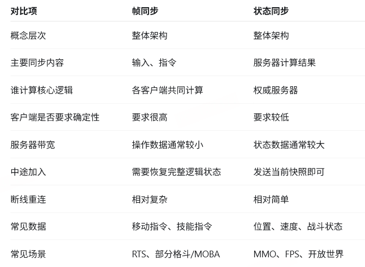

# 属性系统：

## combat_attr：属性管理器
挂载到每一个战斗单元conbatunit下，作为该战斗单位的属性。其中，内部再分为三个属性了别：
```
combat_avatar.combat_attr.avatar_attr
combat_avatar.combat_attr.gun_attrs
combat_avatar.combat_attr.equip_attrs
```
### 每个属性下，键值为：IModAttr
```
name  原子属性名称
ori_value  初始值
pct_change  百分比变化
value_change  固定值变化
cov_value   覆盖值
```

### 修改方式： 代号代表操作对象+操作方式
通过这个id，去查对应的字符串以及操作方式


### 写入：
根据操作方式，将数值变化写入modifier

### 网络同步：同步的是attr，combatattr在客户端和服务端两边都存在。
属性同步触发后，客户端 combat_attr 镜像发生相同变化，客户端 on_setattr 被触发，客户端重新计算并刷新表现


# 同步：
```
多人游戏网络同步
│
├─ 帧同步：同步“玩家输入”
│   └─ 各客户端自行计算出相同结果
│
├─ 状态同步：同步“服务器计算结果”
│   ├─ 状态快照
│   ├─ 属性同步
│   └─ RPC / 事件同步
│
└─ 混合方案：战斗用帧同步，外围系统用属性/状态同步
```
## 帧同步：一般是逻辑帧或 Tick，不是画面帧
#### 流程：
```
客户端发送操作
       ↓
服务器收集、排序操作
       ↓
服务器把同一帧的操作广播给所有客户端
       ↓
所有客户端执行相同逻辑
       ↓
得到相同游戏结果
```
帧同步本质上是：同步操作过程，让各客户端自己计算结果。

#### 要求：
```
相同的初始状态
相同的输入顺序
相同的逻辑帧
确定性计算
相同随机种子
避免浮点误差、容器遍历顺序等不确定因素 
```

## 状态同步：服务器负责运行权威游戏逻辑，客户端把操作意图发给服务器，服务器再把计算后的游戏状态同步给客户端。
```
客户端发送操作意图
       ↓
服务器验证并计算
       ↓
服务器得到最终状态
       ↓
服务器把结果同步给客户端
```
### 属性同步：状态同步的一种具体机制，关注某个对象字段的变化
```
属性发生变化
    ↓
设置脏标记
    ↓
服务器收集变化字段
    ↓
发送给相关客户端
    ↓
客户端更新字段并触发回调
```



根据具体游戏类型来选择，但大多数游戏是混用。